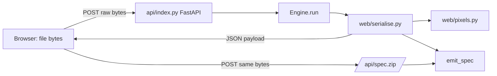

# Design Document

## Overview

A static hand-built frontend and one Python function, both on Vercel Hobby. The function runs the unchanged engine and returns one JSON payload. The browser draws everything from that payload. This is layout and rendering, so the design is short and the test is largely whether it looks right.



## Layout

```
api/index.py              FastAPI app: POST /api/analyze, POST /api/spec.zip
web/
  pixels.py               decode(...) -> PixelBuffer | RenderFailure
  serialise.py            to_payload(result, data, engine_ms) -> dict
  speczip.py              build_zip(spec) -> bytes   (zipfile, in memory)
public/                   served by the CDN
  index.html  app.css
  js/logic.js             pure functions, no DOM
  js/pane.js              hex pane
  js/screens.js           resolved / ambiguous / failed / spec panel
  js/app.js               drop zone, samples, fetch, replay controller
  samples/                copied from spike/samples/ and spike/samples/external/
vercel.json
tests/ui/                 pytest for web/ and api/
tests/ui/js/              tests for logic.js
```

`necropsy/` is not touched. `web/` and `api/` import it. `public/samples/` is produced by `tools/copy_samples.py`. A test asserts every file there is byte-identical to its source (Requirements 11.6, 11.7).

## Python side

### Pixel decoder (`web/pixels.py`)

```
decode(decoded, width, height, bit_depth, row_stride, probe_name, palette, bottom_left) -> PixelBuffer | RenderFailure
PixelBuffer(width, height, channels: "grey8" | "rgb8", data: bytes, note: str)
RenderFailure(reason: str)
```

Order of checks: geometry (Req 3.10), then supported depth (Req 3.9), then the per-pixel loop. Row `r` starts at `r * row_stride`. The loop reads only `ceil(width * bit_depth / 8)` bytes of each row, so padding is never read.

| Depth | Per pixel | Out |
|---|---|---|
| 1 | `(d[o + x//8] >> (7 - x%8)) & 1`, inverted for `pbm` | grey8 |
| 4 | nibble, high first, `* 17` | grey8 |
| 8 | `i = d[o + x]`; with palette `(P[3i], P[3i+1], P[3i+2])` | rgb8, else grey8 |
| 24, 32 | `B=d[p] G=d[p+1] R=d[p+2]`, fourth byte unused | rgb8 |

The decoder uses `bytearray` and slices per row, not a per-pixel Python loop, for 8, 24 and 32 bit (`bytes(row[0:w])`, and a stride-3 slice assignment for BGR to RGB). 1 and 4 bit use a small lookup table of 256 entries. A 500,000-pixel budget keeps every case well under a second.

When `bottom_left` is true the finished rows are reversed (output row `y` is stored row `height - 1 - y`) after decoding, so the same code path serves every depth.

`bottom_left` comes from the serialiser:

```
def bottom_left_for(cand):
    for f in cand.hypothesis.fields:
        if f.name == "image_descriptor":
            v = f.value
            if len(v) == 1 and isinstance(v[0], int):
                return ((v[0] >> 5) & 1) == 0     # bit 5 clear: bottom-left origin
            return False                          # malformed: render as stored
    return False                                  # no record: render as stored
```

`note` is built here: depth, `grey` / `palette` / `BGR→RGB`, and the conventions that applied (Req 3.12).

### Palette (`web/serialise.py`)

```
def palette_for(cand, data):
    if cand.trailer != "pcx_palette_256" or cand.hypothesis.bit_depth != 8: return None
    s = cand.data_end + 1
    return data[s:s+768] if s + 768 <= len(data) else None
```

`data_end` is the trailer's marker offset, so the marker is at `data_end` and the palette follows it. A short palette gives `None` and a greyscale render.

### Serialiser

`to_payload` is a pure function. It walks the `EngineResult`, converts each candidate with `decode`, and attaches the emitted spec. Pixel buffers are base64 in the JSON. Budgets:

- Pixels: candidates are converted in discovery order until 500,000 pixels are spent. The rest carry `render: {"failure": "not rendered: payload limit"}` (Req 2.9).
- Size: after building, `len(json.dumps(payload))` is checked against 4,000,000. If over, rejections are cut from the end until it fits, and `rejections_omitted` and `rejection_counts` are set (Req 2.7). Counts are computed from the full list before cutting.

Payload shape:

```
{ status, stage, reason, total_checks, total_file_size, engine_ms,
  candidates: [ {hypothesis fields, fields: [{name, offset, fmt, value}], row_stride,
                 data_start, data_end, trailer, coherence_score, coherence_status,
                 coherence_method, alternative_paths,
                 render: {width, height, channels, data_b64, note} | {failure} } ],
  termination, partial_candidates,           // FAILED only
  rejections: [ {reason, source, discrepancy, detail, hypothesis?} ],
  rejections_omitted, rejection_counts,
  spec: {slug, files: {name: text}} | {error} }
```

For RESOLVED, `candidates` has one entry. The frontend does not branch on shape beyond `status`.

### Endpoints (`api/index.py`)

- `POST /api/analyze`: reads the body with a length check before parsing, returns 413 above 65,536, times `Engine.run` with `time.perf_counter()`, returns `to_payload`. A catch-all handler returns 500 with the exception class name only (Req 1.7).
- `POST /api/spec.zip`: same cap, re-runs the engine and `emit_spec`, returns `build_zip`. The engine is deterministic apart from the deadline, so this yields the same files. Returns 404 JSON when the result is FAILED.

No disk writes. `write_spec` is never called.

## Frontend

No framework. ES modules, one CSS file, canvas for images. System font stack for sans, `ui-monospace` stack for mono, so no third-party font request (Req 13.7).

### Look

One neutral cold grey background. Text in two greys. One warm accent, used only on field bytes, the recovered-image frame and the closure line. Region tints are neutral blues and greys with text labels. Status chips: RESOLVED and UNRESOLVED_AMBIGUITY share the same chip style and colour family; FAILED uses a different, plain outline. No glow, no scanlines, no shadows beyond one hairline border. CSS variables hold the palette so a polish pass edits one block.

### `logic.js` (pure, tested)

```
fieldRange(rec)            -> [offset, offset + calcsize(fmt))   // small calcsize table for B H I i s
regions(cand, total)       -> {header, data, trailer|null}
byteRoles(cands, total)    -> per-byte {fields: [rec...]}        // overlap-safe, used for union mode
buildSteps(payload)        -> [{kind: "rejection"|"final", ...}] // payload order, nothing added
batch(steps, speed)        -> frames [[i..j], ...]               // <= 10 s at 1x, exact ranges
stageOf(source)            -> "probe"|"revision"|"generic"|"engine"
revisionDiffs(payload)     -> [{path, before, after}] | missing  // from rejections, never reconstructed
declaredVsActual(payload)  -> {declared, actual} | null
```

`calcsize` for the formats the engine emits: `B`=1, `<H`/`>H`=2, `<I`/`>I`/`<i`/`>i`=4, `Ns`=N, `oH`/`oI` resolved to `<`/`>` already in `fmt`.

### Hex pane (`pane.js`)

Fixed row height, virtual scroll: a container of `ceil(n/16) * rowHeight` with only the visible rows plus a margin in the DOM. Each byte is a `span` with a `data-i`. Classes come from `byteRoles` and `regions`: `grey` (default), `field`, `region-header`, `region-data`, `region-trailer`. Field bytes carry a `title`-less custom label popover built on hover or focus. Region labels sit in a thin gutter strip on the left of the grid, with the region name as text. Hover and the field table share one `highlight(recordId)` function that sets a class on both sides and scrolls the range into view.

Static first: the pane renders from a candidate with no timing. The replay later calls the same render with a different candidate view (`stepView`) and a different set of lit records.

### Replay (`app.js`)

A small controller over `buildSteps` and `batch`. State: `index`, `playing`, `speed`. Each frame renders the step's hypothesis in the step log, lights that step's `FieldRecord`s in the pane, and updates the counter. The last step calls the same `showResult` that the static view uses. Reduced motion: start at the last step. The label `Replay` and the `engine_ms` sentence are fixed text above the log.

### Screens (`screens.js`)

- **Resolved**: two columns. Left: hex pane above, field table below. Right: image frame (accent border), dimensions and note, closure line, trailer, revision path, alternative paths, then the declared / actual pair when present, which sits directly under the image so it is visible at 1280×720.
- **Ambiguous**: statement across the top. Below it a `grid` of identical `<Card>` elements. One function builds a card from a candidate and takes no coherence-dependent branch: the coherence text goes into one fixed `<p>`. The grid is `repeat(auto-fill, 240px)`, the image frame is 224×224 for all cards, and the image scales to the largest integer that fits. Cards are in payload order and carry no number. Hover or focus a card calls `pane.show(cand)`, leaving calls `pane.showUnion()`. No selected state exists on load.
- **Failed**: chip, termination sentence, counts, then collapsible groups by stage and reason, each capped at 200 rows with a "{n} more" line. A `partial_candidates` list sits under its own heading.
- **Spec panel**: tabs for the three files in a scrollable `<pre>` with no highlighting, the folder name, the framing sentence and a download button that POSTs the held file bytes to `/api/spec.zip` and saves the response.

### Drop zone and samples

A single drop target with a file input fallback. Samples list below it. Clicking a sample does `fetch('/samples/<name>')` and passes the bytes to the same `analyse(bytes)` that the drop handler calls. External samples show one provenance line, read from a small `samples/index.json` that holds only name and provenance text, never an outcome.

## Hosting

`vercel.json` routes `/api/*` to the Python function and serves `public/` statically. Dependencies: `fastapi` only (plus whatever it pulls in). The function bundles `necropsy/`, `web/` and `api/`. Nothing else is needed at runtime: no database, no secrets, no egress.

The first deploy is a walking skeleton (a page and an `/api/analyze` that runs the engine and returns minimal JSON), so the 24-hour idle test can start early. The cold-hit measurement script is a small PowerShell file, `tools/cold_hit.ps1`, which times the first-screen request and an analyse request and appends the result to `docs/KIRO-LOG.md` by hand.

## Testing

| What | How |
|---|---|
| Pixel decoder | Golden tests from `make_samples.py` ground truth (Req 3.14), synthetic 4 and 32-bit, short palette, Hypothesis never-raises |
| Serialiser | All nine corpus files and the external samples, status and pixels, order equals discovery order, Hypothesis never-raises |
| Lying header | `mystery_i` payload assertions (Req 15.5) |
| Endpoint | FastAPI `TestClient`: 413 over cap, 200 for empty body, Hypothesis arbitrary body returns 200 and valid JSON, sample vs renamed bytes identical |
| Zip | Contains `<slug>/` with exactly three files, bytes equal to `emit_spec` text |
| Samples | Static copies byte-identical to sources |
| `logic.js` | Node's built-in `node --test` on the pure functions, no dependencies |
| Ambiguity neutrality | `node --test` renders the card builder for two fixtures differing only in coherence and compares the markup with the coherence text masked |
| Looks right | A manual checklist run on the deployed URL at 1280×720 for each Requirement 13.5 beat, with a screen capture and the time taken |

Frontend rendering is not unit-tested beyond the pure functions. The screens are checked by eye against the requirements, on the deployed URL.
