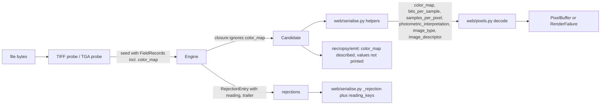

# Design Document

## Overview

This design implements `.kiro/specs/render-fidelity/requirements.md` (Requirements 1 to 12). It touches five places and nothing else:

1. `necropsy/engine/probes.py`: the TIFF probe reads tag 320 as one declared field, `color_map`.
2. `web/pixels.py`: `decode` gets three new draws (palette TIFF, 16-bit TGA colour, 16-bit TGA grey) and two refusals (sub-byte multi-channel TIFF, palette TIFF that cannot be drawn faithfully).
3. `web/serialise.py`: new helpers pull declared values from `FieldRecord`s and pass them to `decode`; a new helper adds `reading` and `trailer` to a Rejection_Item.
4. `necropsy/engine/types.py`, `closure.py`, `engine.py`: `RejectionEntry` gets two optional fields that the Engine writes where it creates a rejection. `closure.py` also keeps `color_map` out of the Requirement_12_Check.
5. `necropsy/emit/render.py`: the emitted text describes `color_map` by tag, type, count, offset and value count and prints none of its values (Requirements 8.2, 8.10 to 8.12; Decision 13, approved). Components 6 states the exact text.

Two documents are also edited: `.kiro/specs/structure-inference-engine/design.md` (Requirement 10) and `README.md` (Requirement 9.8). `tools/real_corpus.py` records the new render comparison (Requirement 8.3).

### What was read to write this design

Every statement about existing code below was checked against the file at the working tree of 27 Nov 2026.

- `necropsy/engine/probes.py`: constants at lines 326 to 366, `_read_range_array` (line 369), `_probe_tiff` loop (lines 463 to 548). The loop has no branch for tag 320 today: tag 320 is not in `TIFF_TAG_NAMES`, so it reaches `if tag_id not in TIFF_TAG_NAMES ...: continue`. Tag 262 is read by the generic branch (`TIFF_TAG_NAMES[262]`, count 1, `order + "H"` at entry + 8).
- `necropsy/engine/closure.py`: the only two reads of `h.fields` in `necropsy/engine/` are the Requirement 12 loops in `_check_ranges` (line 185) and `check_closure` (line 331). `hypothesis_key` in `types.py` does not read `fields`. A grep of `necropsy/engine/` for `.fields` returns exactly those two places and nothing in `strategies.py`, `generic.py` or `coherence.py`.
- `necropsy/engine/engine.py`: rejections are created at three places: `_run` (line 84), `_revise` (line 151), `_generic.on_reject` (lines 106 and 108). The engine only appends `RejectionEntry` values; nothing in `necropsy/engine/` reads a `RejectionEntry` attribute.
- `web/pixels.py`, `web/serialise.py` in full. `decode` is called in one place, `_candidate` in `web/serialise.py`.
- `necropsy/emit/layout.py` and `render.py`: the three palette files get layout kind `file` through `_ranges_layout` (measured), which lists every field name once. `_structure_table` (render.py line 920) and `_render_tests` (line 1227) print every value of every field.
- `necropsy_mcp/core.py` and `tests/test_mcp_server.py`: `agent_sized` removes three things; the test builds its expectation from `to_payload`.
- `tests/ui/test_render_vs_pillow.py`, `tests/test_data_model.py`, `tools/payload_hashes.py`, `spike/payload_hashes.json`, `tools/real_corpus.py`, `tools/build_power.py` (copies `necropsy/`, `necropsy_mcp/`, and `web/__init__.py`, `serialise.py`, `pixels.py`).
- `.kiro/specs/structure-inference-engine/design.md`, section "Corpus Trace (measured)".

Measurements taken while writing (Samples and Real_Corpus files only; scripts under the temp directory, not committed):

- Tag 320 appears in exactly three files: `libtiff_palette-1c-8b.tiff` (SHORT, count 768, value offset 24012, file 25548 bytes), `goimage_video-001-paletted.tiff` (count 768, offset 9678, file 11214 bytes) and `goimage_invalid-palette-ref.tiff` (count 195, offset 37, file 9662 bytes). No file in Samples carries tag 320. All three are RESOLVED at stage `probe` with zero rejections, layout kind `file`, a `ranges` hypothesis, and render `grey8`.
- `libtiff_palette-1c-8b.tiff` is big-endian (`>H`); the two goimage files are little-endian (`<H`).
- The three 16-bit TGAs: `pillow_200x32_la_bl_raw.tga` has image_type 3, descriptor 8, 200 x 32, stride 400; `pillow_la.tga` has image_type 11, descriptor 40 (0x28), 64 x 64, stride 128; `pillow_rgba16.tga` has image_type 2, descriptor 8, 2 x 1, stride 4. All have `bit_depth` 16 and render `no renderer for 16-bit pixels`. Each has one rejection from the probe stage.
- `Engine().run` total checks: `mystery_b` 8, `mystery_h` 10, `mystery_i` 20 (Requirement 10.5).

## Architecture



The direction of data does not change. The probe records a declaration, the Engine passes it through unused, the Serialiser reads it from `FieldRecord`s, and `decode` draws from arguments only. `web/pixels.py` imports nothing from `necropsy.engine` (Requirement 7.2) and reads no file bytes.

### Design decisions

| Decision | Choice | Reason |
|---|---|---|
| Where `color_map` lives | One `FieldRecord` in `Hypothesis.fields` | Requirement 1 and Decision 1. The Serialiser already reads declared values from `fields`. |
| How `color_map` stays out of closure | `closure.py` filters `fields` through `structural_fields(h)` in its two Requirement 12 loops | These are the only two reads of `fields` in the engine. `hypothesis_key` never reads `fields`. A palette is not always outside the data region: in `goimage_invalid-palette-ref.tiff` it is at [37, 427) and the unfiltered check would be free to reject the file, changing its status. |
| Palette checks sit in `_decode` before the depth dispatch | A palette TIFF at 8 bits would otherwise take the 8-bit grey path | Same reason as Requirement 6.2. |
| Origin of 16-bit TGA rows | Derived from `image_descriptor` bit 5 when that value is passed, else the existing `bottom_left` argument | Requirement 7.1 asks the Renderer to derive it; `bottom_left` stays so that every existing call is unchanged. |
| Reading marks | `closure.py` gets `reading_marks` and `generic_reading_mark`; `readings` is untouched | Requirement 11.12: `readings` returns the same tuples. |

## Components and Interfaces

### 1. TIFF probe (`necropsy/engine/probes.py`)

New constants, next to the existing TIFF constants:

```python
TIFF_COLOR_MAP_TAG = 320        # SHORT (3), count 3 * 2^BitsPerSample
TIFF_COLOR_MAP_MAX = 768        # 3 * 2^8, the largest map the renderer can use
TIFF_COLOR_MAP_NAME = "color_map"
```

New function. Byte offsets are stated here, in the constants above and in Data Models.

```python
def _read_color_map(data, order, entry, type_id, n) -> FieldRecord | None:
    """Tag 320 of the IFD entry at `entry`. One FieldRecord or None. Never raises, never rejects."""
    try:
        if type_id != 3 or not (1 <= n <= TIFF_COLOR_MAP_MAX):
            return None
        start = entry + TIFF_ENTRY_VALUE_OFFSET            # entry + 8
        if n * TIFF_TYPE_SIZES[3] > TIFF_VALUE_FIELD_SIZE:  # n * 2 > 4: Array_Rule
            pointer = read(data, "color_map_offset", start, order + "I")
            if pointer is None:
                return None
            start = pointer.value[0]
        return read(data, TIFF_COLOR_MAP_NAME, start, order + f"{n}H")   # None when any value lies outside data
    except Exception:
        return None
```

`read` (probes.py line 39) bounds-checks the whole `struct.calcsize(fmt)` span and returns `None` on a negative or out-of-range offset or on any error, so "partly outside the file" is `None` (Requirement 1.4). Nothing is allocated from `n` before it has passed `1 <= n <= 768`.

Insertion point in `_probe_tiff`: a new branch inside the entry loop, after the predictor branch and before the `tag_id in TIFF_ARRAY_NAMES` branch (tag 320 is in neither table, so no existing branch changes):

```python
if tag_id == TIFF_COLOR_MAP_TAG:
    if not color_map_seen:                 # Requirement 1.5: the first entry in directory order only
        color_map_seen = True
        rec = _read_color_map(data, order, entry, type_id, count.value[0])
        if rec is not None:
            records.append(rec)
    continue
```

`color_map_seen = False` is initialised beside `bps_seen`. The record is appended at the point the entry is read, so it sits in directory order and a file without tag 320 gets an identical list (Requirement 1.7). The `records` list becomes `fields=tuple(records)` in the seed, unchanged code.

The probe adds no rejection, no `out_of_bounds` text and no `problems` entry for tag 320. `values`, `arrays`, `seen_tags` and `array_attempted` are not touched, so no required-tag test, strip arithmetic or seed value reads it.

### 2. Keeping `color_map` out of closure (`necropsy/engine/closure.py`)

This is the Requirement 1.6 mechanism.

```python
REPORT_ONLY_FIELDS = frozenset({"color_map"})   # declared and reported; never part of the structure arithmetic

def structural_fields(h):
    """The header fields the Requirement 12 check compares with the data region."""
    return tuple(f for f in h.fields if f.name not in REPORT_ONLY_FIELDS)
```

Both loops change from `for fr in h.fields:` to `for fr in structural_fields(h):`: in `_check_ranges` (the per-range check, line 185) and in `check_closure` (line 331). That is the whole change. Consequences, each checked against the code:

- **Seed.** The seed's `width`, `height`, `bit_depth`, `header_size`, `data_end`, `ranges` come from `values` and `arrays`, which tag 320 never enters.
- **Closure arithmetic.** Reads `h.header_size`, `h.data_end`, `h.ranges`, `h.encoding`; not `fields`, apart from the two loops above.
- **Hypothesis key.** `hypothesis_key` reads `width, height, bit_depth, header_size, row_alignment, encoding, data_end, planes, row_bytes, ranges, rows_per_strip, tile, maxval`.
- **Requirement 12 check.** Filtered as above.
- **Strategies and Generic Search.** Neither reads `fields` of a TIFF seed (grep above). `dataclasses.replace` copies `fields` unchanged into revised hypotheses.

`tag 262` has no such mechanism today because it never overlaps data. The palette does overlap in one corpus file, which is why a name filter is needed.

### 3. RejectionEntry and the Engine

`necropsy/engine/types.py`:

```python
@dataclass(frozen=True)
class RejectionEntry:
    reason: str
    source: str
    hypothesis: Hypothesis | None = None
    discrepancy: int | None = None
    detail: str = ""
    reading: str | None = None     # "trailer" or "end_of_file"; None when not a trailer-matched reading
    trailer: str | None = None     # Trailer_Name of the matched TrailerEntry, same registry name as Candidate.trailer
```

Both fields come after `detail` with default `None`, so every positional construction in the code base is unchanged.

`necropsy/engine/closure.py` (next to `readings`, which is not edited):

```python
def reading_marks(h, data, rs) -> tuple:
    """(reading, trailer) for each hypothesis of rs = readings(h, data), in the same order. Never raises."""
    try:
        if len(rs) != 2:                                  # readings returns two only when a trailer matched
            return ((None, None),) * len(rs)
        name = match_trailer(data, h.header_size, h.probe_name)[1]   # the same call readings made
        if name is None:
            return ((None, None),) * len(rs)
        return (("trailer", name), ("end_of_file", name))
    except Exception:
        return ((None, None),) * len(rs)


def generic_reading_mark(h, data) -> tuple:
    """(reading, trailer) for a Generic Search hypothesis. Generic Search sets a declared end only for the
    end-of-file reading and only when the trailer matched (generic.py, `sizes.append(("none", len(data) - L, len(data)))`)."""
    try:
        name = match_trailer(data, h.header_size, "generic")[1]
        if name is None:
            return (None, None)
        return (("end_of_file" if h.data_end == len(data) else "trailer"), name)
    except Exception:
        return (None, None)
```

`engine.py` changes, exactly three:

1. `_run`, probe loop:
   ```python
   rs = readings(outcome.seed, data)
   marks = reading_marks(outcome.seed, data, rs)
   for reading, (kind, trailer) in zip(rs, marks):
       ...                                   # budget.charge, check_closure unchanged
       rejections.append(RejectionEntry(verdict.reason, name, reading, verdict.discrepancy,
                                        verdict.detail, kind, trailer))
   ```
2. `_revise`:
   ```python
   rs = readings(child, data)
   for c, (kind, trailer) in zip(rs, reading_marks(child, data, rs)):
       ...                                   # `if c is child` and the key logic unchanged
       rejections.append(RejectionEntry(v.reason, "revision:" + "->".join(c.revision_path),
                                        c, v.discrepancy, v.detail, kind, trailer))
   ```
3. `_generic.on_reject(h, v, reason="", detail="")`: signature unchanged (two positional arguments from `generic.py` line 101, keywords for the trailer error). The `v is None` branch keeps `RejectionEntry(reason, "generic", None, detail=detail)` (no hypothesis: no marks). The other branch becomes
   ```python
   kind, trailer = generic_reading_mark(h, data)
   rejections.append(RejectionEntry(v.reason, "generic", h, v.discrepancy, v.detail, kind, trailer))
   ```
   `data` is in scope in `_generic`. `tests/test_generic.py` passes `lambda h, v: ...` to `generic_search`; that call is untouched.

The probes' own rejections (`probe_precondition_failed`, `field_out_of_bounds`, created in `probes.py`) are not readings: no closure check ran. They keep `reading` and `trailer` at `None`.

Confirmation that no inference path reads the new values: `engine.py` only constructs `RejectionEntry`; a grep for `.source`, `.reason` and attribute reads over `necropsy/engine/` finds none on `RejectionEntry`. The values are written after `check_closure` returned. `budget`, `seen`, `winners` and `alternatives` are untouched, so check counts, order and keys cannot change (Requirement 11.12).

### 4. Renderer (`web/pixels.py`)

#### 4.1 The `decode` signature

Six new keyword arguments, appended after `byte_order`, all default `None`:

```python
def decode(decoded, width, height, bit_depth, row_stride, probe_name,
           palette=None, bottom_left=False, channel_order="bgr", photometric=None,
           palette_name=PALETTE_NAME, no_palette_why=None, maxval=None, planes=1, header_palette=None,
           byte_order=None,
           color_map=None, bits_per_sample=None, samples_per_pixel=None,
           photometric_interpretation=None, image_type=None, image_descriptor=None):
```

`_decode` receives the same six values at the end of its own parameter list (it is called in one place, `decode`). Every existing call passes none of them, so for each such call every new branch is skipped (Requirement 6.4). `photometric` keeps its meaning (`None`, `0`, `1`, `"undeclared"`, used by the grey paths). `photometric_interpretation` is the raw declared integer; it exists because `photometric_for` maps 3 to `None`.

#### 4.2 Order of checks in `_decode`

```text
_decode(...):
  # step 0, Requirement 6.2: before everything else, so a product such as 4 x 4 = 16 never reaches a depth path
  if probe_name == "tiff" and _is_int(bits_per_sample) and _is_int(samples_per_pixel)
         and 1 <= bits_per_sample <= 7 and samples_per_pixel > 1:
      return RenderFailure(SUBBYTE_REASON.format(spp=samples_per_pixel, bps=bits_per_sample))

  # existing checks, unchanged
  if decoded is not bytes/bytearray:                        return RenderFailure("inconsistent geometry")
  if any of width, height, bit_depth, row_stride is not an int > 0:  return RenderFailure("inconsistent geometry")

  # step 1, Requirement 3 (palette): probe tiff and photometric_interpretation == 3
  if probe_name == "tiff" and _is_int(photometric_interpretation) and photometric_interpretation == 3:
      return _decode_tiff_palette(decoded, width, height, bit_depth, row_stride, bottom_left,
                                  color_map, bits_per_sample, samples_per_pixel)   # never falls through to a grey path

  # existing dispatch, unchanged and in the same order
  if probe_name == "pcx" and planes > 1:              ... _decode_pcx_planar
  if probe_name == "pnm" and bit_depth in PNM_DEPTHS and _is_int(maxval): ... _decode_pnm
  if probe_name == "tiff" and bit_depth in (12, 16):  ... _decode_tiff_grey
  if probe_name == "tiff" and bit_depth in TIFF_RGB_NO_RENDERER: ... RenderFailure
  # step 2, Requirements 4 and 5: new
  if probe_name == "tga" and bit_depth == 16 and _is_int(image_type) and image_type in (2, 10, 3, 11):
      return _decode_tga16(decoded, width, height, row_stride, bottom_left, image_type, image_descriptor)
  if bit_depth not in SUPPORTED_DEPTHS: return RenderFailure(f"no renderer for {bit_depth}-bit pixels")
  ... existing 1, 4, 8, 24, 32 bit paths
```

Step 0 precedes the existing type and geometry checks, so Requirement 6.5 and 6.2 hold for any arguments with valid integer `bits_per_sample` and `samples_per_pixel`. `bits_per_sample` of 0 or below, and any boolean, do not trigger it (`_is_int` excludes `bool`); they fall to the existing paths.

The palette function runs its checks in the order of Requirement 3.8: criterion 4, then 10, then 13, then 1, then 2, then 11, then 3. The first failure is returned and no later check runs.

```text
_decode_tiff_palette(decoded, width, height, bit_depth, row_stride, bottom_left, color_map, bits_per_sample, samples_per_pixel):
  1. (3.4)  if not _is_int(bits_per_sample): return RenderFailure("no renderer for palette TIFF: BitsPerSample not recorded")
            if bits_per_sample != 8:         return RenderFailure(f"no renderer for palette TIFF: BitsPerSample {bits_per_sample}")
  2. (3.10) if _is_int(samples_per_pixel) and samples_per_pixel > 1:
                                             return RenderFailure(f"no renderer for palette TIFF with SamplesPerPixel {samples_per_pixel}")
  3. (3.13) if not _is_int(samples_per_pixel):
                                             return RenderFailure(f"no renderer for palette TIFF: bit depth {bit_depth}, SamplesPerPixel not recorded")
            if bit_depth != 8 * samples_per_pixel:            # bit_depth is the `decode` argument; samples_per_pixel above 1 was refused in step 2, so this is 0, negative or 1
                                             return RenderFailure(f"no renderer for palette TIFF: bit depth {bit_depth} is not 8 × SamplesPerPixel {samples_per_pixel}")
  4. (3.1)  if color_map is not a tuple or list:
                                             return RenderFailure("palette TIFF: no ColorMap (tag 320) was read")
  5. (3.2)  if len(color_map) != 768:        return RenderFailure(f"palette TIFF: ColorMap (tag 320) holds {len(color_map)} values, 768 required (3 × 2^8)")
  6. (3.11) p = first position whose value is not an int in 0..65535 (a bool is not an int here)
            if p is not None:                return RenderFailure(f"palette TIFF: ColorMap (tag 320) entry {p} is {color_map[p]!r}, outside 0 to 65535")
  7. (3.3)  geometry, same test as the 8-bit path: if row_stride < width or len(decoded) < row_stride * height:
                                                 return RenderFailure("inconsistent geometry")
            rows = rows cropped to `width`, reversed when bottom_left      # as the 8-bit path
            idx = b"".join(rows)
            failure = _palette_index_failure(idx, 256)                     # Map_Size = 2^8
            if failure is not None:          return failure
  8. (2.1 to 2.3)
            r = bytes(v >> 8 for v in color_map[0:256]); g = ... [256:512]; b = ... [512:768]     # Scale16
            data = _interleave(idx.translate(r), idx.translate(g), idx.translate(b))
            return PixelBuffer(width, height, "rgb8", data, PALETTE_NOTE + " · " + orientation)
```

The `bit_depth` argument of `decode` is the candidate's bit depth (the hypothesis bit depth), and criterion 13 compares it with `8 × samples_per_pixel`. The check also fires when no SamplesPerPixel is recorded, at `bits_per_sample` 8 (a probe-built TIFF with no tag 277 is one; no file in Samples or Real_Corpus is, because the three palette files record 1). At BitsPerSample 8 and SamplesPerPixel 1 a probe-built candidate has `bit_depth` 8 and is drawn. A hand-built call with SamplesPerPixel 1 and a `bit_depth` other than 8 (for example 16) is refused by this check, so it cannot reach the drawing code (Open Point 5, resolved). The geometry check of step 7 stays as the guard for the raster.

`_palette_index_failure` is the helper of Decision 18 (Requirement 3.3):

```python
def _palette_index_failure(idx: bytes, map_size: int) -> RenderFailure | None:
    """None when every byte of `idx` is below `map_size`. Otherwise the RenderFailure that states the first
    byte value at or above `map_size` in raster order and `map_size`. Never raises for bytes and an int."""
```

`_decode_tiff_palette` calls it with 256. At BitsPerSample 8 every byte is below 256, so through `decode` it never fires. Tests call it directly with a smaller `map_size` (for example 4) and with the reason text of the table below, so the first-index rule and the reason content are asserted on the code `decode` runs. `_is_int` excludes `bool`; a `bool` in `color_map` fails check 5.

#### 4.3 16-bit TGA

`_decode_tga16` byte layouts, stated explicitly. A TGA_Word is two bytes read as `struct "<H"` (byte 0 low, byte 1 high). The raster passed in is the engine's decoded raster: `row_stride` bytes per row, `height` rows, rows in stored order. Types 10 and 11 arrive already RLE-decoded.

| Image type | Bit layout of a TGA_Word `w` | Output |
|---|---|---|
| 2 and 10, 16 bit (colour) | bit 15 attribute; bits 14 to 10 R; bits 9 to 5 G; bits 4 to 0 B | `rgb8`; R = `((w >> 10) & 31) * 255 // 31`, G = `((w >> 5) & 31) * 255 // 31`, B = `(w & 31) * 255 // 31` |
| 3 and 11, 16 bit (grey), Alpha_Bits 8 | bits 15 to 8 alpha; bits 7 to 0 grey | `grey8`; value `w & 0xFF` |

`image_descriptor` byte 0x11 (`B`): bits 0 to 3 are the alpha-bit count (`image_descriptor & 0x0F`), bit 5 is the row origin (0 is bottom-left). The probe already reads it as field `image_descriptor` at offset 0x11, format `B` (Decision Record item 14). Image type is field `image_type` at 0x02, format `B`.

```text
_decode_tga16(decoded, width, height, row_stride, bottom_left, image_type, image_descriptor):
  used = 2 * width
  if row_stride < used:                          return RenderFailure("inconsistent geometry")
  have, need = len(decoded), row_stride * height
  descriptor_ok = _is_int(image_descriptor)
  alpha_bits = image_descriptor & 0x0F if descriptor_ok else None
  flip = ((image_descriptor >> 5) & 1) == 0 if descriptor_ok else bool(bottom_left)
  orientation = FLIP_NOTE if flip else STORED_NOTE
  if image_type in (3, 11):
      if not descriptor_ok:                      return RenderFailure("no renderer for 16-bit grey TGA: image descriptor not recorded")
      if alpha_bits != 8:                        return RenderFailure(f"no renderer for 16-bit grey TGA: the descriptor declares {alpha_bits} alpha bits, 8 are required")   # 5.3
      if have < need:                            return RenderFailure(f"16-bit grey TGA: pixel data holds {have} bytes, {need} required")
      rows = [decoded[y * row_stride : y * row_stride + used] for y in range(height)]; reverse if flip
      data = b"".join(row[0::2] for row in rows)          # low byte of each little-endian word
      return PixelBuffer(width, height, "grey8", data, GREY16_NOTE + " · " + orientation)
  # image_type in (2, 10)
  if have < need:                                return RenderFailure(f"16-bit colour TGA: pixel data holds {have} bytes, {need} required")   # 4.9
  rows as above; r, g, b byte lists from the words of each row via the 32-entry table E[v] = v * 255 // 31
  return PixelBuffer(width, height, "rgb8", _interleave(r, g, b), COLOUR16_NOTE.format(alpha=...) + " · " + orientation)
```

The grey rule follows Decision 6: the file declares 16 bits and `Alpha_Bits` of them as alpha, and the grey sample is the remaining `16 - 8 = 8` bits, the low byte. The check `have < need` guards every slice. When an RLE-decoded raster is longer than `need` the extra bytes are not read.

#### 4.4 Exact note and RenderFailure strings

All strings are module constants or f-strings in `web/pixels.py`. Tests pin them as written. `{...}` is a decimal integer.

| Case | Kind | Exact text |
|---|---|---|
| 6.1 sub-byte multi-channel | RenderFailure | `no renderer for TIFF with {spp} samples per pixel of {bps} bits each` |
| 3.4 palette, BitsPerSample not 8 | RenderFailure | `no renderer for palette TIFF: BitsPerSample {bps}` |
| 3.4 palette, BitsPerSample absent | RenderFailure | `no renderer for palette TIFF: BitsPerSample not recorded` |
| 3.10 palette, SamplesPerPixel above 1 | RenderFailure | `no renderer for palette TIFF with SamplesPerPixel {spp}` |
| 3.13 palette, SamplesPerPixel not recorded | RenderFailure | `no renderer for palette TIFF: bit depth {bd}, SamplesPerPixel not recorded` (`{bd}` is the `bit_depth` argument) |
| 3.13 palette, bit depth not 8 × SamplesPerPixel | RenderFailure | `no renderer for palette TIFF: bit depth {bd} is not 8 × SamplesPerPixel {spp}` (`{bd}` is the `bit_depth` argument) |
| 3.1 palette, no ColorMap | RenderFailure | `palette TIFF: no ColorMap (tag 320) was read` |
| 3.2 palette, wrong count | RenderFailure | `palette TIFF: ColorMap (tag 320) holds {found} values, 768 required (3 × 2^8)` |
| 3.11 palette, value outside 0 to 65535 | RenderFailure | `palette TIFF: ColorMap (tag 320) entry {p} is {value}, outside 0 to 65535` (`{p}` zero-based) |
| 3.3 palette, index at or above Map_Size | RenderFailure | `palette TIFF: pixel index {i} is at or above the ColorMap size {size}` (`{size}` is 256 from `decode`) |
| 2.4 palette drawn | note | `8-bit · palette: TIFF ColorMap (tag 320), 768 values, 16-bit to 8-bit by v >> 8 · rows shown in stored order` |
| 4.9 colour TGA short data | RenderFailure | `16-bit colour TGA: pixel data holds {have} bytes, {need} required` |
| 5.3 grey TGA, Alpha_Bits not 8 | RenderFailure | `no renderer for 16-bit grey TGA: the descriptor declares {A} alpha bits, 8 are required` |
| grey TGA, no descriptor | RenderFailure | `no renderer for 16-bit grey TGA: image descriptor not recorded` |
| grey TGA short data | RenderFailure | `16-bit grey TGA: pixel data holds {have} bytes, {need} required` |
| 5.2 grey TGA drawn | note | `16-bit grey TGA · grey = low byte of each word · the 8 declared alpha bits are not drawn · {orientation}` |
| 4.1 to 4.5 colour TGA drawn | note | `16-bit colour TGA · five-five-five, R bits 10-14, G bits 5-9, B bits 0-4 · v×255//31 · alpha not drawn: {alpha} · {orientation}` |

`{orientation}` is `rows flipped: file declares bottom-left origin` or `rows shown in stored order`, the existing `FLIP_NOTE` and `STORED_NOTE`. `{alpha}` for the colour note:

| Alpha_Bits | `{alpha}` |
|---|---|
| 0 | `descriptor declares no alpha bits` |
| 1 | `descriptor declares bit 15 as alpha` |
| 2 to 15 | `descriptor declares {A} alpha bits, which the 16-bit pixel cannot hold; bit 15 is not interpreted` |
| not recorded | `image descriptor not recorded` |

The case `pillow_rgba16.tga` (descriptor 8) therefore ends `... alpha not drawn: descriptor declares 8 alpha bits, which the 16-bit pixel cannot hold; bit 15 is not interpreted · rows flipped: file declares bottom-left origin`.

### 5. Serialiser (`web/serialise.py`)

New helpers, each total (no raise) and each reading only the candidate's `FieldRecord`s:

```python
def color_map_for(cand):
    """The `color_map` value tuple (ints only) of the candidate's FieldRecord, or None."""
    for f in cand.hypothesis.fields:
        if f.name == "color_map":
            v = f.value
            if isinstance(v, tuple) and all(isinstance(x, int) and not isinstance(x, bool) for x in v):
                return v
            return None
    return None
```

For integers the existing `_int_field(cand, name)` is reused: it returns the single integer of the first record named `name`, or `None`. Every record the TIFF and TGA probes create holds a one-element tuple (`struct` format of one value), so its result equals "the first element of the value tuple" of Requirement 6.3. `bits_per_sample` records are named `bits_per_sample` once per array value (probes.py line 392), and the probe requires all equal, so the first record is the common value.

`_candidate` calls `decode` with six more keyword arguments:

```python
out = decode(c.decoded, h.width, h.height, h.bit_depth, c.row_stride, h.probe_name,
             pal, bottom_left_for(c), channel_order=channel_order_for(c), photometric=photometric_for(c),
             palette_name=name, no_palette_why=tga_why, maxval=h.maxval,
             planes=h.planes, header_palette=header_palette_for(c, data), byte_order=byte_order_for(c),
             color_map=color_map_for(c),
             bits_per_sample=_int_field(c, "bits_per_sample"),
             samples_per_pixel=_int_field(c, "samples_per_pixel"),
             photometric_interpretation=_int_field(c, "photometric_interpretation"),
             image_type=_int_field(c, "image_type"),
             image_descriptor=_int_field(c, "image_descriptor"))
```

Passing all six for every candidate is safe because `decode` gates each by `probe_name`. The pixel budget (`PIXEL_BUDGET`) and size budget (`SIZE_BUDGET`) and the code that applies them are not edited (Requirement 7.5). A `RenderFailure` becomes `{"failure": reason}` as today, with no `data_b64` (Requirement 3.9).

The rejection keys:

```python
READING_VALUES = ("trailer", "end_of_file")

def reading_keys(r) -> dict:
    """{"reading": ..., "trailer": ...} when the entry carries both recorded values, else {}. Never raises."""
    try:
        reading, trailer = getattr(r, "reading", None), getattr(r, "trailer", None)
        if isinstance(reading, str) and reading in READING_VALUES and isinstance(trailer, str) and trailer:
            return {"reading": reading, "trailer": trailer}
    except Exception:
        pass
    return {}
```

`_rejection` builds its dict as today and ends with `d.update(reading_keys(r)); return d`. The existing six keys (`reason`, `source`, `stage`, `discrepancy`, `detail`, `hypothesis`) keep their order, and `reading` then `trailer` follow `hypothesis` (Requirement 11.5). The keys are absent, never `null` (11.7). `_build` calls `_rejection` for the `rejections` list, which is the first of the two places that emit a Rejection_Item. The second, the `internal_error` item in `to_payload`'s fallback, is a hand-written dict with no hypothesis; it is not routed through `_rejection` and needs no edit (11.9). `rejection_counts` and the size-budget loop are not edited; the loop's `_size(item)` now includes about 40 bytes more per marked item. Requirements 11.10 and 7.5 expect no change of `rejections_omitted` for any Samples or Real_Corpus file, and the task asserts it.

The Serialiser imports nothing from `necropsy.engine.trailers` and does not compare a `data_end` with a length (11.4). An import-scan and a grep-style test assert it.

### 6. Emit (`necropsy/emit/render.py`)

Approved (Decision 13). The structure table and the emitted test's field list print every value of every field. For `color_map` that would be up to 768 integers in each place. Two edits in `render.py`, no other file of `necropsy/emit/` changes:

```python
DESCRIBED_FIELDS = frozenset({"color_map"})    # declared; described by one line, never printed value by value

def _described(f) -> str:
    """The one-line description of a field of DESCRIBED_FIELDS. Names tag, type, count, offset; no values."""
    return ("tag 320, SHORT (3), count %d, offset 0x%04X; 3 × 2^BitsPerSample values, not listed"
            % (len(f.value), f.offset))
```

- `_structure_table` (line 909): for a field whose name is in `DESCRIBED_FIELDS` the value cell is `_described(f)` instead of `", ".join(str(v) for v in f.value)`.
- `_render_tests` (line 1197): in the loop that builds `fields`, a field of `DESCRIBED_FIELDS` is stored as the comment string `"# %s: %s" % (f.name, _described(f))` instead of the tuple `(name, offset, fmt, tuple(f.value))`. When `FIELDS = [` is written, a tuple is written as `    <repr>,` as today and a comment string as `    <comment>` at the same position. `FIELDS` then holds no `color_map` tuple, so `test_source_fields_and_closure` has nothing to compare for it, and the 768 values are not in the test file. The compiled text stays valid Python (`compile` is already called on it).

Exact emitted text, for `libtiff_palette-1c-8b.tiff` (tag 320 is SHORT, type 3; count is `len(f.value)`; the offset is the field offset):

| Place | Text |
|---|---|
| structure table row | `\| 0x5DCC \| color_map \| >768H \| tag 320, SHORT (3), count 768, offset 0x5DCC; 3 × 2^BitsPerSample values, not listed \|` |
| `FIELDS` list line | `    # color_map: tag 320, SHORT (3), count 768, offset 0x5DCC; 3 × 2^BitsPerSample values, not listed` |

`layout.py` is not edited. A file-kind layout lists every field of the hypothesis by name, offset and format and holds no values (`_ranges_layout`, `layout.py` line 290 and the `first` dict at lines 157 and 187). So once the probe reads tag 320, the emitted `requirements.md` gains one criterion line and one entry in its `necropsy-layout` block for `color_map`, with name, offset and format and no values. This is a consequence of the probe change. Requirement 8.11 (amended, Decision 20) states exactly this diff: the color_map description, its criterion line and its layout entry, none containing the values. No `layout.py` exclusion is needed. `_describe_fmt(">768H")` is `big-endian, 1536 bytes`.

### 7. Real-corpus tool (`tools/real_corpus.py`)

`RENDER_FILES` is the tuple of the six files of Requirement 8.1. For those files only, `run_one` adds a key `render_comparison` to the row; every other row has no such key, so other rows are byte-identical in the JSON.

```python
def render_comparison(path, data) -> dict:
    """Our rendered bytes against Pillow_Render, byte for byte. Never raises."""
    render = to_payload(Engine().run(data), data, 0.0)["candidates"][0]["render"]
    # failure: {"render": "none", "reason": render["failure"], ...}
    # ours = base64 data; grey8 expanded to R,G,B by repeating each byte (as tests/ui/test_render_vs_pillow.py does)
    # theirs = Image.open(path).convert("RGB").tobytes()    # Pillow refusing -> not comparable, reason stated
```

Entry shape (all keys always present, `null` where not applicable):

```json
{"render_comparison": {"channels": "rgb8", "ours_failure": null,
  "compared_bytes": 71049, "differing_bytes": 0, "not_comparable": null, "cause": null}}
```

| Situation | `channels` | `ours_failure` | `compared_bytes` | `differing_bytes` | `not_comparable` |
|---|---|---|---|---|---|
| picture, Pillow decodes, sizes equal | `rgb8` or `grey8` | `null` | length of the RGB buffers | count of unequal bytes | `null` |
| `goimage_invalid-palette-ref.tiff` | `null` | the RenderFailure reason | `null` | `null` | `Pillow refuses the file (UnidentifiedImageError)` |
| picture, dimensions differ from Pillow | picture kind | `null` | `null` | `null` | `dimensions differ: ours WxH, Pillow WxH` |

`cause` is `null` when `differing_bytes` is 0 or `null`. If `differing_bytes` is above 0 the tool writes the file name, the count and a cause string into the Markdown; the cause is text the author writes after reading the difference, never a change of method (Requirement 8.5). The canonical comparison (`pixel_verdicts`) of `pillow_rgba16.tga` is computed by the unchanged code and stays `mismatch: 2 of 8 canonical bytes differ` (its note keeps the same cause). `docs/REAL-CORPUS-RESULTS.md` gets one new section, "Render comparison (render-fidelity)", with one row per file; the main table is not edited. `Image.MAX_IMAGE_PIXELS` handling and the no-network rule are as in the existing module.

## Data Models

### `color_map` FieldRecord

| Part | Value |
|---|---|
| name | `color_map` |
| offset | offset of the first value. If `N × 2 <= 4`, the IFD entry offset + 8. If `N × 2 > 4`, the `I` read at entry + 8 (`order + "I"`, 4 bytes). |
| fmt | `order + f"{N}H"`, with `order` `<` for header `II` and `>` for `MM`; `N` in 1..768, so the largest is `<768H` or `>768H` (1536 bytes) |
| value | the tuple returned by `struct.unpack_from(fmt, data, offset)`: N integers, each 0 to 65535, never unwrapped |

The ColorMap is stored as all N/3 reds, then all N/3 greens, then all N/3 blues. For BitsPerSample 8, `N = 768`: reds at `value[0:256]`, greens at `[256:512]`, blues at `[512:768]`. The renderer uses a map of exactly 768 values only.

IFD_Entry (12 bytes), the offsets the probe uses (`TIFF_ENTRY_*`): tag `H` at entry + 0, type `H` at entry + 2, count `I` at entry + 4, value field 4 bytes at entry + 8. For tag 320 the type must be 3 (SHORT). A first entry that fails type, count or bounds records nothing; a later valid entry for tag 320 is ignored.

### TGA header bytes read by the renderer through the Serialiser

| Field | Offset | Format | Use |
|---|---|---|---|
| `image_type` | 0x02 | `B` | 2, 10 colour; 3, 11 grey (1 and 9 stay as before) |
| `image_descriptor` | 0x11 | `B` | bits 0-3 Alpha_Bits; bit 5 row origin (0 bottom-left) |
| TGA_Word | pixel data | `<H` | one 16-bit pixel |

### `RejectionEntry` and Rejection_Item

`RejectionEntry.reading` is `"trailer"`, `"end_of_file"` or `None`. `RejectionEntry.trailer` is `"pcx_palette_256"`, `"tga2_footer"` or `None`. Rejection_Item key order: `reason, source, stage, discrepancy, detail, hypothesis[, reading, trailer]`.

### Fixture layout for Requirement 6

A little-endian TIFF, 118 bytes (0x76), built in code with `struct.pack("<...")`. It declares 2 x 2 pixels of 4 samples of 4 bits each (bit depth 16, row 4 bytes). Offsets are bytes from the start of the file.

| Offset | Bytes (hex) | Format | Meaning |
|---|---|---|---|
| 0x00 | `49 49` | `2s` | byte order `II`: little-endian |
| 0x02 | `2A 00` | `<H` | magic 42 |
| 0x04 | `08 00 00 00` | `<I` | IFD at offset 8 |
| 0x08 | `08 00` | `<H` | 8 IFD entries |
| 0x0A | `00 01 03 00 01 00 00 00 02 00 00 00` | `<HHIHH` | entry 0: tag 256 ImageWidth, type 3 SHORT, count 1, value 2, 2 pad bytes |
| 0x16 | `01 01 03 00 01 00 00 00 02 00 00 00` | `<HHIHH` | entry 1: tag 257 ImageLength, SHORT, count 1, value 2 |
| 0x22 | `02 01 03 00 01 00 00 00 04 00 00 00` | `<HHIHH` | entry 2: tag 258 BitsPerSample, SHORT, count 1, value 4 |
| 0x2E | `03 01 03 00 01 00 00 00 01 00 00 00` | `<HHIHH` | entry 3: tag 259 Compression, SHORT, count 1, value 1 (none) |
| 0x3A | `06 01 03 00 01 00 00 00 02 00 00 00` | `<HHIHH` | entry 4: tag 262 PhotometricInterpretation, SHORT, count 1, value 2 (RGB) |
| 0x46 | `11 01 04 00 01 00 00 00 6E 00 00 00` | `<HHII` | entry 5: tag 273 StripOffsets, type 4 LONG, count 1, value 110 |
| 0x52 | `15 01 03 00 01 00 00 00 04 00 00 00` | `<HHIHH` | entry 6: tag 277 SamplesPerPixel, SHORT, count 1, value 4 |
| 0x5E | `17 01 04 00 01 00 00 00 08 00 00 00` | `<HHII` | entry 7: tag 279 StripByteCount, LONG, count 1, value 8 |
| 0x6A | `00 00 00 00` | `<I` | offset of the next IFD: 0, none |
| 0x6E | `12 34 56 78 9A BC DE F0` | 8 bytes | pixel data: 2 rows of 4 bytes; each byte holds two 4-bit samples |

Entries are in ascending tag order (256, 257, 258, 259, 262, 273, 277, 279). The probe computes `bit_depth = 4 × 4 = 16`, `header_size = 110`, `data_end = 110 + 8 = 118 = len(data)`, and the closure check expects `row_stride × height = 4 × 2 = 8` bytes. Before this change the render of this file is a 16-bit big-or-little-endian grey picture (`_decode_tiff_grey`), a wrong picture; after, `decode` returns the RenderFailure `no renderer for TIFF with 4 samples per pixel of 4 bits each`. Every byte is commented in the fixture builder. The fixture is built from this table, not from any evaluation file, and is not compared against one. Test expectations come from the table, not from the output of `decode`.

### Fixture layout for Requirement 3.13

A little-endian palette TIFF, 1650 bytes (0x672), built in code with `struct.pack("<...")`. It declares 2 x 2 pixels, BitsPerSample 8, PhotometricInterpretation 3, a valid 768-value ColorMap, and **no tag 277**, so SamplesPerPixel is not recorded (the probe defaults it to 1 for the arithmetic, `values.get(277, 1)`, and records no field). Entries are in ascending tag order: 256, 257, 258, 259, 262, 273, 279, 320.

| Offset | Bytes (hex) | Format | Meaning |
|---|---|---|---|
| 0x00 | `49 49 2A 00 08 00 00 00` | `<2sHI` | `II`, magic 42, IFD at offset 8 |
| 0x08 | `08 00` | `<H` | 8 IFD entries |
| 0x0A | `00 01 03 00 01 00 00 00 02 00 00 00` | `<HHIHH` | tag 256 ImageWidth, SHORT, count 1, value 2 |
| 0x16 | `01 01 03 00 01 00 00 00 02 00 00 00` | `<HHIHH` | tag 257 ImageLength, SHORT, count 1, value 2 |
| 0x22 | `02 01 03 00 01 00 00 00 08 00 00 00` | `<HHIHH` | tag 258 BitsPerSample, SHORT, count 1, value 8 |
| 0x2E | `03 01 03 00 01 00 00 00 01 00 00 00` | `<HHIHH` | tag 259 Compression, SHORT, count 1, value 1 |
| 0x3A | `06 01 03 00 01 00 00 00 03 00 00 00` | `<HHIHH` | tag 262 PhotometricInterpretation, SHORT, count 1, value 3 (palette) |
| 0x46 | `11 01 04 00 01 00 00 00 6E 06 00 00` | `<HHII` | tag 273 StripOffsets, LONG, count 1, value 1646 (0x66E) |
| 0x52 | `17 01 04 00 01 00 00 00 04 00 00 00` | `<HHII` | tag 279 StripByteCount, LONG, count 1, value 4 |
| 0x5E | `40 01 03 00 00 03 00 00 6E 00 00 00` | `<HHII` | tag 320 ColorMap, SHORT, count 768, values at offset 110 (0x6E) |
| 0x6A | `00 00 00 00` | `<I` | next IFD: 0, none |
| 0x6E | 1536 bytes | `<768H` | ColorMap values: word `k` is `k * 85 % 65536`, in 0 to 65535 |
| 0x66E | `00 01 02 03` | 4 bytes | pixel data: indices 0, 1, 2, 3 (2 rows of 2) |

Expected render: a RenderFailure with the reason `no renderer for palette TIFF: bit depth 8, SamplesPerPixel not recorded`, no `rgb8` or `grey8`. Without this refusal the fixture would draw as an `rgb8` palette picture, so the test also builds the same bytes with a tag 277 entry of value 1 (SamplesPerPixel recorded) and asserts the `rgb8` picture, to show the refusal is caused by the missing record. The ColorMap sits before the pixel data, so the Requirement_12_Check relies on `color_map` being filtered by `structural_fields` (Components 2). Expected values come from this table, not from the output of `decode`. No file in Samples or Real_Corpus is used.

## Expected diff (stated before implementation)

### Pictures (Requirement 8.1)

Exactly these six render changes and no others:

| File | Before | After |
|---|---|---|
| `libtiff_palette-1c-8b.tiff` | `grey8` 157 x 151, note `8-bit · greyscale; no palette · rows shown in stored order` | `rgb8` 157 x 151 through the ColorMap, note as in 4.4 |
| `goimage_video-001-paletted.tiff` | `grey8` 150 x 103, same grey note | `rgb8` 150 x 103 through the ColorMap |
| `goimage_invalid-palette-ref.tiff` | `grey8` 150 x 103 | no picture: `{"failure": "palette TIFF: ColorMap (tag 320) holds 195 values, 768 required (3 × 2^8)"}` |
| `pillow_200x32_la_bl_raw.tga` | `no renderer for 16-bit pixels` | `grey8` 200 x 32, rows flipped (descriptor 8, bit 5 clear) |
| `pillow_la.tga` | `no renderer for 16-bit pixels` | `grey8` 64 x 64, stored order (descriptor 40 = 0x28, bit 5 set) |
| `pillow_rgba16.tga` | `no renderer for 16-bit pixels` | `rgb8` 2 x 1, pixel 1 = (172, 0, 255), pixel 2 = (0, 255, 82) (Decision 4), note ends with the 8-alpha-bits text |

The expected Pillow comparison, to be measured and not assumed: the two palette files and the three TGAs equal Pillow_Render byte for byte (`differing_bytes` 0); `goimage_invalid-palette-ref.tiff` is not comparable because Pillow refuses it. If a measured result differs it is recorded as measured (Requirement 8.5).

All other files in Samples and Real_Corpus keep their render outcome (Requirement 8.7). No file changes status (Requirement 8.6): the three palette files and three TGAs stay RESOLVED, stage `probe`.

### Payload hashes (Requirements 11.16, 11.17)

`spike/payload_hashes.json` covers the eleven files of Samples: `mystery_a` to `mystery_i` and the two files of `spike/samples/external/`, both measured on 27 Nov 2026 (Decision 17).

| Key | Change | Reason |
|---|---|---|
| `samples/mystery_b` | changes | 7 rejections with a trailer match (measured in requirements) |
| `samples/mystery_i` | changes | 19 rejections with a trailer match (measured in requirements) |
| `samples/mystery_a`, `mystery_c`, `mystery_d`, `mystery_e`, `mystery_f`, `mystery_g`, `mystery_h` | unchanged | no rejection with a trailer match |
| `samples/external_a` | changes | PCX, 1162 bytes, 7 rejections, all with a trailer match (3 Trailer_Readings, 4 EOF_Readings) (measured, Requirement 11.16) |
| `samples/external_b` | unchanged | TGA, 9260 bytes, 1 rejection whose hypothesis declares its `data_end`, so no trailer match (measured) |

Requirements 1 to 10 change no Samples hash: no file in Samples carries tag 320 (measured), and none of the six render files is in Samples. The new hashes are taken only after the reading values of Requirement 11.14 and 11.15 are asserted, in that task.

### Emitted spec for files with `color_map` (Requirements 8.2, 8.10 to 8.12)

Files in Samples or Real_Corpus whose candidates carry `color_map`: `libtiff_palette-1c-8b.tiff`, `goimage_video-001-paletted.tiff`, `goimage_invalid-palette-ref.tiff`. Each is RESOLVED with layout kind `file`. Per Requirement 8.11, the emitted spec of each differs from its emitted spec at the commit before this change only by the color_map description, its criterion line and its layout entry, none containing the values. The rows below are that diff, and nothing else; any other difference is reported and not accepted.

| Emitted file | Expected diff |
|---|---|
| `requirements.md` | one added criterion in the fields list: ``THE parser SHALL read `color_map` at offset <hex> using struct format `<fmt>` (<order>, <bytes> bytes).`` with offset 0x5DCC, `>768H`, big-endian, 1536 bytes for `libtiff_palette-1c-8b.tiff`; 0x25CE, `<768H`, little-endian, 1536 bytes for `goimage_video-001-paletted.tiff`; 0x0025, `<195H`, little-endian, 390 bytes for `goimage_invalid-palette-ref.tiff`. One added entry `{"name": "color_map", "offset": <decimal>, "fmt": "<fmt>", "expect": null}` in the `necropsy-layout` block. Criterion numbers after the added line shift by one. |
| `design.md` | one added row in the structure table: `\| 0x5DCC \| color_map \| >768H \| tag 320, SHORT (3), count 768, offset 0x5DCC; 3 × 2^BitsPerSample values, not listed \|`, and the analogous rows for `0x25CE`, `<768H`, count 768 and for `0x0025`, `<195H`, count 195 |
| `test_tiff.py` | one added line in the `FIELDS` list, the comment of Components 6 with the same three counts and offsets. No tuple for `color_map`. |

The emitted text of these three specs contains none of the individual ColorMap values, and `color_map` is one field entry, never one per value (Requirements 7.6, 8.10, 8.11). The emitted spec of every other file in Samples and Real_Corpus is byte-identical (Requirement 8.12). A test asserts this against pins taken from the commit before the change (Testing Strategy).

### Payload size (Decision 16, Requirement 8.13)

The Web_Payload and MCP_Analyse of the three files hold the 768 (or 195) values once, in `fields[].value` of the candidate. The payload also carries `value_repr`, which MCP_Analyse removes. These files have no rejections, so no second copy of the field appears.

Measured on 27 Nov 2026 with the current code (no `color_map` field yet), MCP_Analyse as `server.py` renders it (`separators=(",", ":")`, `ensure_ascii=False`), against the 30,000-character limit of `tests/test_mcp_server.py`:

| File | Now (characters) | `color_map` field, estimated | Estimated after |
|---|---|---|---|
| `libtiff_palette-1c-8b.tiff` | 1,948 | up to 4,537 | up to 6,486 |
| `goimage_video-001-paletted.tiff` | 1,789 | up to 4,537 | up to 6,327 |
| `goimage_invalid-palette-ref.tiff` | 1,788 | up to 1,191 | up to 2,980 |

The estimate serialises a field entry (`name`, `offset`, `fmt`, `value`) with random 16-bit values, so it is an upper bound near the real size (real palettes with smaller numbers are shorter). All three stay below 6,500 characters, a fifth of the limit. The final numbers are measured in task 2 from the real output and stated in the final report (Requirement 8.13). The web payload of each grows by about twice the MCP figure (4.5 KB for 768 values, plus the same again in `value_repr`).

### Rejection readings (Requirement 11)

`mystery_b` rejections in list order carry `reading`: 0 `trailer`, 1 `end_of_file`, 2 `end_of_file`, 3 `trailer`, 4 `end_of_file`, 5 `trailer`, 6 `end_of_file`, each with `trailer` `pcx_palette_256`. The files of Requirement 11.17 gain the keys on the rejections listed there. No picture, render value, status, candidate or emitted spec changes through Requirement 11.

## Correctness Properties

*A property is a characteristic or behavior that should hold true across all valid executions of a system-essentially, a formal statement about what the system should do. Properties serve as the bridge between human-readable specifications and machine-verifiable correctness guarantees.*

Reflection on overlap: the never-raises criteria 3.7, 6.6 and 7.4 collapse into one property over all of `decode`. Criteria 2.1, 2.2, 2.3 and 2.6 are one exact-pixel property. Criteria 1.1, 1.2, 1.3 and 1.9 are one reader property. Criteria 4.1 and 4.8, and 5.1 and 5.6, are merged with their orientation criteria 4.6 and 5.4. Criteria 6.1, 6.2 and 6.5 are one exhaustive property. Properties 10 to 12 cover Requirement 11. Property 13 covers the two extra palette refusals (3.10, 3.11) and the index helper, Property 14 the emitted description of `color_map`, and Property 15 criterion 3.13 (kept apart from Property 13 because it states the bit-depth rule and a different reason, and Property 4 already holds the order). The refusal of 3.13 in Property 4's order is an overlap on purpose: Property 4 fixes the order, Property 15 fixes the content.

### Property 1: The color-map reader never raises and agrees with `struct`

*For any* byte sequence of length 0 to 4096, any byte order character, any entry offset, any type id and any count, `_read_color_map` returns either `None` or exactly one `FieldRecord` named `color_map` whose `fmt` is `order + f"{N}H"` with `1 <= N <= 768`, whose type id was 3, and whose `value` equals `struct.unpack_from(fmt, data, offset)` of the same data.

**Validates: Requirements 1.1, 1.2, 1.3, 1.4, 1.9**

### Property 2: `color_map` does not change what the Engine concludes

*For any* TIFF built with tag 320 present or absent, with arbitrary values, count and offset, `Engine.run` returns the same status, termination, candidate set, hypothesis keys and `total_checks` as `Engine.run` on the same file with the tag 320 IFD entry's `color_map` record removed from the seed's field list, and a file with no tag 320 yields a field list equal in names, offsets, formats and values, in order, to the list before this change.

**Validates: Requirements 1.4, 1.5, 1.6, 1.7, 1.8, 7.3**

### Property 3: Palette pixels equal the per-pixel definition

*For any* ColorMap of 768 words in 0 to 65535, any index raster of 1 to 4096 pixels with indices 0 to 255, and any row padding, `decode` with `photometric_interpretation` 3 and `bits_per_sample` 8 returns an `rgb8` PixelBuffer whose data has length 3 × the pixel count and whose pixel `i` equals `(map[v] >> 8, map[256 + v] >> 8, map[512 + v] >> 8)` for index `v`, byte for byte.

**Validates: Requirements 2.1, 2.2, 2.3, 2.6**

### Property 4: Palette failures follow the stated order and never draw grey

*For any* `bits_per_sample` (0 to 65535 or `None`), any `bit_depth` (positive integer), any `samples_per_pixel` (any integer or `None`), any `color_map` of 0 to 1024 values of any integer or `None`, and any `decoded` bytes of 0 to 65536 bytes, `decode` with probe `tiff` and `photometric_interpretation` 3 returns a PixelBuffer of channels `rgb8` or a RenderFailure, never `grey8`; and when several conditions apply it returns the failure of the first in the order of Requirement 3.8: BitsPerSample (3.4), then SamplesPerPixel above 1 (3.10), then bit depth not 8 × SamplesPerPixel or SamplesPerPixel not recorded (3.13), then missing map (3.1), then wrong count (3.2), then a value outside 0 to 65535 (3.11). The test computes the expected first failure from an independent model of the seven conditions, not from `decode`.

**Validates: Requirements 3.1, 3.2, 3.4, 3.5, 3.8, 3.10, 3.11, 3.13, 12.3**

### Property 5: Sixteen-bit TGA colour pixels equal the per-pixel definition

*For any* TGA_Word raster of 1 to 4096 pixels, any `image_descriptor` whose low four bits are 0 to 15, any image type in {2, 10} and either row origin, `decode` returns an `rgb8` PixelBuffer whose pixel is `(((w >> 10) & 31) * 255 // 31, ((w >> 5) & 31) * 255 // 31, (w & 31) * 255 // 31)`, with rows reversed exactly when bit 5 of the descriptor is 0 and the pixel order within a row unchanged, whatever bit 15 holds; and the note states the alpha case of 4.2 to 4.5 for that Alpha_Bits.

**Validates: Requirements 4.1, 4.2, 4.3, 4.4, 4.5, 4.6, 4.8**

### Property 6: Sixteen-bit TGA grey pixels equal the low byte, or no picture

*For any* TGA_Word raster and any `image_type` in {3, 11}, `decode` with Alpha_Bits 8 returns a `grey8` PixelBuffer whose byte is `w & 0xFF` with the row order of Property 5; and with any other Alpha_Bits 0 to 15 returns a RenderFailure that names the 16-bit grey TGA and the Alpha_Bits as a decimal number.

**Validates: Requirements 5.1, 5.2, 5.3, 5.4, 5.6**

### Property 7: Sub-byte multi-channel TIFF is refused before any depth path

*For any* `bits_per_sample` from 1 to 7 and `samples_per_pixel` from 2 to 8, any `photometric_interpretation` (including 3), any dimensions and any raster, `decode` with `probe_name` `tiff` returns a RenderFailure whose reason begins `no renderer for TIFF with` and states both integers, including the products 16 (4 × 4), 8 (4 × 2) and 12 (4 × 3).

**Validates: Requirements 6.1, 6.2, 6.5, 12.2**

### Property 8: `decode` never raises and has a typed result

*For any* arguments to `decode`, including arbitrary `decoded` bytes, any integers or `None` for the new keyword arguments, arbitrary `color_map` values and arbitrary strings for `probe_name`, `decode` returns a PixelBuffer or a RenderFailure and does not raise; and a call that passes none of the six new keyword arguments returns the same result as the version of `decode` before this change.

**Validates: Requirements 3.7, 6.4, 6.6, 7.4**

### Property 9: The Serialiser's value helpers are total and read only the FieldRecords

*For any* candidate whose `FieldRecord`s have arbitrary names and arbitrary value tuples, `color_map_for` returns the `color_map` tuple when it consists of integers and `None` otherwise, `_int_field` returns an integer only for a one-integer tuple, no helper raises, and `to_payload` of any engine result never raises.

**Validates: Requirements 2.5, 4.7, 5.5, 6.3, 7.1, 11.11**

### Property 10: The Engine marks exactly the trailer-matched readings

*For any* byte sequence that a probe or revision turns into hypotheses, with and without the bytes of a registry trailer signature appended, every `RejectionEntry` for a reading of a hypothesis with no declared `data_end` and a matching trailer has `reading` `trailer` (when the hypothesis `data_end` is `None`) or `end_of_file` (when it equals the file length) and `trailer` equal to the matching registry name; every other entry has both values `None`. The expected values come from an independent model that counts matches against the registry bytes, not from `readings`.

**Validates: Requirements 11.1, 11.2, 11.3**

### Property 11: `reading_keys` adds the keys exactly when both values are valid

*For any* object with arbitrary `reading` and `trailer` attributes of any type, `reading_keys` returns `{"reading": r, "trailer": t}` exactly when `r` is one of the strings `trailer`, `end_of_file` and `t` is a non-empty string, returns `{}` otherwise, and never raises.

**Validates: Requirements 11.5, 11.7, 11.9, 11.11**

### Property 12: A payload equals its earlier form once the new keys are removed

*For any* file in Samples and Real_Corpus and any generated PCX or TGA bytes, the Web_Payload with `reading` and `trailer` removed from every Rejection_Item equals the Web_Payload computed with the new keys disabled; `rejection_counts`, `rejections_omitted`, status, termination, candidates and renders are equal; and `emit_spec` output is byte-identical to that of the code before Requirement 11.

**Validates: Requirements 11.8, 11.10, 11.12, 11.18**

### Property 13: The extra refusals and the index check state their values

*For any* `samples_per_pixel` above 1 with `bits_per_sample` 8 and any `color_map`, `decode` returns a RenderFailure whose reason begins `no renderer for palette TIFF with SamplesPerPixel` and states that integer. *For any* 768-value `color_map` with at least one value below 0 or above 65535 (including a `bool`), at `bits_per_sample` 8 and `samples_per_pixel` 1, `decode` returns a RenderFailure that states the zero-based position and the value of the first such entry and the range 0 to 65535. *For any* bytes `idx` and any `map_size` from 1 to 256, `_palette_index_failure(idx, map_size)` returns `None` exactly when every byte of `idx` is below `map_size`, and otherwise a RenderFailure that states the first byte at or above `map_size` in raster order and `map_size`. In every case no PixelBuffer is returned.

**Validates: Requirements 3.3, 3.10, 3.11, 3.12**

### Property 14: The emitted text describes `color_map` and does not depend on its values

*For any* hypothesis with a `color_map` FieldRecord of N integers (N from 1 to 768, each 0 to 65535) and any other fields, `_structure_table` and `_render_tests` output contain the description with N and the field offset, contain no `repr` of the `color_map` tuple, and are equal to their output for the same hypothesis with a different tuple of the same length.

**Validates: Requirements 7.6, 7.7, 8.10, 8.11**

### Property 15: A palette TIFF whose bit depth is not 8 × SamplesPerPixel is refused with both values stated

*For any* `bits_per_sample` equal to 8, any `bit_depth` (positive integer), any `samples_per_pixel` that is `None`, or an integer not above 1 (above 1 is refused first by 3.10) for which `bit_depth` is not `8 × samples_per_pixel` (this includes `samples_per_pixel` 1 with `bit_depth` 16, `samples_per_pixel` 0 and negative values), any `color_map` (a valid 768-value map included) and any raster, `decode` with probe `tiff` and `photometric_interpretation` 3 returns a RenderFailure and no PixelBuffer, whose reason begins `no renderer for palette TIFF: bit depth` and states the `bit_depth` argument as a decimal integer and either the SamplesPerPixel as a decimal integer or that it was not recorded. *For any* `samples_per_pixel` of 1 with `bit_depth` 8 and a valid map, the same call does not return this failure. The test cases include `bit_depth` 16 with `samples_per_pixel` 1 (refused) and `bit_depth` 8 with `samples_per_pixel` `None` (refused).

**Validates: Requirements 3.12, 3.13**

## Error Handling

- **Parsers never raise.** `_read_color_map` returns `None` for every malformed case and is wrapped in a try as `read` is. `_probe_tiff` is still covered by the existing top-level wrapper, which is not used to hide anything new.
- **Tag 320 problems are not rejections.** A bad tag 320 changes no status and adds no rejection (Decision 2). The reason a picture is missing is stated by the renderer, for a palette TIFF only: `palette TIFF: no ColorMap (tag 320) was read`.
- **Renderer.** Every new branch checks integer types with `_is_int`, checks lengths before slicing, and returns a `RenderFailure` with a stated reason. The existing `try/except` in `decode` stays as the last line of defence and is not relied on by the new code. A palette value or index that cannot be drawn is a failure, never a clipped value.
- **Serialiser.** The new helpers return `None` or `{}` on anything unexpected. `to_payload` keeps its fallback.
- **Engine.** `reading_marks` and `generic_reading_mark` return `(None, None)` on any exception, so a failure in labelling cannot change a result.

## Testing Strategy

Property-based library: Hypothesis (already used). Each property is one test with at least 100 examples (`@settings(max_examples=200, deadline=None)` as in the existing suite), tagged `Feature: render-fidelity, Property N: <title>`. Fixtures are built in code from the byte tables above; expected values are computed from the fixture's definition, with no tolerance, hash or length-only comparison (Requirement 9.5).

New test files:

| File | Content |
|---|---|
| `tests/test_color_map.py` | Property 1; Property 2; examples for Requirement 1.4 (type 4, count 0, count 769, values outside the file) and 1.5 (a bad first entry followed by a good one); field list unchanged for files with no tag 320 (using `tools/snapshot_tiff_fields.py` rows); the corpus sweep of Requirement 1.6 and 1.8 |
| `tests/test_render_fidelity.py` | Properties 3 to 9, 13 and 15; the Requirement 6 fixture as an engine and render test; the Requirement 3.13 fixture (below) run through the Engine and Serialiser, and `decode` called directly with bits_per_sample 8 and (bit_depth, samples_per_pixel) of (16, 1), (8, `None`), (8, 0) and (8, -1) refused by 3.13, (16, 2) refused first by 3.10, and (8, 1) drawn; the pinned strings of the table in 4.4; palette note; `_first_index_at_or_above` with a size parameter; an import scan of `web/pixels.py` asserting no `necropsy.engine` import (7.2); `web/serialise.py` asserts no import of `necropsy.engine.trailers` and no call to `match_trailer` or `trailer_data_end` (11.4); the corpus render of the six files; the 16-bit colour map and palette fixture built in code with a little-endian TIFF carrying tag 320 |
| `tests/test_emit_color_map.py` | Property 14; the emitted `requirements.md`, `design.md` and `test_tiff.py` of the three palette files contain the description and none of the ColorMap values (searched as `", ".join(values)`), and equal their pre-change text once the added lines of the Expected diff are removed; every other file of Samples and Real_Corpus emits byte-identical text, asserted against `tests/data/emit_pre_color_map_sha256.json` (SHA-256 of every emitted file of the 92 files, criterion numbers stripped, taken from the commit before task 2 as `tests/test_emit_unchanged_spec.py` does; that test skips ranged layouts, so it does not cover these); the emitted tests of the three files run (`_run_emitted` of `tests/test_emit_tiff.py`) |
| `tests/test_rejection_reading.py` | Properties 10 to 12; `mystery_b` rejections 0 to 6 as in Requirement 11.14 and 11.15; `mystery_b` rejections 0 and 1 equal except `hypothesis`, `reading`, `trailer`; the Generic Search two-argument `on_reject` call still works; MCP keys |

Existing tests edited, each in its own task, citing the requirement:

- `tests/ui/test_render_vs_pillow.py`: remove the `render_pending` entries of `goimage_video-001-paletted.tiff` and `libtiff_palette-1c-8b.tiff` and the `no_renderer` entries of `pillow_200x32_la_bl_raw.tga`, `pillow_la.tga`, `pillow_rgba16.tga` (Requirement 9.2); those five files are then compared with Pillow_Render by the existing `test_render_matches_pillow` path, with no tolerance. The `pillow_fails` entry of `goimage_invalid-palette-ref.tiff` stays; a new test asserts its render is a RenderFailure with `195` and `768` (Requirement 3.6). The comment block above the entries is updated to say what is now true. The `render_pending` and `no_renderer` branches of the test body are left in place unused (removing them is not requested).
- `spike/payload_hashes.json` and `tests/test_data_model.py::test_payload_of_every_sample_unchanged_byte_for_byte` (Requirement 11.16): only the hashes of `mystery_b` and `mystery_i`, and `external_a`, are replaced. `external_b` is unchanged.
- `tests/test_mcp_server.py`: the comparison with `to_payload` is not edited; one assertion is added that `reading` and `trailer` appear in MCP_Analyse rejections of `mystery_b` (Requirement 11.13), in its own commit.

Property-based tests of the properties above are the only property tests added; the existing never-raises tests of `Engine.run` and the probes cover `_probe_tiff` with arbitrary bytes. The new reader gets its own never-raises test (Property 1, Requirement 9.4) because it takes entry geometry, which arbitrary bytes alone seldom reach; the generator draws bytes with `st.binary(max_size=4096)` and integers for order, entry, type and count.

Measurement (Requirement 8): `python -m tools.real_corpus` regenerates `docs/REAL-CORPUS-RESULTS.md` and `spike/real_corpus_results.json`. The task diffs the new results against `git show HEAD:...` of both files and checks: every status equal; every other row equal except the added `render_comparison` of the six files; the `pillow_rgba16.tga` canonical row equal; rejection items gain only the two keys. The build runs offline.

### Why there are no PBT-free sections

Every feature here is a pure function of bytes or of field values (probe reader, `decode`, helpers, labelling), so property-based testing applies. The import scans, the README statement, the corpus-trace edit and the `public/` check are smoke or example tests.

## Corpus Trace fix (Requirement 10)

Edit `.kiro/specs/structure-inference-engine/design.md`, section "Corpus Trace (measured)", table lines:

- `| mystery_b | pcx | revision depth 1 | 1 | 8×8, 8 bpp, rle_pcx, region [128, 186), trailer pcx_palette_256, path [inclusive_bounds] | 4 |` becomes the same line ending `| 8 |`.
- `| mystery_i | pcx | revision depth 2 | 1 | 8×8, 8 bpp, rle_pcx, region [128, 186), path [inclusive_bounds, rle_pcx], alternative [rle_pcx, inclusive_bounds] | 10 |` becomes the same line ending `| 20 |`.

The `mystery_h` row also ends `| 10 |`; it stays (measured 10). The note is inserted as one paragraph directly after the table and before "Two details from the trace:":

> The counts of 4 for mystery_b and 10 for mystery_i predate Decision Record item 24, which adds an end-of-file reading after each trailer-matched hypothesis. The measured counts are 8 for mystery_b and 20 for mystery_i.

The two cells and this note are the only differences in the file. The measured counts (8 and 20) were confirmed on 27 Nov 2026; the task confirms them again before editing and, if either differs, leaves the file unchanged and reports (Requirement 10.6). No test file is edited.

## Open Points

Resolved by the updated requirements, and no longer open:

| Earlier point | Resolution |
|---|---|
| Palette at 8 bits per sample with several samples | Requirement 3.10 and Decision 14(a). The earlier `bit_depth` refusal is dropped. |
| ColorMap value out of range | Requirement 3.11 and Decision 14(b). |
| Edit to `necropsy/emit/render.py` | Approved, Decision 13, Components 6. |
| Requirement 3.3 unreachable | Decision 18 and `_palette_index_failure(idx, map_size)`. |
| Size budget and payload size | Decision 16, measured sizes above. `rejections_omitted` is asserted unchanged for every Samples and Real_Corpus file. |
| Task order and Requirement 9.2 | Decision 15; the Task Order Sketch changes each expectation in the commit that makes it wrong. |
| Whether `external_a` and `external_b` change | Measured, Decision 17. |
| 1. Requirement 8.11 wording | Resolved by the amended 8.11 and Decision 20. The emitted spec of each palette file differs only by the color_map description, its criterion line and its layout entry, none containing the values. The Expected diff states exactly that, and `layout.py` is not edited. |
| 5. Hand-built `decode` palette calls with no `samples_per_pixel`, or with a `bit_depth` other than `8 × samples_per_pixel` | Resolved by Requirement 3.13 and Decision 19. The gap is closed: `decode` compares its `bit_depth` argument with `8 × samples_per_pixel`, and also refuses when SamplesPerPixel is not recorded at bits_per_sample 8. A hand-built call with SamplesPerPixel 1 and a bit depth other than 8 (for example 16) is refused with both values stated. Property 15 and the 3.13 fixture cover it. |

Still open:

1. **`necropsy/report/pretty.py` and `public/`.** The CLI table and the front end print field values in full, so the `color_map` field will print as one long row. `public/` may not be edited and `pretty.py` is not in scope. Not measured for UI effect.
2. **Generic Search hypotheses.** A generic hypothesis with a trailer match has both readings and is marked through `generic_reading_mark` with no signature change. Whether any Samples or Real_Corpus file has such a rejection is measured in the task.
3. **README** is `README.md` at the repository root. Its current contents were not read for this design.
4. **Sizes are estimates until task 2.** The `color_map` field size above is an upper bound from random values; the real figures come from the real output.

## Measurement plan (Requirements 8.3 to 8.9)

1. Before any code: run `python -m tools.real_corpus` once on the clean tree and keep `git show HEAD:spike/real_corpus_results.json` as the "before" file; do not commit this run.
2. After the last render task: run the tool again. A script (not committed) compares the two JSON files row by row: statuses, candidates, `pixel_verdicts`, `checks`, notes. Allowed differences: the `render_comparison` key of the six files and the `reading` and `trailer` additions (Requirement 11 only touches the web payload, not this JSON, so none are expected here).
3. The six files' entries: `libtiff_palette-1c-8b.tiff`, `goimage_video-001-paletted.tiff` and the three TGAs carry `render_comparison` with `compared_bytes` and `differing_bytes` (0 expected, measured); `goimage_invalid-palette-ref.tiff` carries `ours_failure` with the 195/768 reason and `not_comparable` stating that Pillow refuses the file. `pillow_rgba16.tga` carries both its unchanged canonical verdict (`mismatch: 2 of 8 canonical bytes differ`) and the new `render_comparison` entry beside it.
4. Any non-zero `differing_bytes` is written to the Markdown section with file name, count and cause, and nothing else is changed to hide it.
5. Hashes: `python -m tools.payload_hashes` once on the code after Requirement 11, only after the rejection readings of `mystery_b` are asserted. `external_a` and `mystery_i` change, `external_b` does not.
6. Sizes: after task 2, measure the MCP_Analyse output of the three palette files in characters and report them (Requirement 8.13).

## Task Order Sketch

One commit per task, in this order. `python -m tools.build_power` runs before any commit that changes `necropsy/` or `web/`, and the regenerated `powers/necropsy/` files are part of that commit (Requirement 9.6). No task touches `public/`. Each expectation that a task makes wrong changes in that task's commit, and the message cites the requirement number (Decision 15).

| # | Task | Requirements | Notes |
|---|---|---|---|
| 1 | Correct the Corpus Trace | 10 | Confirms 8 and 20 first. Only doc edit. |
| 2 | TIFF probe reads `color_map`; closure ignores it; emitter describes it | 1, 7.3, 7.6, 7.7, 8.2, 8.10 to 8.13, 9.2 | `probes.py`, `closure.py`, `render.py` (two edits), `tests/test_color_map.py` (Properties 1, 2), `tests/test_emit_color_map.py` (Property 14) and its pin file taken first from the previous commit. The emitter edit is in this commit because this commit changes the emitted text of the three palette files. Expectations that change here: the three palette files' field lists and payload in any test that pins them (found by running the suite, `tests/test_real_corpus.py` and `tests/test_emit_ranges.py` first). The measured MCP_Analyse sizes of the three files are recorded and the 30,000-character test must pass. Samples hashes do not change (no Samples file has tag 320). |
| 3 | Refuse sub-byte multi-channel TIFF | 6, 7.1 | `decode` step 0, six new keyword arguments (inert apart from step 0), serialiser passes `bits_per_sample` and `samples_per_pixel`, the byte-table fixture. Corpus unchanged (Requirement 6.7). Commit message carries the three statements below. |
| 4 | README states the sealed-set case | 9.8 | Same three statements. |
| 5 | `decode` palette branch | 2, 3 (including 3.13), 12.3 | Pixel code, `_palette_index_failure`, the three extra refusals (3.10, 3.11, 3.13); Properties 3, 4, 13, 15. Not wired: the Serialiser does not pass `color_map` or `photometric_interpretation` yet, so no corpus render changes. |
| 6 | `decode` 16-bit TGA branches | 4, 5 | Properties 5, 6. Not wired: `image_type` and `image_descriptor` not yet passed. |
| 7 | Wire the palette; correct the three palette expectations | 2.5, 2.7, 3.6, 3.9, 9.2 | Serialiser passes `color_map` and `photometric_interpretation`. In the same commit `test_render_vs_pillow.py` loses the two `render_pending` entries and gains the 195/768 test. |
| 8 | Wire 16-bit TGA; correct the three TGA expectations | 4.7, 4.10, 5.5, 5.7, 9.2 | Serialiser passes `image_type` and `image_descriptor`; the three `no_renderer` entries are removed. |
| 9 | Real-corpus render comparison | 8.3 to 8.9 | `tools/real_corpus.py`, regenerated results, the before-and-after comparison of the measurement plan. Stops and reports if a status or another render changes. |
| 10 | `RejectionEntry` fields and Engine marks | 11.1 to 11.4, 11.12 | `types.py`, `closure.py`, `engine.py`; Property 10; `build_power`. No payload change yet. |
| 11 | Serialiser emits `reading` and `trailer`; hashes updated | 11.5 to 11.11, 11.14 to 11.18 | `reading_keys`; Properties 11, 12; assert 11.14 and 11.15 values first; then update `spike/payload_hashes.json` (`mystery_b`, `mystery_i`, `external_a`; `external_b` stays) and the expectation in `tests/test_data_model.py`. The hash test is red the moment the keys appear, so the changes are one commit. |
| 12 | MCP test covers the two keys | 11.13 | Own commit; one added assertion. |
| 13 | Final verification and report | 8.6, 8.7, 8.9, 8.13, 11.19, 11.20, 12 | Whole suite green, `git diff --name-only` over `public/` empty, final report names `reading`, `trailer` and the values `trailer`, `end_of_file`, `pcx_palette_256`, `tga2_footer`, and the three MCP_Analyse sizes. |

Task 3's commit message (and task 4's README text) states: the case was found on the sealed evaluation set; the set was not used for development or measurement; it is fixed anyway because showing a wrong picture is the one thing NECROPSY must never do. No path or file name of that set appears anywhere (Requirement 12.4).
