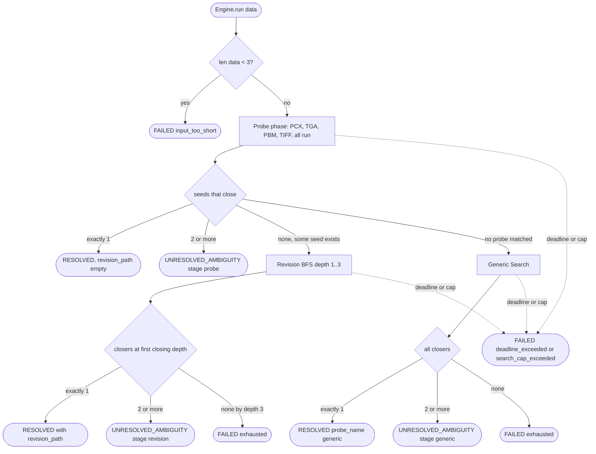
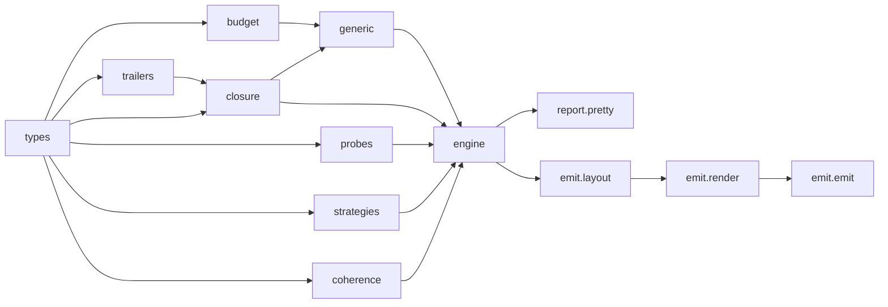

# Design Document

## Overview

The Structure-Inference Engine is a pure-Python, standard-library-only package that takes arbitrary bytes and returns one of three results: `VerifiedHypothesis` (`RESOLVED`), `AmbiguousResult` (`UNRESOLVED_AMBIGUITY`) or `FailureReport` (`FAILED`). It makes no network calls, needs no GPU and runs on a free hosting tier.

Inference runs in three phases. Each phase collects every closing hypothesis at its own stage and never picks one by list order.

1. **Probe phase.** Four probes (PCX, TGA, PBM, TIFF) each emit one seed on a signature match. Probes read declarations and fixed layout, and never apply conventions.
2. **Revision phase.** This runs only if a probe matched and no seed closed. It is a breadth-first search, to depth 3, over three strategies: `inclusive_bounds`, `rle_pcx` and `row_padding_variants`.
3. **Generic Search.** This runs only if no probe matched. It searches header length, field offset, field width, endianness, signedness and encoding. Width plus bit depth fixes the height.

Every hypothesis must pass the closure gate. The gate decodes the data region `[header_size, data_end)` under the declared encoding, and requires an exact output length and full consumption of the region. Row coherence is computed on closing candidates as a reported heuristic. It never affects the outcome.

A separate emitter package turns a successful result into a Kiro spec folder. A separate report package renders results as text. Neither lives in `necropsy/engine/`, because the engine steering rules forbid presentation code in the inference path.

**Determinism.** The steering rule for the engine forbids clocks and randomness in the inference path. There are two exceptions, both stated here:

- The deadline reads `time.monotonic()`. Through the injected `Budget`, the deadline can only turn a run into `FAILED / deadline_exceeded`. It never changes a `RESOLVED` or `UNRESOLVED_AMBIGUITY` outcome into a different one.
- Coherence sampling uses `random.Random(0)`. It is seeded, so it is deterministic for a given Python version (3.10 here).

## Architecture

### Control flow



### Package layout

```
necropsy/
    __init__.py
    engine/                  inference only; no formatting
        __init__.py          exports Engine, result types, Budget
        types.py             dataclasses and hypothesis_key
        budget.py            deadline and shared closure-check cap
        trailers.py          TrailerEntry, TRAILER_REGISTRY, match_trailer
        closure.py           row_stride, RLE decoder, check_closure
        probes.py            probe_pcx, probe_tga, probe_pbm, probe_tiff
        strategies.py        inclusive_bounds, rle_pcx, row_padding_variants
        generic.py           generic_search
        coherence.py         row_coherence
        engine.py            Engine
    report/
        __init__.py
        pretty.py            render(result) -> str
    emit/
        __init__.py          exports emit_spec, write_spec, EmittedSpec, EmitError
        layout.py            build_layout(result, data) -> dict
        render.py            render_requirements, render_design, render_tests
        emit.py              emit_spec, write_spec
tests/
    conftest.py              corpus loader; puts spike/ on sys.path
    support/
        __init__.py
        reference_reader.py  layout-block interpreter; imports nothing from necropsy
    test_closure.py
    test_probes.py
    test_strategies.py
    test_coherence.py
    test_generic.py
    test_engine.py
    test_corpus.py
    test_engine_properties.py
    test_pretty.py
    test_emit.py
    test_emit_acceptance.py
```

### Module dependencies



## Components and Interfaces

| Module | Public interface |
|---|---|
| `engine/types.py` | `FieldRecord`, `Hypothesis`, `hypothesis_key`, `RejectionEntry`, `Candidate`, `VerifiedHypothesis`, `AmbiguousResult`, `FailureReport`, `EngineResult`, `REASONS`, `TERMINATIONS` |
| `engine/budget.py` | `Budget(deadline_seconds, cap=10_000, clock=time.monotonic)` with `stop_reason() -> str \| None`, `charge() -> str \| None`, `checks: int` |
| `engine/trailers.py` | `TrailerEntry`, `TRAILER_REGISTRY`, `match_trailer(data, header_size, origin, registry=TRAILER_REGISTRY) -> tuple[int, str \| None]` |
| `engine/closure.py` | `row_stride(width, bit_depth, row_alignment) -> int`, `RleResult`, `rle_pcx_decode(data, start, end, max_output_bytes) -> RleResult`, `rle_pcx_output_length(data, start, end) -> int \| None`, `ClosureVerdict`, `check_closure(h, data) -> ClosureVerdict` |
| `engine/probes.py` | `ProbeOutcome`, `probe_pcx`, `probe_tga`, `probe_pbm`, `probe_tiff`, each `(data) -> ProbeOutcome \| None`; `PROBES` |
| `engine/strategies.py` | `inclusive_bounds`, `rle_pcx`, `row_padding_variants`, each `(h) -> tuple[Hypothesis, ...]`; `STRATEGIES` |
| `engine/generic.py` | `HEADER_LENGTHS`, `WIDTH_HEIGHT_FORMATS`, `VALID_BIT_DEPTHS`, `GenericOutcome`, `generic_search(data, budget, on_reject) -> GenericOutcome` |
| `engine/coherence.py` | `row_coherence(decoded, height, row_stride) -> tuple[float \| None, str]`, `COHERENCE_METHOD = "row_mad_ratio"`, `COHERENCE_SIZE_LIMIT = 262_144` |
| `engine/engine.py` | `Engine(deadline_seconds=5.0, clock=time.monotonic)` with `run(data) -> EngineResult` |
| `report/pretty.py` | `render(result) -> str` |
| `emit/layout.py` | `build_layout(result, data) -> dict` |
| `emit/render.py` | `render_requirements(layout, result, data) -> str`, `render_design(layout, result, data) -> str`, `render_tests(layout, result, data) -> str` |
| `emit/emit.py` | `EmittedSpec`, `EmitError`, `emit_spec(result, data) -> EmittedSpec \| EmitError`, `write_spec(spec, out_dir, overwrite=False) -> pathlib.Path \| EmitError` |
| `tests/support/reference_reader.py` | `extract_layout(markdown) -> dict \| str`, `parse(layout, data) -> dict`, `parse_candidates(layout, data) -> list[dict]`, `make_parser_module(markdown) -> str` |

## Data Models

```python
from dataclasses import dataclass, field

REASONS = frozenset({
    "arithmetic_mismatch", "decoder_overrun", "decoder_underrun", "decoder_unconsumed",
    "degenerate_hypothesis", "field_out_of_bounds", "probe_precondition_failed",
    "unsupported_encoding", "input_too_short", "internal_error",
})
TERMINATIONS = frozenset({
    "exhausted", "deadline_exceeded", "search_cap_exceeded", "input_too_short", "internal_error",
})

@dataclass(frozen=True)
class FieldRecord:
    name: str
    offset: int
    fmt: str            # struct format with explicit "<" or ">" for multi-byte reads
    value: tuple        # exactly what struct.unpack_from returned

@dataclass(frozen=True)
class Hypothesis:
    width: int
    height: int
    bit_depth: int
    header_size: int
    row_alignment: int = 1                 # 1, 2 or 4
    encoding: str = "none"
    data_end: int | None = None            # declared data end (TIFF); None means trailer registry, then EOF
    fields: tuple[FieldRecord, ...] = ()
    probe_name: str = "generic"            # "pcx" | "tga" | "pbm" | "tiff" | "generic"
    bounds: tuple[int, int, int, int] | None = None   # (xmin, ymin, xmax, ymax), PCX only
    revision_path: tuple[str, ...] = ()

def hypothesis_key(h: Hypothesis) -> tuple:
    return (h.width, h.height, h.bit_depth, h.header_size, h.row_alignment, h.encoding, h.data_end)

@dataclass(frozen=True)
class RejectionEntry:
    reason: str                            # member of REASONS
    source: str                            # probe name, "revision:" + "->".join(path), or "generic"
    hypothesis: Hypothesis | None = None
    discrepancy: int | None = None         # arithmetic_mismatch only
    detail: str = ""

@dataclass(frozen=True)
class Candidate:
    hypothesis: Hypothesis
    row_stride: int
    expected_decoded_bytes: int
    data_start: int
    data_end: int
    trailer: str | None
    coherence_score: float | None
    coherence_status: str                  # "scored" | "unscorable" | "not_computed"
    coherence_method: str = "row_mad_ratio"
    decoded: bytes = field(default=b"", repr=False)

@dataclass(frozen=True)
class VerifiedHypothesis:
    candidate: Candidate
    stage: str                             # "probe" | "revision" | "generic"
    rejections: tuple[RejectionEntry, ...]
    total_checks: int
    total_file_size: int
    status: str = "RESOLVED"

@dataclass(frozen=True)
class AmbiguousResult:
    candidates: tuple[Candidate, ...]      # discovery order, >= 2, distinct keys
    stage: str
    reason: str
    coherence_gap: float | None
    rejections: tuple[RejectionEntry, ...]
    total_checks: int
    total_file_size: int
    status: str = "UNRESOLVED_AMBIGUITY"

@dataclass(frozen=True)
class FailureReport:
    termination: str                       # member of TERMINATIONS
    rejections: tuple[RejectionEntry, ...]
    total_checks: int
    total_file_size: int
    partial_candidates: tuple[Candidate, ...] = ()
    status: str = "FAILED"

EngineResult = VerifiedHypothesis | AmbiguousResult | FailureReport
```

`AmbiguousResult.reason` is fixed text: `"{n} candidates pass closure; the bytes cannot separate them. Coherence scores are a heuristic and do not choose."`

## Low-Level Design

### Budget (`engine/budget.py`)

```
class Budget:
    def __init__(self, deadline_seconds, cap=10_000, clock=time.monotonic):
        self._end = clock() + deadline_seconds; self._clock = clock; self.cap = cap; self.checks = 0
    def stop_reason(self):
        if self._clock() >= self._end: return "deadline_exceeded"
        if self.checks >= self.cap:    return "search_cap_exceeded"
        return None
    def charge(self):                  # call immediately before a closure check
        reason = self.stop_reason()
        if reason is None: self.checks += 1
        return reason
```

One `Budget` is created per `run()` call. It is passed to every phase, so the deadline and the 10,000-check cap are shared by the probe phase, the revision phase and Generic Search. The clock is injectable, so tests can make the deadline fire deterministically.

### Trailer Registry (`engine/trailers.py`)

```
TrailerEntry(name: str, length: int, marker: int, applies_to: frozenset[str])
TRAILER_REGISTRY = (
    TrailerEntry("pcx_palette_256", 769, 0x0C, frozenset({"pcx", "generic"})),
)
def match_trailer(data, header_size, origin, registry=TRAILER_REGISTRY):
    n = len(data)
    for e in registry:
        if origin in e.applies_to and n - e.length >= header_size and data[n - e.length] == e.marker:
            return n - e.length, e.name
    return n, None
```

The `applies_to` scope keeps a one-byte marker from cutting the tail off TGA, PBM or TIFF hypotheses. TIFF hypotheses declare their own `data_end`, so the registry never applies to them. A future TGA footer or GIF trailer is one new entry, with no change to `check_closure`.

### Closure (`engine/closure.py`)

```
def row_stride(width, bit_depth, row_alignment):
    raw = -(-(width * bit_depth) // 8)           # ceil(width * bit_depth / 8)
    return -(-raw // row_alignment) * row_alignment

RleResult(status: str, data: bytes | None, consumed_to: int)   # status: ok | overrun | underrun | unconsumed

def rle_pcx_decode(data, start, end, max_output_bytes):
    if start < 0 or end > len(data) or start > end or max_output_bytes < 0:
        return RleResult("underrun", None, start)
    out = bytearray(); i = start
    while i < end and len(out) < max_output_bytes:
        b = data[i]; i += 1
        if b >= 0xC0:
            if i >= end: return RleResult("underrun", None, i)       # marker is last byte
            run = b & 0x3F; v = data[i]; i += 1
            if run > max_output_bytes - len(out):
                return RleResult("overrun", None, i)                 # checked before writing
            out += bytes((v,)) * run
        else:
            out.append(b)
    if len(out) != max_output_bytes: return RleResult("underrun", None, i)
    if i != end:                     return RleResult("unconsumed", None, i)
    return RleResult("ok", bytes(out), i)

def rle_pcx_output_length(data, start, end):     # counts only; allocates nothing
    n = 0; i = start
    while i < end:
        b = data[i]; i += 1
        if b >= 0xC0:
            if i >= end: return None
            n += b & 0x3F; i += 1
        else:
            n += 1
    return n
```

The decoder's allocation never exceeds `min(max_output_bytes, 63 × (end − start))`, even when `max_output_bytes` is derived from huge input-declared dimensions.

```
ClosureVerdict(ok, reason, discrepancy, decoded, data_start, data_end, trailer)

def check_closure(h, data):
    if h.width <= 0 or h.height <= 0 or h.bit_depth <= 0 or h.row_alignment not in (1, 2, 4) \
       or h.header_size < 0 or h.header_size > len(data):
        return reject("degenerate_hypothesis")
    stride = row_stride(h.width, h.bit_depth, h.row_alignment); expected = stride * h.height
    if h.data_end is not None:
        if h.data_end > len(data) or h.data_end < h.header_size: return reject("field_out_of_bounds")
        end, trailer = h.data_end, None
    else:
        end, trailer = match_trailer(data, h.header_size, h.probe_name)
    if h.encoding == "none":
        if end - h.header_size == expected: return accept(data[h.header_size:end], h.header_size, end, trailer)
        return reject("arithmetic_mismatch", discrepancy=(end - h.header_size) - expected)
    if h.encoding == "rle_pcx":
        r = rle_pcx_decode(data, h.header_size, end, expected)
        if r.status == "ok": return accept(r.data, h.header_size, end, trailer)
        return reject("decoder_" + r.status)
    return reject("unsupported_encoding")
```

`check_closure` is wrapped in `try/except Exception`, and an exception becomes `reject("internal_error")`. This is a last line of defence; inner code bounds-checks every read.

### Probes (`engine/probes.py`)

Every read goes through one helper. The helper returns `None` instead of raising when `offset < 0` or `offset + struct.calcsize(fmt) > len(data)`.

```
def read(data, name, offset, fmt) -> FieldRecord | None
ProbeOutcome(seed: Hypothesis, rejections: tuple[RejectionEntry, ...])
```

A probe returns `None` only for a signature mismatch or a file shorter than its minimum length. After a signature match, it always returns a `ProbeOutcome`. Values it cannot read are 0, and it attaches `field_out_of_bounds` or `probe_precondition_failed` entries.

| Probe | Min length | Signature | Fields (offset, format) | Seed |
|---|---|---|---|---|
| PCX | 128 | `0x00 == 0x0A`, `0x02 ∈ {0,1}` | encoding 0x02 `B`; bit_depth 0x03 `B`; xmin 0x04 `<H`; ymin 0x06 `<H`; xmax 0x08 `<H`; ymax 0x0A `<H`; planes 0x41 `B`; bytes_per_line 0x42 `<H` | width = xmax, height = ymax, header 128, alignment 1, encoding none (0x00) or rle_pcx (0x01), bounds set |
| TGA | 18 | `0x01 ∈ {0,1}`, `0x02 ∈ {1,2,3,9,10,11}` | id_length 0x00 `B`; color_map_type 0x01 `B`; image_type 0x02 `B`; color_map_length 0x05 `<H`; color_map_entry_size 0x07 `B`; width 0x0C `<H`; height 0x0E `<H`; bit_depth 0x10 `B` | header = 18 + id_length + color_map_type × color_map_length × ceil(entry_size / 8); encoding none for 1–3, rle_tga for 9–11 |
| PBM | 7 | `0x00..0x02 == b"P4\n"` | magic 0x00 `3s`; width at token offset `<n>s`; height at token offset `<n>s` | bit_depth 1, alignment 1, header = offset after dimensions line |
| TIFF | 8 | `0x00..0x01 ∈ {II, MM}` and magic 42 in that order | byte_order 0x00 `2s`; magic 0x02 `oH`; ifd_offset 0x04 `oI`; ifd_entry_count at ifd_offset `oH`; tag values at entry + 8 (`oH` for SHORT, `oI` for LONG) | width, height, bit_depth = bps × spp, header = strip_offset, data_end = strip_offset + strip_byte_count, encoding none if compression 1 |

In the TIFF row, `o` is `<` for `II` and `>` for `MM`.

**PBM parsing.** The header text is read only within `data[:1024]`. From index 3, while the line starts with `#`, the parser skips past the next `\n`. It then takes the next line up to `\n`. That line must split on ASCII whitespace into exactly two all-digit tokens. The token offsets are found by locating each token inside the line. `header_size` is the index after that `\n`. On any failure, the seed is `width = 0`, `height = 0`, `header_size = 3`, with `probe_precondition_failed`.

**TIFF walk.**
- Entries are read at `ifd_offset + 2 + 12k` for `k < ifd_entry_count`, stopping at the first entry that does not fit. The stop records `field_out_of_bounds`.
- For each entry, the probe reads tag (`oH`, +0), type (`oH`, +2) and count (`oI`, +4).
- A tag in `{256, 257, 258, 259, 273, 277, 279}` with type 3 or 4 and count 1 becomes a `FieldRecord` at entry + 8. SHORT values are left-justified, so `oH` at +8 is the value.
- Defaults: compression 1, samples_per_pixel 1.

### Revision strategies (`engine/strategies.py`)

```
def inclusive_bounds(h):
    if h.bounds is None: return ()
    xmin, ymin, xmax, ymax = h.bounds
    return (replace(h, width=xmax - xmin + 1, height=ymax - ymin + 1,
                    revision_path=h.revision_path + ("inclusive_bounds",)),)

def rle_pcx(h):
    if h.probe_name != "pcx" or h.encoding != "none": return ()
    return (replace(h, encoding="rle_pcx", revision_path=h.revision_path + ("rle_pcx",)),)

def row_padding_variants(h):
    return tuple(replace(h, row_alignment=a, revision_path=h.revision_path + ("row_padding_variants",))
                 for a in (2, 4) if a != h.row_alignment)

STRATEGIES = (("inclusive_bounds", inclusive_bounds), ("rle_pcx", rle_pcx),
              ("row_padding_variants", row_padding_variants))
```

`rle_pcx` is restricted to PCX-origin hypotheses that declare `none`. The file says it is PCX, PCX's only compression is RLE, and the encoding byte may be damaged, as in mystery_i. Applying it to a TGA or TIFF declaration would replace one declaration with an arbitrary other one.

### Revision phase (`engine/engine.py`)

```
seen = {hypothesis_key(s) for s in seeds}
frontier = list(seeds)
for depth in (1, 2, 3):
    winners, next_frontier = [], []
    for h in frontier:
        for name, fn in STRATEGIES:
            for c in fn(h):
                k = hypothesis_key(c)
                if k in seen: continue
                seen.add(k)
                stop = budget.charge()
                if stop: return failure(stop, partial=winners)
                v = check_closure(c, data)
                if v.ok: winners.append((c, v))
                else:    reject(c, v, source="revision:" + "->".join(c.revision_path)); next_frontier.append(c)
    if winners:
        return resolved(winners[0]) if len(winners) == 1 else ambiguous(winners, "revision")
    frontier = next_frontier
return failure("exhausted")
```

Winners are not added to the next frontier, because the search stops at the first closing depth. The probe phase uses the same collect-all rule: every probe runs, and its closing seeds go through the same `resolved` or `ambiguous` decision with stage `probe`.

### Generic Search (`engine/generic.py`)

The design no longer nests over every pair of width offset and height offset. Width plus bit depth fixes the height. The search groups reads by value, so the inner loop runs over distinct width values and distinct bit-depth values, and looks the height up.

```
HEADER_LENGTHS = tuple(range(4, 257, 4))
WIDTH_HEIGHT_FORMATS = ("<H", ">H", "<I", ">I", "<i", ">i")
FORMAT_SIZE = {"<H": 2, ">H": 2, "<I": 4, ">I": 4, "<i": 4, ">i": 4}
VALID_BIT_DEPTHS = (1, 4, 8, 16, 24, 32)

def generic_search(data, budget, on_reject):
    found = {}                                        # key -> (Hypothesis, ClosureVerdict), insertion order
    for L in HEADER_LENGTHS:
        if L >= len(data): break
        stop = budget.stop_reason()
        if stop: return GenericOutcome(tuple(found.values()), stop)
        reads = {}                                    # value -> [(fmt, offset)], formats then offsets ascending
        for f in WIDTH_HEIGHT_FORMATS:
            for o in range(0, L - FORMAT_SIZE[f] + 1):
                v = struct.unpack_from(f, data, o)[0]
                if v > 0: reads.setdefault(v, []).append((f, o))
        depths = {}                                   # value -> [offset]
        for o in range(L):
            if data[o] in VALID_BIT_DEPTHS: depths.setdefault(data[o], []).append(o)
        end, trailer = match_trailer(data, L, "generic")
        sizes = [("none", end - L)]
        if trailer is not None:
            n = rle_pcx_output_length(data, L, end)
            if n: sizes.append(("rle_pcx", n))
        for enc, S in sizes:
            if S <= 0: continue
            for W, w_reads in reads.items():
                for B in depths:
                    stride = row_stride(W, B, 1)
                    if S % stride: continue
                    Hh = S // stride
                    h_reads = reads.get(Hh)
                    if not h_reads or not any(a[1] != b[1] for a in w_reads for b in h_reads): continue
                    h = Hypothesis(W, Hh, B, L, 1, enc, None, fields(w_reads, h_reads, depths[B]), "generic")
                    if hypothesis_key(h) in found: continue
                    stop = budget.charge()
                    if stop: return GenericOutcome(tuple(found.values()), stop)
                    v = check_closure(h, data)
                    if v.ok: found[hypothesis_key(h)] = (h, v)
                    else: on_reject(h, v)
    return GenericOutcome(tuple(found.values()), None)
```

`fields(...)` builds every equivalent read. It makes one `width` record per `(fmt, offset)` in `w_reads`, one `height` record per entry in `h_reads`, and one `bit_depth` record (`B`) per offset in `depths[B]`.

The enumeration order is deterministic: header length, then encoding, then width value in first-seen order, then bit depth in first-seen order. The order affects only the discovery order of candidates. It never decides between them.

### Row coherence (`engine/coherence.py`)

```
COHERENCE_METHOD = "row_mad_ratio"
COHERENCE_SIZE_LIMIT = 262_144

def row_coherence(decoded, height, row_stride):
    """Heuristic only. Never a gate, never promotes, never orders.

    Known failure modes:
    1. Narrower strides score better on smooth images: at stride 1 the "rows" are horizontal neighbours.
    2. Identical bytes at an identical stride, split into different bit depths (8x8 at 8 bpp and
       64x8 at 1 bpp), score identically.
    3. A header can absorb whole rows: a candidate missing the top rows of the true image scores close to it.
    """
    if height * row_stride > COHERENCE_SIZE_LIMIT: return None, "not_computed"
    if height < 2 or row_stride < 1 or len(decoded) < height * row_stride: return None, "unscorable"
    rows = [decoded[i*row_stride:(i+1)*row_stride] for i in range(height)]
    mad = lambda a, b: sum(map(abs, map(int.__sub__, a, b))) / row_stride
    adjacent = sum(mad(rows[i], rows[i+1]) for i in range(height - 1)) / (height - 1)
    P = height * (height - 1) // 2
    ks = range(P) if P <= 1024 else random.Random(0).sample(range(P), 1024)
    pairs = [pair_at(k, height) for k in ks]          # k-th pair (i, j), i < j, lexicographic order
    baseline = sum(mad(rows[i], rows[j]) for i, j in pairs) / len(pairs)
    if baseline == 0: return None, "unscorable"
    return adjacent / baseline, "scored"
```

`pair_at(k, h)` finds row `i` by binary search on `before(i) = i × (2h − i − 1) / 2`, the number of pairs that start before row `i`. It then returns `(i, i + 1 + k − before(i))`, in `O(log h)`.

`coherence_gap` is `(second − first) / second` over the two lowest scores. It is `None` when fewer than two candidates are scored or the second-lowest score is 0.

### Engine (`engine/engine.py`)

```
class Engine:
    def __init__(self, deadline_seconds=5.0, clock=time.monotonic): ...
    def run(self, data):
        try:
            return self._run(bytes(data))
        except Exception as exc:
            return FailureReport("internal_error",
                                 (RejectionEntry("internal_error", "engine", detail=f"{type(exc).__name__}: {exc}"),),
                                 0, len(data) if isinstance(data, (bytes, bytearray)) else 0)
```

`_run` follows the control flow above. It creates one `Budget`, keeps one rejection list in the order produced, and checks `budget.stop_reason()` before each probe. It builds each `Candidate` from a `(Hypothesis, ClosureVerdict)` pair, checking `budget.stop_reason()` before each `row_coherence` call. A stop at any point returns `FailureReport(termination, rejections, budget.checks, len(data), partial_candidates)`.

### Pretty printer (`report/pretty.py`)

`render(result) -> str` dispatches on `result.status` and produces the exact lines from Requirement 8.4 to 8.6. Each status has its own first line: `RESOLVED`, `UNRESOLVED_AMBIGUITY: …` or `FAILED: …`. The function is wrapped in `try/except Exception`, and an exception returns `"render error: <ExceptionClass>"`.

### Spec emission (`emit/`)

`emit_spec(result, data)` is pure.
- It returns `EmittedSpec(slug, files)`, where `files` is a tuple of `(name, text)` pairs for `requirements.md`, `design.md` and `tests.py`.
- For a `FailureReport` it returns `EmitError("nothing recovered: FAILED/<termination>")`.

`write_spec(spec, out_dir, overwrite=False)` does the writing.
- It rejects slugs that do not match `^[a-z0-9-]+$`.
- It resolves `out_dir / slug` and checks that the result is inside `out_dir`.
- It refuses an existing folder unless `overwrite`.
- It writes the three files as UTF-8 without a BOM, and returns the folder path or an `EmitError`.

#### Slugs

- Probe origin: the probe name (`pcx`, `tga`, `pbm` or `tiff`).
- Generic Search: `unknown-` followed by `hashlib.sha256(data).hexdigest()[:8]`.

#### Layout schema `necropsy-layout/1`

The emitted `requirements.md` contains exactly one fenced block whose info string is `necropsy-layout`, holding JSON:

```
{
  "schema": "necropsy-layout/1",
  "kind": "format" | "file" | "ambiguous",
  "slug": "<slug>",
  "byte_order": null | {"offset": 0, "length": 2, "values": {"II": "<", "MM": ">"}},
  "fields": [ {"name": str, "offset": <expr>, "fmt": str, "expect": int | null} ],
  "tag_table": null | {
      "at": <expr>, "count_fmt": str, "entry_size": 12,
      "tag_offset": 0, "tag_fmt": str, "type_offset": 2, "type_fmt": str,
      "count_offset": 4, "count_fmt_entry": str, "value_offset": 8,
      "value_fmt_by_type": {"3": str, "4": str}, "require_count": 1,
      "entries": [ {"name": str, "tag": int, "default": int | null} ]
  },
  "image": {"width": <expr>, "height": <expr>, "bit_depth": <expr>, "row_alignment": 1 | 2 | 4},
  "data": {"start": <expr>, "end": <expr> | null, "encoding": <encoding>,
           "trailers": [ {"name": str, "length": int, "marker": int} ]},
  "equivalent_reads": { "<field>": [[fmt, offset], ...] },
  "observed": { "<name>": int, ... },
  "candidates": [ <layout without "candidates">, ... ]
}
```

The schema's building blocks:

- **Expressions.** An `<expr>` is an integer literal, a string naming a field or tag entry already read, or one of `{"add": [e, …]}`, `{"sub": [a, b]}`, `{"mul": [e, …]}` and `{"ceil_div": [a, b]}`.
- **Byte order.** In any format string, `@` is replaced by the resolved byte-order prefix.
- **Encoding.** `<encoding>` is either a literal string, or `{"field": name, "values": {"<int>": str}, "otherwise": str}`.
- **Data end.** When `data.end` is `null`, a reader applies the first matching trailer, otherwise it uses the file end.
- **Kind `ambiguous`.** Only `schema`, `kind`, `slug` and `candidates` are set; each candidate is a `file` or `format` layout.

Kind and content by origin:

| Origin | Kind | Notes |
|---|---|---|
| PCX | `format` | Width and height are `{"add": [{"sub": ["xmax", "xmin"]}, 1]}` when `inclusive_bounds` is in the path, otherwise `"xmax"` and `"ymax"`. Encoding is `{"field": "encoding", "values": {"0": "none", "1": "rle_pcx"}}`, or the literal `"rle_pcx"` when `rle_pcx` is in the path. Alignment is taken from the result. Trailers list `pcx_palette_256`. |
| TGA | `format` | Start is `{"add": [18, "id_length", {"mul": ["color_map_type", "color_map_length", {"ceil_div": ["color_map_entry_size", 8]}]}]}`. Encoding is mapped from `image_type`. |
| TIFF | `format` | `byte_order` is set, with the tag table as specified in Requirement 2.8. Start is `"strip_offset"`; end is `{"add": ["strip_offset", "strip_byte_count"]}`. Encoding is `{"field": "compression", "values": {"1": "none"}, "otherwise": "unsupported"}`. |
| PBM | `file` | The token offsets are this file's. The prose states the text-header rules. |
| Generic | `file` | The first equivalent read of each field is used as the field; all reads appear in `equivalent_reads`. The prose states that this is one file's layout, not a format. |

#### Emitted `requirements.md`

The emitted file uses the Kiro headings `# Requirements Document`, `## Introduction`, `## Glossary`, `## Requirements`, `### Requirement N: …`, `**User Story:**` and `#### Acceptance Criteria`. Its requirements are:

1. **Signature and byte order.** One criterion per `expect` field, and one for the byte-order rule.
2. **Fields.** One criterion per field and tag entry. Example: `THE parser SHALL read \`width\` at offset 0x000C using struct format \`<H\` (little-endian, 2 bytes).` For `@` formats, the endianness is described as "declared by bytes 0x00–0x01 (II little-endian, MM big-endian)".
3. **Data region and encoding.** The start and end rule, trailers and encoding.
4. **Closure.** The closure rule, and the statement that the source file satisfied it with the observed numbers.
5. **Observed values.** `WHEN parsing the source file, THE parser SHALL return <name> = <value>`.

For an ambiguous result, the file instead has one requirement per candidate, written with `WHERE candidate k is assumed, …`. It also has a requirement stating that every candidate passes closure, that the bytes cannot separate them, and that coherence is a heuristic with the three failure modes named.

The layout block sits in the Introduction.

#### Emitted `design.md`

The emitted file uses the Kiro headings Overview, Architecture, Components and Interfaces, Data Models, Correctness Properties, Error Handling and Testing Strategy. Its content:

- the structure table (or one table per candidate);
- the stage and source;
- `revision_path`;
- the data region and trailer;
- the closure arithmetic line from Requirement 8.4;
- coherence, labelled "heuristic (row_mad_ratio)";
- rejected hypotheses, numbered, with source, reason and discrepancy. Up to 500 are listed, followed by `"… and N more not listed"`.

#### Emitted `tests.py`

```python
"""Generated by NECROPSY from <slug>. Tests for parser_<module>.parse."""
import base64, struct
import pytest
from hypothesis import given, settings, strategies as st
import parser_<module> as parser

SOURCE = base64.b64decode("<...>")          # or None when the source exceeds 65,536 bytes
EXPECTED = {"width": 8, "height": 8, "bit_depth": 8, "row_alignment": 1, "data_start": 86, "data_end": 150}
FIELDS = [("width", 22, ">H", (8,)), ...]

def _stride(w, b, a):
    raw = -(-(w * b) // 8)
    return -(-raw // a) * a

@settings(max_examples=200, deadline=None)
@given(st.binary(max_size=65536))
def test_never_raises(data):
    assert isinstance(parser.parse(data), dict)

@settings(max_examples=200, deadline=None)
@given(st.binary(max_size=65536))
def test_reported_fields_round_trip(data):
    r = parser.parse(data)
    if r.get("ok"):
        for name, offset, fmt, value in r["fields"]:
            assert struct.unpack_from(fmt, data, offset) == tuple(value)

@settings(max_examples=200, deadline=None)
@given(st.binary(max_size=65536))
def test_closure_holds_whenever_parse_succeeds(data):
    r = parser.parse(data)
    if r.get("ok"):
        assert len(r["pixels"]) == _stride(r["width"], r["bit_depth"], r["row_alignment"]) * r["height"]

def test_source_fields_and_closure():
    if SOURCE is None:
        pytest.skip("source larger than 65,536 bytes; fixture not embedded")
    for name, offset, fmt, value in FIELDS:
        assert struct.unpack_from(fmt, SOURCE, offset) == value
    r = parser.parse(SOURCE)
    assert r["ok"] and {k: r[k] for k in EXPECTED} == EXPECTED
```

**Parser contract.**
- On success, `parse(data)` returns a dict with:
  - `ok: True`;
  - `width`, `height`, `bit_depth`, `row_alignment`, `encoding`, `data_start`, `data_end`;
  - `pixels: bytes`;
  - `fields: [(name, offset, fmt, value_tuple)]`.
- On failure, it returns `{"ok": False, "error": str}`.
- It never raises.

**Ambiguous results.** The emitted tests target `parse_candidates(data) -> list[dict]`. `EXPECTED_CANDIDATES` lists each candidate's summary, and the fixture test asserts that every expected candidate is present.

#### Reference reader (`tests/support/reference_reader.py`)

The reference reader is a generic interpreter of `necropsy-layout/1` and contains no format knowledge.

- **Inputs and imports.** It reads the single `necropsy-layout` block from markdown text. It imports only `json`, `re` and `struct`. A test asserts that its source contains no `necropsy` import.
- **Steps.** It resolves the byte order, then reads `fields` in order (offsets may be expressions over earlier fields), checks each `expect`, and walks `tag_table`. It then evaluates `image`, resolves `data.start` and `data.end` (falling back to `trailers`, then EOF), and resolves the encoding.
- **Decoding.** It decodes `none` only by slicing. Any other encoding returns `{"ok": False, "error": "encoding not supported by reference reader"}`.
- **Result.** It checks closure and returns the parser-contract dict.
- **`make_parser_module(markdown)`** returns Python source for a `parser_<slug>` module. The module embeds the markdown text and exposes `parse` and `parse_candidates` by calling the reader. The acceptance test writes it to a temporary directory and runs the emitted `tests.py` there with `python -m pytest`.

## Corpus Trace (measured)

Measured with a reference model of these rules on Python 3.10.11. The implementation tasks re-measure the same values as tests.

| File | Probes matched | Stage | Closing | Result | Checks |
|---|---|---|---|---|---|
| mystery_a | pbm | probe | 1 | 4×4, 1 bpp, header 7, stride 1, region [7, 11), path [] | 1 |
| mystery_b | pcx | revision depth 1 | 1 | 8×8, 8 bpp, rle_pcx, region [128, 186), trailer pcx_palette_256, path [inclusive_bounds] | 4 |
| mystery_c | tga | probe | 1 | 16×16, 24 bpp, header 18, stride 48, region [18, 786), path [] | 1 |
| mystery_d | none | generic | 18 | ambiguous; includes 8×8, 8 bpp, header 40; 9 scored, 9 unscorable | 18 |
| mystery_e | tiff | probe | 1 | 8×8, 8 bpp, declared region [86, 150), all multi-byte fields `>`, path [] | 1 |
| mystery_f | none | generic | 8 | ambiguous; includes 12×10, 8 bpp, header 12; width reads `<H`, `<I`, `<i` at 0x00 | 8 |
| mystery_g | none | generic | 8 | ambiguous; includes 8×8, 24 bpp, header 20; 7 scored, 1 unscorable | 8 |
| mystery_h | pcx | revision depth 2 | 1 | 6×6, 8 bpp, alignment 4, stride 8, region [128, 176), path [inclusive_bounds, row_padding_variants] | 10 |
| mystery_i | pcx | revision depth 2 | 1 | 8×8, 8 bpp, rle_pcx, region [128, 186), path [inclusive_bounds, rle_pcx] | 10 |

Two details from the trace:

- **mystery_b and the TGA probe.** mystery_b matched the TGA probe in an earlier draft, because byte `0x02 = 1` is a valid TGA image type. It no longer matches, because byte `0x01 = 5` is not a valid TGA colour-map type.
- **Field round-trip.** Every `FieldRecord` of every candidate round-tripped through `struct.unpack_from`, with 0 failures across the corpus.

## Measured Performance

| Input | Result | Closure checks | Time |
|---|---|---|---|
| 65,536 random bytes | FAILED / exhausted | 0 | 0.041 s |
| 65,536 bytes: dense small header values, valid bit depths, PCX palette trailer, RLE-safe body | FAILED / exhausted | 0 | 0.220 s |
| 65,536 bytes of `0x08` | FAILED / exhausted | 0 | 0.009 s |
| 300 random and mutated corpus inputs | no exceptions | — | worst 0.048 s |
| `Engine(deadline_seconds=0.0)` on mystery_c | FAILED / deadline_exceeded | 0 | — |

An earlier version of the measurement script recorded 0.03 s on 65,536 random bytes. The figures above are from the final-rules reference model. A second run of that model gave 0.042 s, 0.236 s and 0.008 s for the three 65,536-byte inputs, and a worst case of 0.057 s over the 300 inputs; every non-timing output line was identical.

The per-unit work bounds that make the 0.25-second overshoot in Requirement 5.4 hold:

- One closure check decodes at most the data region.
- One Generic Search header length does at most `6 × 256` reads and one `rle_pcx_output_length` pass.
- One coherence computation handles at most 262,144 decoded bytes and 1,024 pairs.

## Correctness Properties

### Property 1: Never raises

For any byte sequence of up to 65,536 bytes, including mutated corpus files, `Engine().run(data)` returns a `VerifiedHypothesis`, `AmbiguousResult` or `FailureReport` without raising.

**Validates: Requirements 6.2, 6.3, 6.5**

### Property 2: Deadline bound

For the same inputs, `Engine(deadline_seconds=5.0).run(data)` returns within 5.25 seconds.

**Validates: Requirements 5.4, 6.6**

### Property 3: Closure soundness

For every candidate of a `RESOLVED` or `UNRESOLVED_AMBIGUITY` result, `check_closure(candidate.hypothesis, data).ok` is true, and its `data_start`, `data_end` and `decoded` match the candidate.

**Validates: Requirements 1.7, 1.8, 1.14, 10.2, 10.3**

### Property 4: Field round-trip

For every `FieldRecord` of every candidate, `struct.unpack_from(fr.fmt, data, fr.offset) == fr.value`.

**Validates: Requirements 8.1, 8.2**

### Property 5: Equivalent reads agree

For every candidate, all `FieldRecord`s sharing a name have the same first value.

**Validates: Requirements 4.7, 8.3**

### Property 6: RLE decoder is bounded and typed

For any bytes, `start`, `end` and `max_output_bytes`, `rle_pcx_decode` returns an `RleResult` whose status is one of `ok`, `overrun`, `underrun` and `unconsumed`, without raising. When the status is `ok`, the decoded length equals `max_output_bytes` and `consumed_to == end`. Otherwise `data is None`.

**Validates: Requirements 1.9, 1.10, 1.11, 6.4**

### Property 7: Outcome well-formed

- `status` matches the result type.
- `RESOLVED` holds exactly one candidate.
- `UNRESOLVED_AMBIGUITY` holds at least two candidates with distinct keys.
- `FAILED` has a termination in `TERMINATIONS`.
- Every rejection reason is in `REASONS`.

**Validates: Requirements 5.6, 5.7, 10.1, 10.2, 10.3**

### Property 8: Coherence cannot change the outcome

If `row_coherence` is replaced by any function returning arbitrary scores, `run(data)` gives the same status, the same candidate keys and the same candidate order.

**Validates: Requirements 10.5, 11.1, 11.8**

### Property 9: No duplicate hypotheses

No two candidates in a result share a hypothesis key, and no key is closure-checked twice in one run.

**Validates: Requirements 3.3**

### Property 10: Deterministic

With the deadline far from expiry, two runs on the same bytes return equal results.

**Validates: Requirements 3.6** (and the engine steering rule on determinism)

### Property 11: Spec emitter is total

For any result produced from arbitrary bytes, `emit_spec` returns `EmittedSpec` for `RESOLVED` and `UNRESOLVED_AMBIGUITY` and `EmitError` for `FAILED`, without raising. An `EmittedSpec` holds exactly the three named files, and its `requirements.md` holds exactly one layout block that parses as JSON with `schema == "necropsy-layout/1"`.

**Validates: Requirements 9.1, 9.6, 9.13, 6.4**

### Property 12: Emitted layout reproduces the engine

For each result with `encoding == "none"`, the reference reader, given only the emitted `requirements.md`, reproduces each candidate's width, height, bit depth, data region and decoded bytes.

**Validates: Requirements 9.16, 9.18**

### Property 13: Pretty printer is total

For any `EngineResult`, `render` returns a string whose first line starts with the result's status, without raising.

**Validates: Requirements 8.4, 8.5, 8.6, 8.7**

### Property 14: Coherence function is total

For any bytes and any integers `height` and `row_stride`, `row_coherence` returns `(float, "scored")` with a finite non-negative float, `(None, "unscorable")` or `(None, "not_computed")`, without raising.

**Validates: Requirements 11.2, 11.3, 11.4, 6.4**

## Error Handling

- **Public entry points.** `Engine.run`, every probe, every strategy, `check_closure`, `rle_pcx_decode`, `generic_search`, `row_coherence`, `render`, `emit_spec` and `write_spec` return structured values. Each has a last-resort `try/except Exception` that converts to its error value. Inner code bounds-checks every read and must not rely on the wrapper.
- **Input-declared sizes.** These are never trusted for allocation:
  - The RLE decoder is capped by `max_output_bytes` and by the region length.
  - Coherence is capped at 262,144 bytes.
  - Generic Search reads only inside the header length.
- **Termination.** The deadline is checked before each probe, before each closure check, at the start of each Generic Search header length and before each coherence call. The cap is checked before each closure check. Both stop the run with a `FailureReport` that keeps the rejections and partial candidates.
- **File writing.** Only `write_spec` writes files, only inside the given directory and only for a valid slug. It never overwrites unless asked.

## Testing Strategy

- **Framework.** pytest, with Hypothesis for property tests. Run with `python -m pytest tests/<file> -q`.
- **Engine property settings.** `@settings(max_examples=100, deadline=None)`, because the engine has its own deadline.
- **Input generator.** `engine_inputs = st.one_of(st.binary(max_size=65536), mutated_corpus())`. `mutated_corpus` takes a corpus file and applies byte flips, truncation and extension. Properties that need a successful result add every corpus file with `@example`, so their assertions run on real `RESOLVED` and `UNRESOLVED_AMBIGUITY` results.
- **Fixtures.** Binary fixtures are built in code from documented byte layouts. The only committed binaries are `spike/samples/`.
- **Pixel checks.** Corpus pixel checks compare exact bytes against the pixel content exposed by `spike/make_samples.py`.
- **Deadline tests.** These use an injected clock, so no test depends on wall-clock timing. The one exception is Property 2, whose 0.25-second margin is stated.
- **Property tags.** Each property test is tagged `Feature: structure-inference-engine, Property N: <title>`.
- **Emitted-spec acceptance.** This runs the emitted `tests.py` in a subprocess with a temporary directory on `PYTHONPATH`. The final checkpoint validates the emitted `requirements.md` and `design.md` for mystery_e and mystery_d with Kiro's spec format validator.