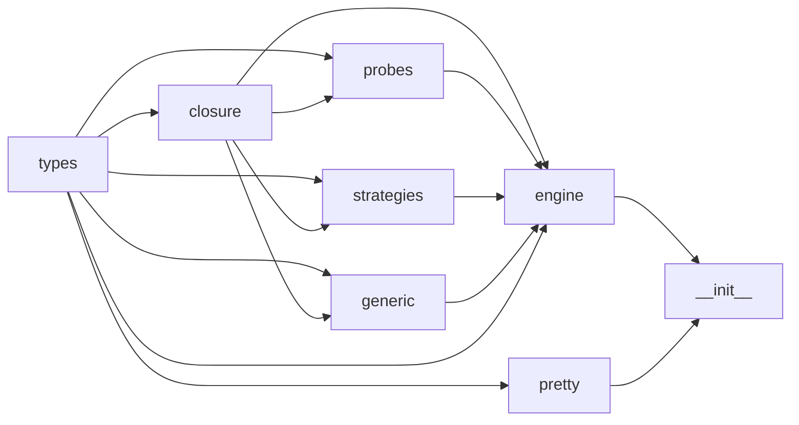
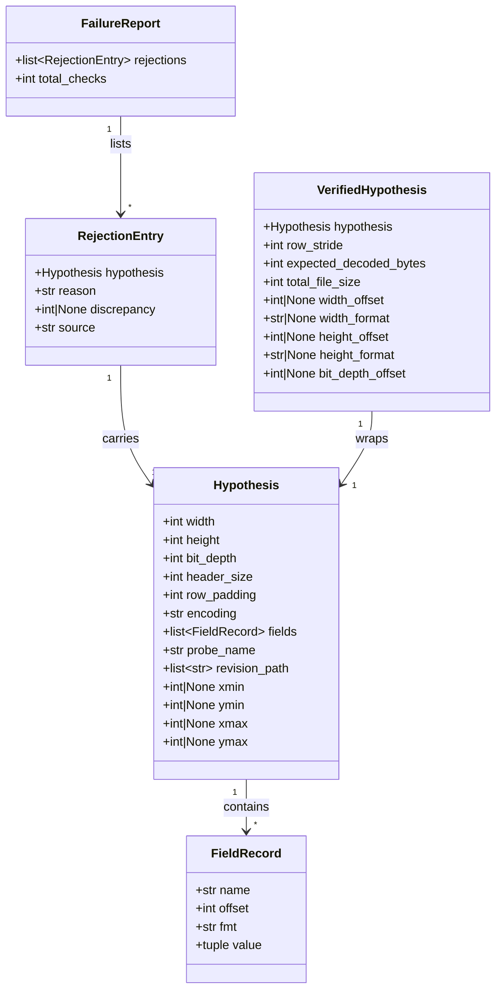

# Design Document

## Overview

The Structure-Inference Engine is a pure-Python library that accepts an arbitrary byte sequence and returns either a `VerifiedHypothesis` (a structurally consistent interpretation of the bytes as a raster image) or a `FailureReport` (a complete account of every hypothesis tried and why each was rejected). It runs with no network calls and no GPU, making it compatible with free hosting tiers.

The engine works in three sequential phases:

1. **Probe Phase** — Four format-specific probes (PCX, TGA, PBM, TIFF) each attempt to build a `Hypothesis` directly from the byte sequence. Each probe is tried in order; the first whose derived hypothesis passes the closure gate is returned immediately.
2. **Revision Phase** — If any probe generated a rejected hypothesis (signature matched but closure failed), the engine applies an ordered, breadth-first search over compositions of five revision strategies (up to depth 3) against those seed hypotheses.
3. **Generic Search** — If no probe even generated a hypothesis (all signatures mismatched), the engine enumerates combinations of header lengths, field offsets, field widths, and encodings until a closing hypothesis is found or the budget is exhausted.

Every hypothesis is verified against a **closure gate** before being accepted. The gate is binary: a hypothesis either closes exactly or is rejected. The engine never raises an exception at its public entry point; malformed or adversarial input always produces a `FailureReport`.

The engine enforces two independent termination conditions: a wall-clock deadline (default 5 seconds) and a shared cap of 10,000 total closure checks. Whichever triggers first wins.

---

## Architecture

### High-Level Control Flow

```mermaid
flowchart TD
    A([run&#40;data&#41;]) --> B{len&#40;data&#41; &lt; 3?}
    B -- yes --> Z1([FailureReport: input_too_short])
    B -- no --> C[Phase 1: Probes]

    C --> D{PCX probe}
    D -- signature mismatch --> E{TGA probe}
    D -- hypothesis generated --> P1{closure gate}
    P1 -- pass --> R([VerifiedHypothesis])
    P1 -- fail → record rejection --> E

    E -- signature mismatch --> F{PBM probe}
    E -- hypothesis generated --> P2{closure gate}
    P2 -- pass --> R
    P2 -- fail → record rejection --> F

    F -- signature mismatch --> G{TIFF probe}
    F -- hypothesis generated --> P3{closure gate}
    P3 -- pass --> R
    P3 -- fail → record rejection --> G

    G -- signature mismatch --> H{any probe generated a hypothesis?}
    G -- hypothesis generated --> P4{closure gate}
    P4 -- pass --> R
    P4 -- fail → record rejection --> H

    H -- yes → at least one rejection --> I[Phase 2: Revision BFS]
    H -- no → all signatures mismatched --> J[Phase 3: Generic Search]

    I --> P5{candidate passes closure?}
    P5 -- yes --> R
    P5 -- no, record rejection --> P5
    I --> L{deadline or cap?}
    L -- yes --> Z2([FailureReport: deadline_exceeded / search_cap_exceeded])
    I --> K{depth 3 exhausted?}
    K -- yes, no match found --> Z3([FailureReport])

    J --> P6{candidate passes closure?}
    P6 -- yes --> R
    J --> M{deadline or cap?}
    M -- yes --> Z4([FailureReport: deadline_exceeded / search_cap_exceeded])
    J --> N{all combinations tried?}
    N -- yes --> Z5([FailureReport])
```



### Module Dependency Graph



---

## Components and Interfaces

### `types.py` — Data Model

All public data types are `dataclasses`. No business logic lives here.

| Type | Role |
|---|---|
| `FieldRecord` | A single extracted field: name, byte offset, struct format, raw value tuple |
| `Hypothesis` | A candidate structural interpretation, fully parameterised |
| `RejectionEntry` | One closure failure: hypothesis parameters + reason + source |
| `VerifiedHypothesis` | A hypothesis that passed the closure gate, plus derived values |
| `FailureReport` | Complete failure accounting: rejection list + total check count |
| `HypothesisResult` | `VerifiedHypothesis | FailureReport` |

### `closure.py` — Closure Gate

Three pure functions; no I/O; never raise.

| Function | Signature | Purpose |
|---|---|---|
| `compute_row_stride` | `(width, bit_depth, row_padding) → int` | Row byte width including padding |
| `rle_pcx_decode` | `(data, start, max_output_bytes) → bytes \| None` | Bounded PCX RLE decoder |
| `check_closure` | `(h: Hypothesis, data: bytes) → (bool, str, int \| None)` | Full closure verdict |

### `probes.py` — Initial Probes

Four functions, each `probe_xxx(data: bytes) → Hypothesis | None`. Return `None` on signature mismatch (silent); return a `Hypothesis` (which may fail closure) on signature match.

### `strategies.py` — Revision Strategies

Five functions, each `apply_xxx(h: Hypothesis, data: bytes) → list[Hypothesis]`. Return an empty list when the strategy does not apply to the given hypothesis.

### `generic.py` — Generic Search

One function: `generic_search(data, check_fn, deadline_fn) → HypothesisResult | None`. Returns `None` when the budget is exhausted without a match.

### `engine.py` — Orchestrator

`Engine` class with public method `run(data: bytes) → HypothesisResult`. Owns all mutable state (check counter, deadline start, rejection list, termination flag). `run()` wraps `_run_inner()` in a bare `except Exception` to satisfy the never-raise contract.

### `pretty.py` — Pretty Printer

`PrettyPrinter.render(result: HypothesisResult) → str`. Pure function over the result types; no side effects.

---

## Data Models

### Type Relationships



### `FieldRecord`

```python
@dataclass
class FieldRecord:
    name: str
    offset: int
    fmt: str       # struct format string, e.g. "<H"
    value: tuple   # raw tuple from struct.unpack_from — never unwrapped
```

The `value` field stores the tuple directly from `struct.unpack_from`. This guarantees the field round-trip property: `struct.unpack_from(fr.fmt, original_data, fr.offset) == fr.value` for every record in a `VerifiedHypothesis`.

### `Hypothesis`

```python
@dataclass
class Hypothesis:
    width: int
    height: int
    bit_depth: int
    header_size: int
    row_padding: int           # default 0
    encoding: str              # "none" or "rle_pcx"
    fields: list[FieldRecord]  # all extracted fields with offsets
    probe_name: str            # probe that generated this, or "generic"
    revision_path: list[str]   # strategies applied so far, in order
    # Optional bounds fields (present only for PCX-origin hypotheses):
    xmin: int | None = None
    ymin: int | None = None
    xmax: int | None = None
    ymax: int | None = None
```

The `revision_path` accumulates in-place as strategies are applied; each strategy appends its own name before returning the new candidate. The deduplication key used by the engine is `(width, height, bit_depth, header_size, row_padding, encoding)` — `revision_path` and `fields` are excluded from the key.

### `RejectionEntry`

```python
@dataclass
class RejectionEntry:
    hypothesis: Hypothesis     # None only for uncaught_exception / input_too_short
    reason: str                # typed reason string (see closure.py)
    discrepancy: int | None    # set for arithmetic_mismatch; None otherwise
    source: str                # probe name or strategy-sequence string, e.g. '["inclusive_bounds","rle_pcx"]'
```

Valid `reason` values: `arithmetic_mismatch`, `decoder_overrun`, `decoder_underrun`, `field_out_of_bounds`, `search_cap_exceeded`, `deadline_exceeded`, `input_too_short`, or an exception class name and message.

### `VerifiedHypothesis`

```python
@dataclass
class VerifiedHypothesis:
    hypothesis: Hypothesis
    row_stride: int
    expected_decoded_bytes: int   # row_stride × height
    total_file_size: int
    # Set only for generic-search results:
    width_offset: int | None = None
    width_format: str | None = None
    height_offset: int | None = None
    height_format: str | None = None
    bit_depth_offset: int | None = None
```

### `FailureReport`

```python
@dataclass
class FailureReport:
    rejections: list[RejectionEntry]
    total_checks: int
```

Entries are ordered: probe rejections first (in probe order), then revision-phase rejections (breadth-first depth order), then generic-search rejections.

---

## Low-Level Design

### Closure Gate (`closure.py`)

#### `compute_row_stride`

```python
import math

def compute_row_stride(width: int, bit_depth: int, row_padding: int) -> int:
    if bit_depth >= 8:
        return (width * bit_depth // 8) + row_padding
    else:
        return math.ceil(width * bit_depth / 8) + row_padding
```

#### `rle_pcx_decode`

Decodes from `data[start:]`. Returns the decoded `bytes` only when the output length equals `max_output_bytes` exactly. Returns `None` for overrun or underrun. Never raises.

```
out = bytearray()
i = start
while i < len(data) and len(out) < max_output_bytes:
    b = data[i]; i += 1
    if b >= 0xC0:                       # RLE run marker
        run = b & 0x3F
        if i < len(data):
            val = data[i]; i += 1
            remaining = max_output_bytes - len(out)
            if run > remaining:
                return None             # overrun
            out.extend([val] * run)
    else:
        out.append(b)                   # literal byte

if len(out) != max_output_bytes:
    return None                         # underrun
return bytes(out)
```

The `max_output_bytes` guard prevents unbounded memory allocation on malformed or adversarial data.

#### `check_closure`

```
row_stride = compute_row_stride(h.width, h.bit_depth, h.row_padding)
expected_bytes = row_stride * h.height

if h.encoding == "none":
    actual = len(data) - h.header_size
    if actual == expected_bytes:
        return (True, "", None)
    else:
        discrepancy = len(data) - (h.header_size + expected_bytes)
        return (False, "arithmetic_mismatch", discrepancy)

elif h.encoding == "rle_pcx":
    decoded = rle_pcx_decode(data, h.header_size, expected_bytes)
    if decoded is None:
        # Distinguish overrun vs underrun by re-running with a larger cap
        # and checking how many bytes were produced before abort
        # (implementation detail — both return None, so we probe the reason)
        # Practical approach: attempt a decode with max_output_bytes+1
        probe = rle_pcx_decode(data, h.header_size, expected_bytes + 1)
        if probe is not None and len(probe) == expected_bytes + 1:
            # would have kept going → actual underrun
            return (False, "decoder_underrun", None)
        else:
            # stopped early or ran over → overrun
            return (False, "decoder_overrun", None)
    return (True, "", None)
```

> **Implementation note**: The overrun/underrun distinction above is approximated; a cleaner approach is to instrument `rle_pcx_decode` to return a typed sentinel. The final implementation should return an enum or typed result from the decoder so `check_closure` does not need to call the decoder twice. The contract is: `decoder_overrun` when the decoded output would exceed `max_output_bytes`; `decoder_underrun` when the input is exhausted before producing `max_output_bytes` bytes.

### Probes (`probes.py`)

All probes return `None` on a signature mismatch. A matching signature always produces a `Hypothesis`, which may still fail closure. All byte offsets and struct formats are taken verbatim from the requirements.

#### PCX Probe

Signature: `data[0] == 0x0A` and `data[2] == 0x01`; minimum length 128 bytes.

| Field | Offset | Format | Notes |
|---|---|---|---|
| `xmin` | `0x04` | `<H` | |
| `ymin` | `0x06` | `<H` | |
| `xmax` | `0x08` | `<H` | |
| `ymax` | `0x0A` | `<H` | |
| `bit_depth` | `0x03` | `B` | bits per plane |
| `planes` | `0x41` | `B` | |
| `bytes_per_line` | `0x42` | `<H` | |

Initial hypothesis: `width = xmax`, `height = ymax`, `header_size = 128`, `encoding = "none"`. Closure additionally requires `xmax ≥ xmin`, `ymax ≥ ymin`, and `bytes_per_line > 0`; if any fails, the probe records a `RejectionEntry` and returns that failed hypothesis (so the revision phase can still use it as a seed — specifically to apply `inclusive_bounds`).

**Corpus coverage**: `mystery_b` (PCX RLE, 8×8) and `mystery_h` (PCX padded rows, 6×6) both trigger this probe. Neither closes on the initial hypothesis; both reach `VerifiedHypothesis` via the revision phase.

#### TGA Probe

Signature: `data[2] ∈ {1, 2, 3, 9, 10, 11}`; minimum length `18 + data[0]` bytes.

| Field | Offset | Format |
|---|---|---|
| `id_length` | `0x00` | `B` |
| `image_type` | `0x02` | `B` |
| `width` | `0x0C` | `<H` |
| `height` | `0x0E` | `<H` |
| `bit_depth` | `0x10` | `B` |

Initial hypothesis: `header_size = 18 + id_length`, `encoding = "none"`. Closure additionally requires `width > 0` and `height > 0`.

**Corpus coverage**: `mystery_c` (TGA uncompressed, 16×16, 24 bpp) closes on the initial hypothesis with `revision_path = []`.

#### PBM Probe

Signature: `data[0:3] == b"P4\n"`; minimum length 7 bytes.

The ASCII header is parsed line by line from byte 3. Comment lines beginning with `#` are skipped. The first non-comment line is split on whitespace to extract `width` and `height` as decimal integers. `header_size` is the byte offset of the first byte after the final newline in the ASCII header (the start of the binary pixel data). `bit_depth` is fixed at 1; `row_stride = ceil(width / 8)`.

**Corpus coverage**: `mystery_a` (PBM P4, 4×4, 1 bpp, 11 bytes). Header is `"P4\n4 4\n"` = 7 bytes; `row_stride = ceil(4/8) = 1`; `header_size = 7`; closure: `7 + 1×4 = 11`. Closes immediately with `revision_path = []`.

#### TIFF Probe

Signature: `data[0:2] ∈ {b"II", b"MM"}` and magic uint16 at offset `0x02` read in the declared byte order equals 42. All subsequent fields are read as little-endian regardless of byte order mark (the requirements state "naively as little-endian").

| Field | Offset | Format | Notes |
|---|---|---|---|
| `ifd_offset` | `0x04` | `<I` | |
| IFD entry count | `ifd_offset` | `<H` | |
| tag 256 (`width`) | search | `<H` or `<I` | value depending on TIFF type |
| tag 257 (`height`) | search | `<H` or `<I` | |
| tag 258 (`bit_depth`) | search | `<H` or `<I` | |
| tag 273 (`strip_offset`) | search | `<H` or `<I` | |
| tag 279 (`strip_byte_count`) | search | `<H` or `<I` | |

If `ifd_offset` or any tag offset falls outside `[0, len(data))`, the probe records a `RejectionEntry` with `reason = "field_out_of_bounds"` and returns `None` (skips). Initial hypothesis: `header_size = strip_offset`, `encoding = "none"`. Closure condition additionally checks `strip_offset + strip_byte_count == len(data)` AND decoded bytes == `row_stride × height`.

**Corpus coverage**: `mystery_e` (TIFF big-endian "MM", 8×8, 8 bpp). The probe reads all fields as little-endian, producing wrong values. The `endianness_flip` strategy corrects them, yielding `revision_path = ["endianness_flip"]`.

### Revision Strategies (`strategies.py`)

All strategy functions have signature `apply_xxx(h: Hypothesis, data: bytes) → list[Hypothesis]`.

#### `apply_inclusive_bounds`

Applies only when `h.xmin`, `h.ymin`, `h.xmax`, `h.ymax` are all set (PCX-origin hypotheses).

```
new_width  = h.xmax - h.xmin + 1
new_height = h.ymax - h.ymin + 1
return [Hypothesis(..., width=new_width, height=new_height,
                   revision_path=h.revision_path + ["inclusive_bounds"])]
```

**Corpus coverage**: Both `mystery_b` and `mystery_h` reach `VerifiedHypothesis` through paths that start with `inclusive_bounds`.

#### `apply_endianness_flip`

Iterates over all `FieldRecord` entries in `h.fields`. For each record whose `fmt` starts with `<`, re-reads at the same offset using the `>` prefix (and vice versa). Rebuilds `width`, `height`, `bit_depth`, `header_size` from the flipped values by name. Single-byte formats (`B`, `b`) are unchanged.

```
flipped_fields = []
name_to_value = {}
for fr in h.fields:
    if fr.fmt.startswith("<"):
        new_fmt = ">" + fr.fmt[1:]
    elif fr.fmt.startswith(">"):
        new_fmt = "<" + fr.fmt[1:]
    else:
        new_fmt = fr.fmt
    new_val = struct.unpack_from(new_fmt, data, fr.offset)
    flipped_fields.append(FieldRecord(fr.name, fr.offset, new_fmt, new_val))
    name_to_value[fr.name] = new_val[0]

return [Hypothesis(
    width=name_to_value.get("width", h.width),
    height=name_to_value.get("height", h.height),
    ...
    revision_path=h.revision_path + ["endianness_flip"],
)]
```

**Corpus coverage**: `mystery_e` (TIFF big-endian "MM"). The initial TIFF probe reads fields as little-endian. `endianness_flip` re-reads them in big-endian, yielding the correct `width=8`, `height=8`, `bit_depth=8`, `header_size=86`.

#### `apply_header_length_scan`

Generates candidates with adjusted `header_size` values:

- Add `k` for `k ∈ {1, 2, 4, 8, 16, 32, 64, 128}` (in that order)
- Subtract `k` for `k ∈ {1, 2, 4}` (in that order)

Skips any adjusted value outside `[0, len(data))`. Each adjusted size is a separate candidate with `revision_path = h.revision_path + ["header_length_scan"]`.

#### `apply_row_padding_variants`

Returns three candidates with `row_padding ∈ {1, 2, 4}`, all other parameters unchanged.

```
return [
    replace(h, row_padding=p, revision_path=h.revision_path + ["row_padding_variants"])
    for p in (1, 2, 4)
]
```

**Corpus coverage**: `mystery_h` (PCX padded rows, 6×6, row_stride=8). After `inclusive_bounds` gives `width=6`, `height=6`, `header_size=128`, `encoding="none"`, the row stride with `row_padding=0` is 6, giving closure check `128 + 6×6 = 164 ≠ 176`. With `row_padding=2` the stride is 8, giving `128 + 8×6 = 176 = len(data)`. Hence `revision_path = ["inclusive_bounds", "row_padding_variants"]`.

#### `apply_rle_pcx`

```
return [replace(h, encoding="rle_pcx",
                revision_path=h.revision_path + ["rle_pcx"])]
```

**Corpus coverage**: `mystery_b` (PCX RLE). After `inclusive_bounds` gives `width=8`, `height=8`, `encoding="none"`, closure fails (file contains RLE-compressed data). `rle_pcx` switches to `encoding="rle_pcx"`, the decoder produces exactly `8×8 = 64` bytes, closure passes. `revision_path = ["inclusive_bounds", "rle_pcx"]`.

### Strategy Ordering

```python
STRATEGIES = [
    apply_inclusive_bounds,
    apply_endianness_flip,
    apply_header_length_scan,
    apply_row_padding_variants,
    apply_rle_pcx,
]
```

### Revision Phase BFS (`engine.py`)

The revision phase searches strategy sequences breadth-first up to depth 3. At depth 1 every single strategy is applied to every seed hypothesis. At depth 2 every two-strategy sequence is applied to every seed. At depth 3 every three-strategy sequence.

```
seed_pool: list[Hypothesis]  # probe-generated, closure-failed hypotheses
seen: set[tuple] = {hypothesis_key(h) for h in seed_pool}
frontier: list[Hypothesis] = seed_pool[:]

for depth in range(1, 4):
    next_frontier: list[Hypothesis] = []
    for base_h in frontier:
        for strategy_fn in STRATEGIES:
            candidates = strategy_fn(base_h, data)
            for candidate in candidates:
                key = hypothesis_key(candidate)
                if key in seen:
                    continue
                seen.add(key)
                if over_limit():          # deadline or cap
                    return termination_failure_report()
                check_count += 1
                passed, reason, disc = check_closure(candidate, data)
                if passed:
                    return make_verified(candidate, data)
                record_rejection(candidate, reason, disc)
                next_frontier.append(candidate)
    frontier = next_frontier

return None  # exhausted without finding a match
```

`hypothesis_key(h) = (h.width, h.height, h.bit_depth, h.header_size, h.row_padding, h.encoding)`

Deduplication prevents the same parameter combination from being closure-checked more than once, regardless of which strategy sequence produced it.

### Generic Search (`generic.py`)

The generic search is entered only when no probe even generated a hypothesis (all signatures mismatched — the file has no recognised format header).

```
HEADER_LENGTHS = sorted(set(range(4, 257, 4)) | {4, 8, 16, 32, 64, 128, 256})
# = [4, 8, 12, 16, ..., 256]  (multiples of 4 plus powers of 2, deduplicated)

WIDTH_HEIGHT_FORMATS = ["<H", ">H", "<I", ">I", "<i", ">i"]
FORMAT_SIZES = {"<H": 2, ">H": 2, "<I": 4, ">I": 4, "<i": 4, ">i": 4}
VALID_BPP = {1, 4, 8, 16, 24, 32}

for h_len in HEADER_LENGTHS:
    if h_len >= len(data):
        continue
    for w_fmt in WIDTH_HEIGHT_FORMATS:
        ws = FORMAT_SIZES[w_fmt]
        for w_off in range(0, h_len - ws + 1):
            w_val = struct.unpack_from(w_fmt, data, w_off)[0]
            if w_val <= 0:
                continue
            for h_fmt in WIDTH_HEIGHT_FORMATS:
                hs = FORMAT_SIZES[h_fmt]
                for h_off in range(0, h_len - hs + 1):
                    if w_off == h_off:
                        continue
                    h_val = struct.unpack_from(h_fmt, data, h_off)[0]
                    if h_val <= 0:
                        continue
                    for bpp_off in range(0, h_len):
                        bpp_val = data[bpp_off]
                        if bpp_val not in VALID_BPP:
                            continue
                        row_stride = compute_row_stride(w_val, bpp_val, 0)
                        # Skip guard: would exceed file even before closure check
                        if h_len + row_stride * h_val > len(data):
                            continue
                        for enc in ("none", "rle_pcx"):
                            if over_limit():
                                return termination_failure_report()
                            check_count += 1
                            hyp = Hypothesis(width=w_val, height=h_val,
                                             bit_depth=bpp_val, header_size=h_len,
                                             row_padding=0, encoding=enc,
                                             fields=[...], probe_name="generic",
                                             revision_path=[])
                            passed, reason, disc = check_closure(hyp, data)
                            if passed:
                                return make_verified_generic(
                                    hyp, w_off, w_fmt, h_off, h_fmt, bpp_off, data)
return None
```

**Corpus coverage**: `mystery_d`, `mystery_f`, `mystery_g` all reach `VerifiedHypothesis` via generic search (no probe signature matches). The search is not exhaustive — the shared 10,000-check cap and 5-second deadline will terminate it on large files before all combinations are tried. The engine never claims a `FailureReport` from generic search proves no closing hypothesis exists.

For generic-search results, the `VerifiedHypothesis` records `width_offset`, `width_format`, `height_offset`, `height_format`, and `bit_depth_offset` as top-level fields so the winning search axes are observable.

### Engine Class (`engine.py`)

```python
class Engine:
    def __init__(self, deadline_seconds: float = 5.0):
        self._deadline_seconds = deadline_seconds

    def run(self, data: bytes) -> HypothesisResult:
        try:
            return self._run_inner(data)
        except Exception as exc:
            return FailureReport(
                rejections=[RejectionEntry(
                    hypothesis=None,
                    reason=f"{type(exc).__name__}: {exc}",
                    discrepancy=None,
                    source="uncaught_exception",
                )],
                total_checks=0,
            )
```

The outer `try/except` is the last line of defence for the never-raise contract. All inner code is expected to handle its own errors; this catch is for truly unexpected failures.

`_run_inner` owns these instance variables for one `run()` call:
- `self._start: float` — `time.monotonic()` at the start of the call
- `self._check_count: int` — total closure checks performed so far
- `self._rejections: list[RejectionEntry]` — accumulated in entry order
- `self._terminated: str | None` — `"deadline"` or `"cap"` once a limit fires

### Pretty Printer (`pretty.py`)

```python
class PrettyPrinter:
    def render(self, result: HypothesisResult) -> str:
        if isinstance(result, VerifiedHypothesis):
            return self._render_verified(result)
        return self._render_failure(result)

    def _render_verified(self, v: VerifiedHypothesis) -> str:
        h = v.hypothesis
        lines = ["=== Verified Hypothesis ==="]
        lines.append(f"{'Offset':<8}  {'Field':<20}  {'Format':<6}  Value")
        for fr in h.fields:
            lines.append(f"0x{fr.offset:04X}    {fr.name:<20}  {fr.fmt:<6}  {fr.value}")
        lines.append("")
        lines.append(
            f"Closure: {h.header_size} + {v.row_stride * h.height} = {v.total_file_size}"
        )
        lines.append(f"revision_path: {h.revision_path}")
        return "\n".join(lines)

    def _render_failure(self, f: FailureReport) -> str:
        lines = [
            f"=== Failure Report ({len(f.rejections)} entries, "
            f"{f.total_checks} checks) ==="
        ]
        for i, entry in enumerate(f.rejections, 1):
            disc = (
                f" (discrepancy={entry.discrepancy})"
                if entry.discrepancy is not None
                else ""
            )
            lines.append(f"{i:3}. [{entry.source}] {entry.reason}{disc}")
        return "\n".join(lines)
```

The closure line format is exactly: `{header_size} + {row_stride × height} = {total_file_size}` with all three values as decimal integers (Requirement 8 criterion 3).

---

## Corpus Trace

This section walks through the expected resolution path for each of the eight corpus files, grounding every requirement in a concrete example.

| File | Format | Size | Expected resolution |
|---|---|---|---|
| `mystery_a` | PBM P4, 4×4, 1 bpp | 11 B | PBM probe → immediate closure |
| `mystery_b` | PCX RLE, 8×8, 8 bpp | 955 B | PCX probe → `["inclusive_bounds", "rle_pcx"]` |
| `mystery_c` | TGA uncompressed, 16×16, 24 bpp | 786 B | TGA probe → immediate closure |
| `mystery_d` | DIB body, 8×8, 8 bpp | 104 B | No probe match → Generic Search |
| `mystery_e` | TIFF big-endian "MM", 8×8, 8 bpp | 150 B | TIFF probe → `["endianness_flip"]` |
| `mystery_f` | Raw 32-bit dims, 12×10, 8 bpp | 132 B | No probe match → Generic Search |
| `mystery_g` | Raw unusual header, 8×8, 24 bpp | 212 B | No probe match → Generic Search |
| `mystery_h` | PCX padded rows, 6×6, 8 bpp | 176 B | PCX probe → `["inclusive_bounds", "row_padding_variants"]` |

### mystery_a (PBM)
- Header: `b"P4\n4 4\n"` = 7 bytes; `bit_depth = 1`; `row_stride = ceil(4/8) = 1`
- Closure: `7 + 1×4 = 11 == len(data)` ✓

### mystery_b (PCX RLE)
- PCX probe: `data[0]=0x0A`, `data[2]=0x01` ✓; reads `xmax=7`, `ymax=7` → `width=7`, `height=7`
- Closure with `encoding="none"`: `128 + 7×7 = 177 ≠ 955` ✗
- `inclusive_bounds`: `width = 7−0+1 = 8`, `height = 7−0+1 = 8`
- Closure with `encoding="none"`: `128 + 8×8 = 192 ≠ 955` ✗
- `rle_pcx`: `encoding = "rle_pcx"`; decoder produces exactly `64` bytes ✓

### mystery_c (TGA)
- TGA probe: `data[2]=2 ∈ {1,2,3,9,10,11}` ✓; `width=16`, `height=16`, `bit_depth=24`, `header_size=18`
- `row_stride = 16×24/8 = 48`; closure: `18 + 48×16 = 786 == len(data)` ✓

### mystery_d (DIB body)
- No probe signature matches → Generic Search
- Header length 40; `width` at `0x04` as `<i` = 8; `height` at `0x08` as `<i` = 8; `bit_depth` at `0x0E` as `B` = 8
- `row_stride = 8`; closure: `40 + 8×8 = 104 == len(data)` ✓

### mystery_e (TIFF big-endian "MM")
- TIFF probe: `data[0:2]=b"MM"` ✓; magic read as big-endian = 42 ✓
- All fields read as little-endian (probe convention) → wrong values
- Closure fails; `endianness_flip` re-reads all multi-byte fields in big-endian
- With flipped values: `width=8`, `height=8`, `bit_depth=8`, `header_size=86 (strip_offset)`
- `row_stride = 8`; closure: `86 + 8×8 = 150 == len(data)` ✓

### mystery_f (raw 32-bit dims)
- No probe signature matches → Generic Search
- Header length 12; `width` at `0x00` as `<I` = 12; `height` at `0x04` as `<I` = 10; `bit_depth` at `0x08` as `B` = 8
- `row_stride = 12`; closure: `12 + 12×10 = 132 == len(data)` ✓

### mystery_g (raw unusual header)
- No probe signature matches → Generic Search
- Header length 20; `width` at `0x04` as `<H` = 8; `height` at `0x06` as `<H` = 8; `bit_depth` at `0x08` as `B` = 24
- `row_stride = 8×24/8 = 24`; closure: `20 + 24×8 = 212 == len(data)` ✓

### mystery_h (PCX padded rows)
- PCX probe: `data[0]=0x0A`, `data[2]=0x00` → `data[2] != 0x01` → signature mismatch
  - **Wait**: `mystery_h` uses `header[2] = 0` (uncompressed). The PCX probe checks `data[2] == 0x01`. This is a mismatch. However the requirements state `mystery_h` should return `revision_path=["inclusive_bounds","row_padding_variants"]`, which implies the PCX probe must have matched (otherwise there would be no PCX seed for `inclusive_bounds`).
  - **Resolution**: The PCX probe signature must accept `data[2] ∈ {0, 1}` (0 = uncompressed PCX, 1 = RLE). The requirements state `data[2] == 0x01` as the signature for the PCX probe in Requirement 2 criterion 1, but `mystery_h` is encoded as uncompressed PCX (`header[2] = 0`). The probe must be relaxed to `data[2] in (0, 1)` to generate the seed hypothesis needed for the revision path `["inclusive_bounds", "row_padding_variants"]` to apply.
  - **Design decision**: The PCX probe checks `data[0] == 0x0A` and `data[2] in (0, 1)`. The initial `encoding` field of the resulting hypothesis is `"none"` for `data[2] == 0` and `"none"` for `data[2] == 1` as well (the `rle_pcx` strategy later switches encoding if needed).
- With signature matched: `xmin=0`, `ymin=0`, `xmax=5`, `ymax=5` → `width=5`, `height=5` (raw `xmax`/`ymax`)
- Closure with `encoding="none"`: `128 + 5×5 = 153 ≠ 176` ✗
- `inclusive_bounds`: `width = 5−0+1 = 6`, `height = 5−0+1 = 6`
- Closure with `row_padding=0`: `128 + 6×6 = 164 ≠ 176` ✗
- `row_padding_variants(padding=2)`: `row_stride = 6+2 = 8`; closure: `128 + 8×6 = 176 == len(data)` ✓

---

## Error Handling

### Never-Raise Contract

The public `Engine.run()` method wraps `_run_inner()` in a bare `except Exception`. Any unexpected exception is caught and returned as a `FailureReport` with the exception class name and message as the rejection reason. This contract holds for all inputs including zero-length bytes, adversarially crafted bytes, and integers-disguised-as-bytes.

### Input Validation

- `len(data) < 3`: Return `FailureReport` with `reason = "input_too_short"` immediately, without attempting any probe.
- `len(data) == 0`: Covered by the above.

### Probe Errors

Each probe guards its minimum length before reading any field. All `struct.unpack_from` calls are preceded by a length check; if data is too short, the probe returns `None` (silent skip). Probes never raise.

### Decoder Safety

`rle_pcx_decode` accepts `max_output_bytes` and aborts immediately if the decoded output would exceed it. This prevents unbounded memory growth on adversarial RLE inputs. The decoder also handles truncated input (exhausted before `max_output_bytes` reached) by returning `None`.

### Termination Guarantees

- **Deadline**: Checked before each closure check via `time.monotonic()`. Once triggered, the engine returns immediately with `FailureReport(reason="deadline_exceeded")` and the rejection list accumulated so far.
- **Search cap**: Counter incremented after each closure check. At 10,000 the engine returns `FailureReport(reason="search_cap_exceeded")`.
- Both conditions are checked in the same `_over_limit()` guard function, called before each check.

### Field Out of Bounds

The TIFF probe validates `ifd_offset` and all tag offsets against `[0, len(data))` before reading. If any falls outside the range, the probe records a `RejectionEntry` with `reason = "field_out_of_bounds"` and returns `None`.

### Deduplication

The revision phase maintains a `seen` set of hypothesis keys `(width, height, bit_depth, header_size, row_padding, encoding)`. Identical parameter combinations are skipped without a closure check, preventing redundant work and protecting against strategy compositions that circle back to the same hypothesis.

---

## Testing Strategy

### Framework and Libraries

- **Test runner**: `pytest`
- **Property-based testing**: `hypothesis` library (already in use in the project, as evidenced by `.hypothesis/` directory in the workspace)
- **Corpus fixtures**: The eight sample files in `spike/samples/` are read as bytes fixtures

### File Layout

```
tests/
    test_engine.py        # corpus tests (Req 7) + never-raise property tests (Req 6)
    test_closure.py       # unit tests for compute_row_stride, rle_pcx_decode, check_closure
    test_probes.py        # unit tests for each probe
    test_strategies.py    # unit tests for each strategy
    test_generic.py       # unit tests for generic_search
    test_pretty.py        # unit tests for PrettyPrinter
```

### Unit Tests (example-based)

Each probe, strategy, and closure function gets concrete example tests:

- **Probes**: Each probe is tested with its matching corpus file (should return a `Hypothesis`) and with a file whose signature does not match (should return `None`). PCX and TGA probes are also tested with files shorter than their minimum length (should return `None`).
- **Closure**: `compute_row_stride` is tested for `bit_depth ≥ 8` and `bit_depth < 8`. `check_closure` is tested for `arithmetic_mismatch`, correct match, `decoder_overrun`, and `decoder_underrun`.
- **Strategies**: Each strategy is tested with a known input and known expected output. `apply_inclusive_bounds` is tested with a PCX-origin hypothesis; `apply_endianness_flip` with a TIFF-origin hypothesis.
- **Pretty printer**: Tested with a minimal `VerifiedHypothesis` and a minimal `FailureReport`. The closure line format and column ordering are asserted exactly.
- **Corpus**: All eight files in `spike/samples/` are tested against the expected `VerifiedHypothesis` values from Requirement 7.

### Property Tests (Hypothesis library)

Each property test is configured with `@settings(max_examples=100)` and tagged with a comment referencing the design property it validates.

| Test | Tag | Property |
|---|---|---|
| Engine never raises on arbitrary bytes | `Feature: structure-inference-engine, Property 1: never raises` | Req 6.3 |
| Engine returns within deadline on arbitrary bytes | `Feature: structure-inference-engine, Property 2: deadline respected` | Req 6.5 |
| VerifiedHypothesis always passes closure gate | `Feature: structure-inference-engine, Property 3: closure soundness` | Req 1.1–1.2 |
| All FieldRecords round-trip via struct.unpack_from | `Feature: structure-inference-engine, Property 4: field round-trip` | Req 8.2 |
| RLE decoder never raises on arbitrary bytes | `Feature: structure-inference-engine, Property 5: RLE decoder never raises` | Req 6.4 |
| RLE decoder output is exactly max_output_bytes when not None | `Feature: structure-inference-engine, Property 6: RLE output bounded` | Req 1.6 |
| FailureReport is structurally valid | `Feature: structure-inference-engine, Property 7: FailureReport is total` | Req 5 |

---

## Correctness Properties

*A property is a characteristic or behavior that should hold true across all valid executions of a system — essentially, a formal statement about what the system should do. Properties serve as the bridge between human-readable specifications and machine-verifiable correctness guarantees.*

### Property 1: Never Raises

*For any* byte sequence `data`, `Engine().run(data)` returns a `HypothesisResult` without raising an exception.

**Validates: Requirements 6.1, 6.2, 6.3**

### Property 2: Deadline Respected

*For any* byte sequence `data`, `Engine(deadline_seconds=5.0).run(data)` returns a `HypothesisResult` within 5 seconds of the call.

**Validates: Requirements 1.7, 6.5**

### Property 3: Closure Soundness

*For any* byte sequence `data` where `Engine().run(data)` returns a `VerifiedHypothesis` `v`, calling `check_closure(v.hypothesis, data)` returns `True`.

**Validates: Requirements 1.1, 1.2, 1.4**

### Property 4: Field Round-Trip

*For any* `VerifiedHypothesis` `v` produced from byte sequence `data`, for every `FieldRecord` `fr` in `v.hypothesis.fields`, `struct.unpack_from(fr.fmt, data, fr.offset) == fr.value`.

**Validates: Requirements 8.1, 8.2**

### Property 5: RLE Decoder Never Raises

*For any* byte sequence `data`, start offset `start ∈ [0, len(data)]`, and non-negative integer `max_output_bytes`, `rle_pcx_decode(data, start, max_output_bytes)` returns either `bytes` or `None` without raising.

**Validates: Requirements 1.6, 6.3**

### Property 6: RLE Output Bounded

*For any* call to `rle_pcx_decode(data, start, max_output_bytes)` that returns a non-`None` result `r`, `len(r) == max_output_bytes`.

**Validates: Requirements 1.6**

### Property 7: FailureReport Is Total

*For any* byte sequence `data` where `Engine().run(data)` returns a `FailureReport` `f`, `len(f.rejections) >= 0` and `f.total_checks >= 0`.

**Validates: Requirements 5.1, 5.2, 5.3**
