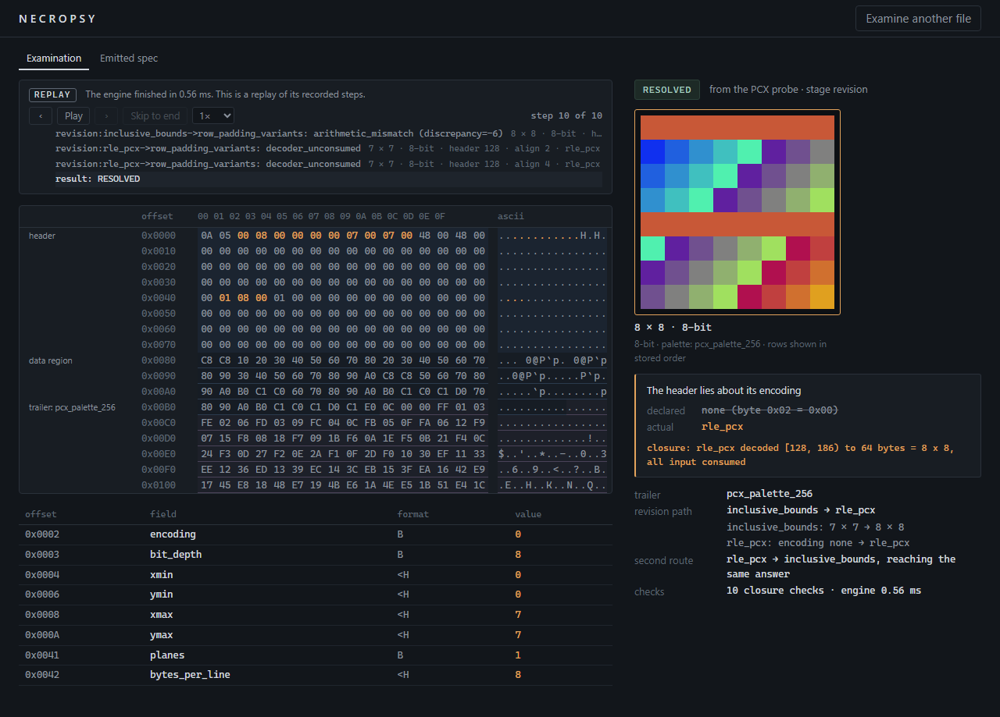
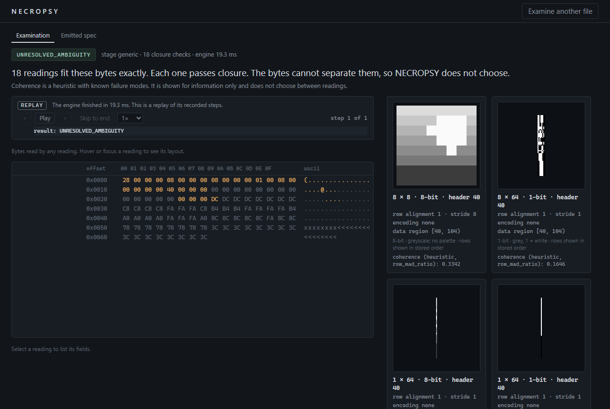
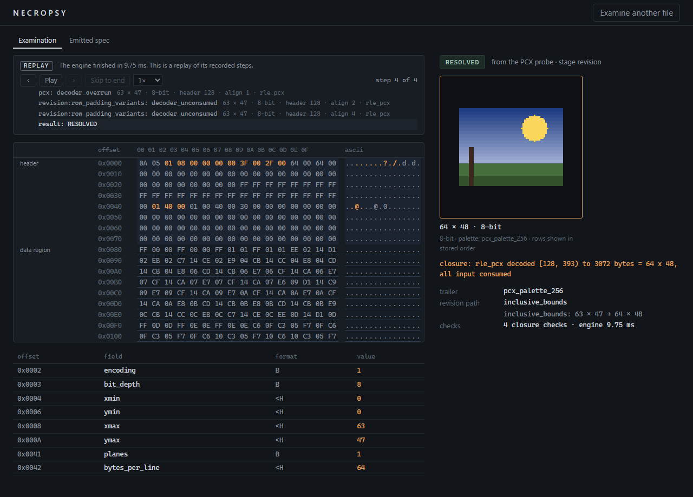
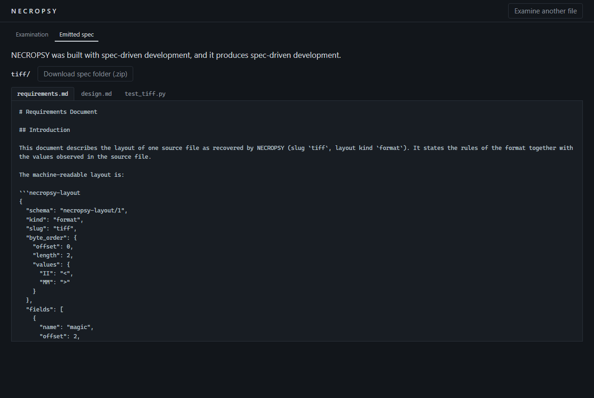

<p align="center">
  
</p>

<h1 align="center">NECROPSY</h1>

<p align="center">
  <b>Structure inference for files nothing can open.</b><br>
  It reads the raw bytes, proves a layout closes or refuses to choose between layouts that all close,<br>
  and emits a Kiro spec for the parser it declines to write.
</p>

<p align="center">
  <a href="https://github.com/RAK2315/necropsy/actions/workflows/tests.yml"></a>
  <a href="LICENSE"></a>
  <a href="https://necropsy.vercel.app"></a>
  
  
</p>

<p align="center">
  <a href="https://necropsy.vercel.app"><b>Live demo</b></a> ·
  <a href="#how-it-works">How it works</a> ·
  <a href="#scope-limits">Scope limits</a> ·
  <a href="#spec-emission">Spec emission</a> ·
  <a href="#quickstart">Quickstart</a> ·
  <a href="#built-with-kiro">Built with Kiro</a>
</p>

---

Files outlive the software that wrote them. An image saved in a format nothing installed today can open is lost, even though every byte is intact. NECROPSY treats such a file as a specimen. It does three things:

1. **Infers** how the bytes are laid out as a raster image: header, fields, data region, encoding, row stride.
2. **Proves or refuses.** A layout is accepted only if decoding its data region yields exactly `row_stride x height` bytes and consumes the whole region. When several layouts pass that check, NECROPSY reports all of them and chooses none.
3. **Emits a spec, not a parser.** For what it recovered, it writes a Kiro-format spec folder (`requirements.md`, `design.md`, `test_<slug>.py`). The test file is the acceptance suite for a parser you write from the document.

<p align="center">
  
  <br><sub><code>mystery_i</code>: the header declares the data uncompressed. Closure fails, revision tries RLE, closure holds. The screen shows declared versus actual.</sub>
</p>

## Three outcomes

`Engine().run(data)` returns exactly one of these:

| Outcome | Meaning |
|---|---|
| `RESOLVED` | Exactly one layout closes. You get its fields, the closure arithmetic, the revision path that reached it, and the recovered image. |
| `UNRESOLVED_AMBIGUITY` | Several layouts close and the bytes cannot separate them. Every candidate is reported, none is preferred. This is a correct answer, not a failure. |
| `FAILED` | Nothing closed within the search axes and budget. You get every rejection, grouped by stage, and the reason the search stopped. |

<p align="center">
  
  <br><sub><code>mystery_d</code>, a headerless 104-byte blob: 18 readings fit the bytes exactly, so NECROPSY does not choose.</sub>
</p>

## How it works

The engine lives in `necropsy/engine/` and uses only the Python standard library.

**Probes read what a file declares about itself.** Four probes (PCX, TGA, PBM, TIFF) apply their format's fixed layout and read the file's own declarations, such as the PCX encoding byte, the TIFF byte-order mark and the TGA image descriptor. A signature match always produces a seed hypothesis, even when the values read are wrong, so a damaged file can still be revised.

**Revision recovers conventions the file does not state.** A seed that fails closure is revised by three strategies: `inclusive_bounds`, `rle_pcx` and `row_padding_variants`. The search is breadth-first to depth 3 and collects every closing candidate at a depth before deciding, so the order strategies are listed in never picks the answer. When two routes reach the same answer, both are reported (`alternative_paths`).

**Generic search handles files with no recognised header.** It tries header lengths 4 to 256 in steps of 4, widths and heights read as `<H`, `>H`, `<I`, `>I`, `<i` and `>i`, and bit depths 1, 4, 8, 16, 24 and 32. The budget is 10,000 closure checks and a 5.0-second deadline per run.

**Closure is the gate.** `row_stride = round_up(ceil(width x bit_depth / 8), row_alignment)`. The decoded size must equal `row_stride x height`, and the decoder must stop exactly at the end of the data region. Self-declaring trailers (the 769-byte PCX 256-colour palette, the 26-byte TGA 2.0 footer) come from a registry that the gate reads as data. The check is binary: no score can admit a layout that fails it or reject one that passes.

**Coherence is reported, never used to decide.** Each candidate gets a row-coherence score (`row_mad_ratio`). On `mystery_d`, the true 8x8 at 8 bpp and the wrong 64x8 at 1 bpp both score 0.3342, and the wrong 8x64 at 1 bpp scores 0.1646, which reads as more coherent than the truth. That is why it never gates, promotes or orders anything.

The rule underneath all of this, from the engine spec's Decision Record: **probes read declarations and never apply conventions.** "This data is RLE compressed" is a declaration, so a probe reads it. "Width is `xmax - xmin + 1`" is a convention that is not in the file, so it is left to revision to discover.

## The corpus

Nine samples in `spike/samples/`, written byte by byte by `spike/make_samples.py`, plus two files written by Pillow's encoders in `spike/samples/external/`. The results below come from running the engine on each file. The checks column agrees with the independent reimplementation in `spike/VERIFY.md`, which was written from the requirements alone and shares no code with the engine.

| File | Bytes | Outcome | Stage | Closing | Checks | Layout found |
|---|---:|---|---|---:|---:|---|
| `mystery_a` | 11 | RESOLVED | probe (PBM) | 1 | 1 | 4x4, 1 bpp, header 7 |
| `mystery_b` | 955 | RESOLVED | revision, depth 1 | 1 | 4 | 8x8, 8 bpp, PCX RLE, region [128, 186), palette trailer; path `inclusive_bounds` |
| `mystery_c` | 786 | RESOLVED | probe (TGA) | 1 | 1 | 16x16, 24 bpp, header 18 |
| `mystery_d` | 104 | UNRESOLVED_AMBIGUITY | generic | 18 | 18 | includes 8x8, 8 bpp, header 40 |
| `mystery_e` | 150 | RESOLVED | probe (TIFF) | 1 | 1 | 8x8, 8 bpp, region [86, 150) |
| `mystery_f` | 132 | UNRESOLVED_AMBIGUITY | generic | 8 | 8 | includes 12x10, 8 bpp, header 12 |
| `mystery_g` | 212 | UNRESOLVED_AMBIGUITY | generic | 8 | 8 | includes 8x8, 24 bpp, header 20 |
| `mystery_h` | 176 | RESOLVED | revision, depth 2 | 1 | 10 | 6x6, 8 bpp, rows padded to 4; path `inclusive_bounds`, `row_padding_variants` |
| `mystery_i` | 955 | RESOLVED | revision, depth 2 | 1 | 10 | 8x8, 8 bpp, PCX RLE despite an encoding byte of 0x00; path `inclusive_bounds`, `rle_pcx` |
| `external_a` | 1,162 | RESOLVED | revision, depth 1 | 1 | 4 | 64x48, 8 bpp, PCX RLE, palette trailer (Pillow 12.2.0) |
| `external_b` | 9,260 | RESOLVED | probe (TGA) | 1 | 1 | 64x48, 24 bpp, header 18, TGA 2.0 footer (Pillow 12.2.0) |

For each ambiguous file, the true layout is among the closing candidates. How the external files were made is recorded in [spike/samples/external/README.md](spike/samples/external/README.md).

<p align="center">
  
  <br><sub><code>external_a</code>, written by Pillow rather than by this project: the bounds convention is recovered by revision and the image comes back byte for byte.</sub>
</p>

## Scope limits

These are stated deliberately. The project's claim is that it never reports what it did not establish, and that includes what it cannot do.

- **Raster images only.** Layouts are modelled as width, height, bit depth, row alignment, header and data region.
- **Two encodings are decoded: uncompressed and PCX RLE.** TGA RLE and compressed TIFF are recognised from their declarations and rejected as `unsupported_encoding`.
- **Single-strip TIFF only.** The probe reads one strip offset and one strip byte count.
- **Multi-plane PCX normally comes out `FAILED`.** The PCX seed uses bits per plane and does not model the `planes` field. A 3-plane RGB PCX written by Pillow returns `FAILED: exhausted` after 6 checks.
- **Rows are taken as stored.** The TGA origin bit is read and reported, not acted on.
- **Generic search is bounded, not exhaustive.** `FAILED` means nothing closed within the axes and budget above, not that the file has no valid layout.
- **The web service accepts files up to 65,536 bytes.**

## Spec emission

When the engine resolves a file or reaches an ambiguity, `necropsy.emit` writes a spec folder for what it recovered. A `FAILED` result emits nothing.

<p align="center">
  
</p>

The folder is named by slug: the probe name (`pcx`, `tga`, `pbm`, `tiff`), or `unknown-<first 8 hex digits of SHA-256>` for a generic result.

- `requirements.md` states every field, the data region, the encoding and the closure rule in EARS form. It embeds one machine-readable `necropsy-layout` block.
- `design.md` carries the closure arithmetic for this file.
- `test_<slug>.py` is the acceptance suite.

**The parser is not included, on purpose.** Run `pytest` in an emitted folder and it stops with:

```
E   ModuleNotFoundError: No module named 'parser_tiff'
```

That is the deliverable, not a bug. The suite waits for a module named `parser_<slug>`, which the reader implements from `requirements.md`:

- For a resolved file it exposes `parse(data)`.
- For an ambiguous file it exposes `parse_candidates(data)`.

The emitted requirements say this in their own acceptance criteria.

`tests/test_emit_acceptance.py` checks that the document is enough to do this. A reference reader that imports nothing from `necropsy` builds the parser module from the emitted `requirements.md` alone. It places the module next to the emitted tests and runs plain `pytest` in that folder, which passes for the TGA (`mystery_c`) and TIFF (`mystery_e`) specs.

## Web UI

https://necropsy.vercel.app serves a FastAPI analysis service (`app.py`, `web/`) and a static front end (`public/`) over the unchanged engine. The UI:

- shows a hex pane with header, data and trailer regions, and a field table
- replays the engine's recorded steps
- has a distinct screen for each outcome, with one image per candidate on the ambiguity screen
- has an emitted-spec panel with a zip download

The eleven corpus files are one click away on the start page.

## Quickstart

Requires Python 3.10. The engine has no third-party dependencies; the test suite needs pytest and Hypothesis, and the web tests need FastAPI, httpx and uvicorn.

```bash
git clone https://github.com/RAK2315/necropsy.git
cd necropsy
python -m pip install pytest hypothesis fastapi httpx uvicorn
```

Examine a sample and print the report:

```bash
python -c "from necropsy.engine import Engine; from necropsy.report import render; print(render(Engine().run(open('spike/samples/mystery_e', 'rb').read())))"
```

The report starts with `RESOLVED` and ends with:

```
closure: [86, 150) holds 64 bytes = 8 x 8
revision_path: []
```

Swap in `mystery_d` for `UNRESOLVED_AMBIGUITY: 18 candidates close; the bytes cannot distinguish them`.

Emit the spec for `mystery_e` into `build/emitted/tiff/`:

```bash
python -c "from necropsy.engine import Engine; from necropsy.emit import emit_spec, write_spec; d = open('spike/samples/mystery_e', 'rb').read(); print(write_spec(emit_spec(Engine().run(d), d), 'build/emitted'))"
```

## Tests

```bash
python -m pytest tests -q
node --test tests/ui/js/logic.test.mjs tests/ui/js/screens.test.mjs
```

At commit `e7f9c7f`:

- **Python suite:** 376 passed, both locally (Windows) and in GitHub Actions (Ubuntu).
- **Front-end tests:** 20 passed.
- **Browser checks:** tests that drive the real page in headless Chrome or Edge need Node. Without it they are skipped.
- **Property tests:** 26 Hypothesis `@given` tests across 10 files cover the 15 numbered correctness properties in the engine design, including "Never raises", "Closure soundness", "Coherence cannot change the outcome" and "Emitted layout reproduces the engine".

[`.github/workflows/tests.yml`](.github/workflows/tests.yml) runs both suites on every push and pull request.

## Built with Kiro

Everything here can be checked in [`.kiro/`](.kiro), [`docs/KIRO-LOG.md`](docs/KIRO-LOG.md) and the git history.

**Specs.** Two specs, each with `requirements.md`, `design.md` and `tasks.md`:

| Spec | Requirements | Tasks | Status |
|---|---:|---:|---|
| [`structure-inference-engine`](.kiro/specs/structure-inference-engine) | 12 | 15 (69 checklist items with sub-tasks) | all checked |
| [`necropsy-ui`](.kiro/specs/necropsy-ui) | 15 | 16 | 14 checked; the host gate and final acceptance remain |

The engine requirements open with an 18-item Decision Record. Each entry is a design reversal with the measurement that forced it. Its design states 15 numbered correctness properties.

**Steering.** Five files in `.kiro/steering/`:

- always on:
  - `project.md`: scope, free-tier hosting, commit discipline
  - `parsers.md`: structured errors, never raise, a property test for each parser
- path-scoped:
  - `engine.md`: standard library only, bounds-checked lengths, explicit endianness
  - `tests.md`: offline, deterministic, fixtures from documented byte layouts
  - `ui.md`: the UI calls the engine and never re-implements inference

**Hooks.** `.kiro/hooks/kiro-usage-log.json` appends every file the Kiro agent saves or creates, with the time and git HEAD, to `docs/KIRO-LOG.md`. It holds 233 rows. Separately, a git pre-commit hook (`.githooks/pre-commit`, `tools/check_no_bom.py`) blocks a UTF-8 byte-order mark in `.kiro/`, because a BOM before `---` breaks steering front matter.

**Agents.** Three custom agents in `.kiro/agents/`:

- `dev` implements one task, runs its tests and commits it.
- `reviewer` reads and runs tests but cannot write.
- `spec` writes only inside `.kiro/specs/`.

**Division of work.**

- **Kiro wrote:** the specs, the engine, emitter, report, web service, front end and tests. 80 of the 118 commits at `e7f9c7f` are per-task commits named `Task <n>: ...`.
- **Claude Code did the unscored work:** scaffolding, git, the steering, hook and agent files, the BOM guard, CI, this README and its icon.
- **Claude Code also verified Kiro's work independently:** `spike/verify_independent.py` reproduces the corpus trace from the requirements alone (`spike/VERIFY.md`), and `spike/TEST_AUDIT.md` audits two test files for tautology.
- **Marking:** the 18 commits made with Claude Code carry a `Co-Authored-By: Claude` trailer.

## Repository layout

```
.kiro/                 specs, steering, hooks and agents
necropsy/engine/       probes, closure gate, trailer registry, revision, generic search, coherence
necropsy/emit/         spec emitter and the necropsy-layout block
necropsy/report/       plain-text report renderer
app.py, web/           FastAPI analysis service: payload, pixel decoding, spec zip
public/                static front end and the sample files it offers
tests/                 engine, emitter and property tests; tests/ui/ for the service and front end
spike/                 corpus generator, samples, independent verification
tools/                 usage-log hook, BOM guard, browser probes, deploy helpers
docs/                  Kiro usage log and README images
.github/workflows/     CI
```

## Licence

MIT. See [LICENSE](LICENSE).
