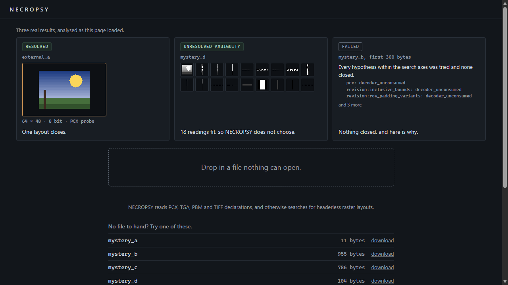
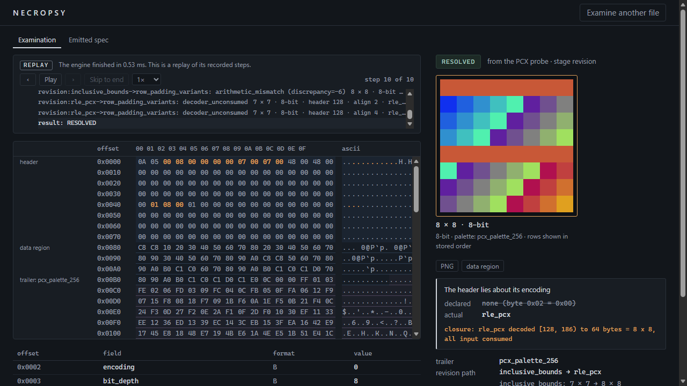
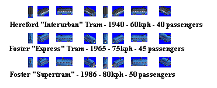
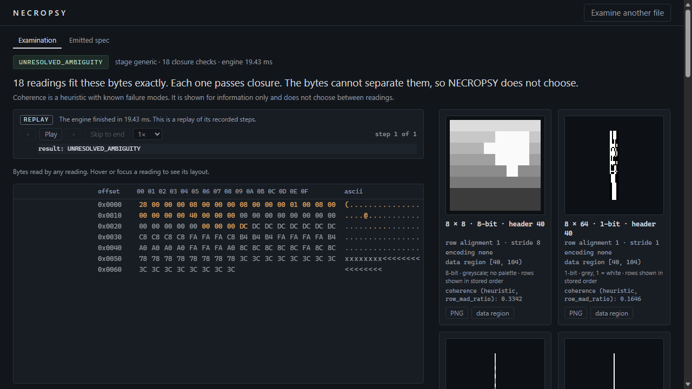
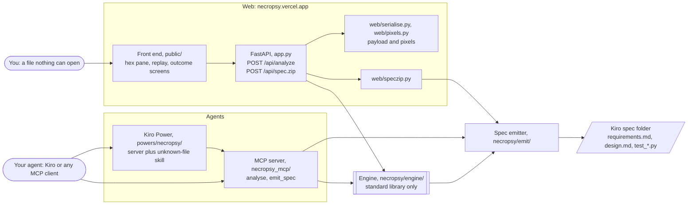
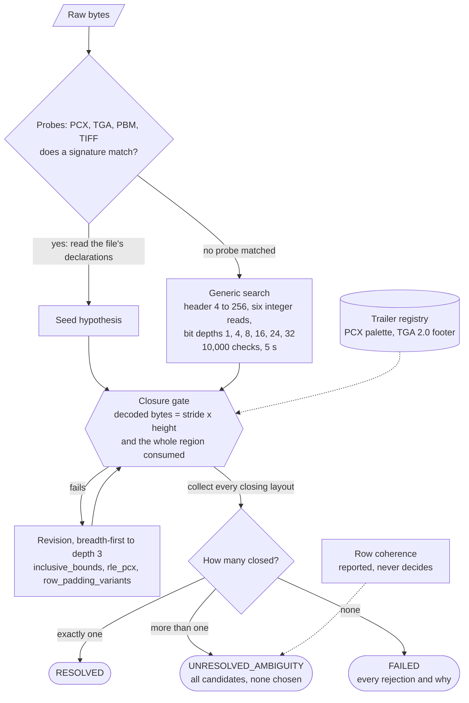

<p align="center">
  
</p>

<h1 align="center">NECROPSY</h1>

<p align="center">
  <b>Recover image files nothing can open.</b><br>
  NECROPSY reads the raw bytes, proves the layout by arithmetic and gives you the picture back.<br>
  When the bytes allow more than one answer, it shows you every one and refuses to guess.
</p>

<p align="center">
  <a href="https://github.com/RAK2315/necropsy/actions/workflows/tests.yml"></a>
  <a href="LICENSE"></a>
  <a href="https://necropsy.vercel.app"></a>
  
  
</p>

<p align="center">
  <a href="https://necropsy.vercel.app"><b>Try it live</b></a> ·
  <a href="#from-spec-to-working-parser">Spec to parser</a> ·
  <a href="#how-it-works">How it works</a> ·
  <a href="#proof">Proof</a> ·
  <a href="#for-agents-mcp-server-and-kiro-power">MCP and Power</a> ·
  <a href="#built-with-kiro">Built with Kiro</a>
</p>

<p align="center">
  
</p>

---

Files outlive the software that wrote them. An image saved in a format nothing installed today can open is lost, even though every byte of it is intact. NECROPSY brings that file back.

Drop in the bytes. NECROPSY works out how they are laid out as an image (the header, its fields, where the pixels start and end, how they are encoded, how long each row is) and accepts a layout only when the arithmetic closes exactly. Then it hands you three things:

- **The recovered image**, on screen and as a PNG download.
- **The evidence**: every field it read, the closure arithmetic, and each step of the search, replayed.
- **A Kiro spec for the format**: `requirements.md`, `design.md` and an acceptance test. Give it to Kiro and you get a working parser.

## What makes it different

**It proves, it does not guess.** A layout is accepted only if decoding its data region yields exactly `row_stride × height` bytes and consumes the whole region. That gate is binary. There is no score, no threshold and no model deciding what looks right.

**It refuses to choose when the bytes cannot.** When several layouts all close, NECROPSY reports every one, each with its own image, and chooses none. On the headerless 104-byte `mystery_d`, 18 readings fit the bytes exactly. Most tools would pick one and call it an answer. NECROPSY tells you the truth.

**It reads what a file says about itself, and catches it lying.** Probes read a file's own declarations, such as the PCX encoding byte or the TIFF byte-order mark. When a declaration contradicts the bytes, revision finds what is really there and shows declared against actual.

<p align="center">
  
  <br><sub><code>mystery_i</code>: the header says the data is uncompressed. Closure fails, revision tries RLE, and closure holds. The screen shows the header's claim struck through.</sub>
</p>

## From spec to working parser

The emitted spec deliberately ships without a parser: the acceptance test is the contract, and you write the parser from the document. This example puts that to work on a real file.

[`examples/spec-to-parser/pillow_odd_stride/`](examples/spec-to-parser/pillow_odd_stride) starts from `odd_stride.pcx`, a 14,313-byte PCX from Pillow's test suite, compressed with RLE and with an odd row length. NECROPSY emitted its spec, which was committed unedited, with its hashes in [`PROVENANCE.md`](examples/spec-to-parser/pillow_odd_stride/PROVENANCE.md). A fresh Kiro session was then given that folder and nothing else, and wrote `parser_pcx.py` from the spec alone.

```
$ python -m pytest examples/spec-to-parser/pillow_odd_stride -q -p no:cacheprovider
....                                                                     [100%]
4 passed
```

<p align="center">
  
  <br><sub>The image decoded by Kiro's parser. Its pixel indices, and the PNG's RGB values, are identical to Pillow's decode of the same file.</sub>
</p>

- The parser imports only `struct`. Kiro reports that its first complete version passed all four tests.
- The acceptance test checks a SHA-256 of the decoded pixels, so a parser that skips the decoding cannot pass.
- One step is not in the spec: the palette. The spec names the 769-byte `pcx_palette_256` trailer but does not say what it holds, so `show.py` reads its 768 bytes as 256 R,G,B entries and says so. Kiro's [`README`](examples/spec-to-parser/pillow_odd_stride/README.md) records this and the four places where the spec was silent.

## Three outcomes

`Engine().run(data)` returns exactly one of these, and each has its own screen in the UI.

| Outcome | Meaning |
|---|---|
| `RESOLVED` | Exactly one layout closes. You get its fields, the closure arithmetic, the revision path that reached it, and the recovered image. |
| `UNRESOLVED_AMBIGUITY` | Several layouts close and the bytes cannot separate them. Every candidate is reported, each with its own image, and none is preferred. This is a correct answer, not a failure. |
| `FAILED` | Nothing closed. You get every rejection, grouped by stage, and the reason the search stopped. |

<p align="center">
  
  <br><sub><code>mystery_d</code>: 18 readings fit these bytes exactly. Each passes closure, so NECROPSY does not choose.</sub>
</p>

## Architecture

One engine, three ways in: the web UI, an MCP server for agents, and a Kiro Power. Every path calls the same `Engine().run(data)`.



Inside the engine, every hypothesis passes through the same binary gate. Nothing is scored or ranked:



## How it works

The engine lives in `necropsy/engine/` and uses only the Python standard library.

1. **Probes read what a file declares.** Four probes (PCX, TGA, PBM, TIFF) read the file's own declarations at their fixed offsets: the PCX encoding byte, the TIFF byte-order mark and BitsPerSample array, the TGA image descriptor and colour map. A signature match always produces a seed, even when the values read are wrong, so a damaged file can still be revised. When a probe matches, the file's declarations are the reading, and generic search does not run.
2. **Revision recovers what a file does not state.** A seed that fails closure is revised by three strategies: `inclusive_bounds`, `rle_pcx` and `row_padding_variants`. The search is breadth-first to depth 3 and collects every closing candidate at a depth before deciding, so the order strategies are listed in never picks the answer.
3. **Generic search handles files with no header at all.** It tries header lengths 4 to 256 in steps of 4, widths and heights read as `<H`, `>H`, `<I`, `>I`, `<i` and `>i`, and bit depths 1, 4, 8, 16, 24 and 32, within 10,000 closure checks and 5.0 seconds per run.
4. **Closure is the gate.** `row_stride = round_up(ceil(width × bit_depth / 8), row_alignment)`. The decoded size must equal `row_stride × height`, and the decoder must stop exactly at the end of the data region. Trailers a file writes about itself (the 769-byte PCX palette, the 26-byte TGA 2.0 footer) come from a registry the gate reads as data. A matched trailer counts as one reading, not a fact: the engine also checks the reading that runs to the end of the file, and reports both if both close.
5. **Coherence is shown, never used to decide.** Each candidate gets a row-coherence figure (`row_mad_ratio`). On `mystery_d`, the true 8×8 at 8 bpp and a wrong 64×8 at 1 bpp both score 0.3342, and a wrong 8×64 at 1 bpp scores 0.1646, which reads as more coherent than the truth. That measurement is why coherence never gates, promotes or orders anything.

The principle underneath, from the engine spec's Decision Record: **a probe reads declarations and never applies conventions.** "This data is RLE compressed" is a declaration, so a probe reads it. "Width is `xmax − xmin + 1`" is a convention the file does not state, so revision discovers it.

## Proof

### The corpus

Nine samples in `spike/samples/`, written byte by byte by `spike/make_samples.py`, plus two files written by Pillow's encoders in `spike/samples/external/`. Results from running the engine on each file now:

| File | Bytes | Outcome | Stage | Closing | Checks | Layout found |
|---|---:|---|---|---:|---:|---|
| `mystery_a` | 11 | RESOLVED | probe (PBM) | 1 | 1 | 4×4, 1 bpp, header 7 |
| `mystery_b` | 955 | RESOLVED | revision, depth 1 | 1 | 8 | 8×8, 8 bpp, PCX RLE, region [128, 186), palette trailer; path `inclusive_bounds` |
| `mystery_c` | 786 | RESOLVED | probe (TGA) | 1 | 1 | 16×16, 24 bpp, header 18 |
| `mystery_d` | 104 | UNRESOLVED_AMBIGUITY | generic | 18 | 18 | includes 8×8, 8 bpp, header 40 |
| `mystery_e` | 150 | RESOLVED | probe (TIFF) | 1 | 1 | 8×8, 8 bpp, region [86, 150) |
| `mystery_f` | 132 | UNRESOLVED_AMBIGUITY | generic | 8 | 8 | includes 12×10, 8 bpp, header 12 |
| `mystery_g` | 212 | UNRESOLVED_AMBIGUITY | generic | 8 | 8 | includes 8×8, 24 bpp, header 20 |
| `mystery_h` | 176 | RESOLVED | revision, depth 2 | 1 | 10 | 6×6, 8 bpp, rows padded to 4; path `inclusive_bounds`, `row_padding_variants` |
| `mystery_i` | 955 | RESOLVED | revision, depth 2 | 1 | 20 | 8×8, 8 bpp, PCX RLE despite an encoding byte of 0x00; path `inclusive_bounds`, `rle_pcx` |
| `external_a` | 1,162 | RESOLVED | revision, depth 1 | 1 | 8 | 64×48, 8 bpp, PCX RLE, palette trailer (Pillow 12.2.0) |
| `external_b` | 9,260 | RESOLVED | probe (TGA) | 1 | 2 | 64×48, 24 bpp, header 18, TGA 2.0 footer (Pillow 12.2.0) |

For each ambiguous file, the true layout is among the closing candidates. Files with a matching trailer are checked under both readings (Decision Record 24), which doubles their check counts.

**Independently reproduced.** [`spike/verify_independent.py`](spike/verify_independent.py) reimplements the engine's requirements from the text alone and shares no code with it. On all nine samples it reaches the same outcome, stage, closing count and check count as the engine ([`spike/VERIFY.md`](spike/VERIFY.md)).

### Real files

[`spike/samples/real/`](spike/samples/real) holds 81 files taken from the test suites of six image decoders (Pillow 38, libtiff 15, Go `image` 14, ImageMagick 8, SDL_image 4, imagers 2), each pinned to an upstream commit with its licence recorded. The engine runs on every file and its pixels are compared with Pillow 12.2.0. Whether a file is in scope comes only from what the file declares, recorded in `manifest.json`, never from the engine's result.

| | Files | Result |
|---|---:|---|
| In scope | 26 | **23 RESOLVED and pixel-identical to Pillow.** 1 RESOLVED with a known interpretation difference (`pillow_rgba16.tga`: Pillow reads bit 15 as alpha, the engine returns raw words). 2 FAILED where Pillow also refuses the file. |
| Out of scope | 55 | 54 FAILED (compressed TIFF, TGA RLE, multi-strip TIFF, multi-plane PCX and similar). 1 RESOLVED only as a literal one-file layout, with no format claim made. |

**No in-scope file that Pillow can decode fails.** The full table is [`docs/REAL-CORPUS-RESULTS.md`](docs/REAL-CORPUS-RESULTS.md), regenerated by `python -m tools.real_corpus`.

### The recovered image is what the file declares

The image on screen follows the file's own declarations: B,G,R order for TGA, R,G,B for TIFF, TIFF's WhiteIsZero, and the TGA colour map from its declared first entry. Across the corpus, wherever Pillow can open the file and NECROPSY renders it, the two images are identical on 28 of 29 readings. The one difference is `mystery_e`, a TIFF that declares no photometric interpretation: NECROPSY shows it as BlackIsZero and says so on screen.

### Tests

At commit `a54b7ce`, in GitHub Actions (Ubuntu):

- **Python suite: 949 passed**, 1 skipped (the real-corpus test for open in-scope failures, whose list is empty).
- **Front-end tests: 22 passed.**
- **Property tests:** 35 Hypothesis `@given` tests across 13 files cover the 17 numbered correctness properties in the engine design, including "Never raises", "Closure soundness", "Coherence cannot change the outcome" and "Emitted layout reproduces the engine".
- **Browser checks:** tests that drive the real page in headless Chrome or Edge (keyboard, contrast, error copy, downloads) run in CI.
- **Break checks:** `tools/break_check.py` applies a deliberate defect, confirms the named test fails, and restores the file byte for byte. One of them replaces the parser with a do-nothing parser and confirms every emitted RLE spec fails it.

[`.github/workflows/tests.yml`](.github/workflows/tests.yml) runs both suites on every push and pull request.

## Web UI

**[necropsy.vercel.app](https://necropsy.vercel.app)** serves a FastAPI analysis service (`app.py`, `web/`) and a static front end (`public/`) over the unchanged engine.

- A hex pane with the header, data and trailer regions marked, and a table of every field read.
- A replay of the engine's recorded steps, one closure check at a time.
- A distinct screen for each outcome, with one image per candidate on the ambiguity screen.
- PNG and data-region downloads, and the emitted spec as a zip.
- Keyboard navigation, checked contrast and a dark colour scheme.
- The eleven corpus files are one click away on the start page.

**Privacy:** uploads are analysed in memory and the service writes nothing to disk. Files up to 65,536 bytes are accepted.

The final acceptance pass ran on the live URL at 1280×720, each beat in a fresh page. All ten passed. Times and captures are in [`docs/acceptance/results.md`](docs/acceptance/results.md).

## For agents: MCP server and Kiro Power

NECROPSY is also a tool other agents can call. `necropsy_mcp/` exposes the engine over MCP (stdio, official SDK `mcp==2.3.0`):

- **`analyse`** returns the web payload with three things removed to keep it readable: the pixel buffers, the emitted spec, and each field's `value_repr`. Tests prove it equals the web serialiser's output minus exactly those keys, byte for byte, on all 92 corpus files. The largest result in the corpus is 25,890 characters (`mystery_d`), under the 30,000 at which Kiro truncates a tool result.
- **`emit_spec`** returns the spec folder's files inline and writes nothing.

[`powers/necropsy/`](powers/necropsy) packages the same server as a **Kiro Power**, with a bundled copy of the engine and an `unknown-file` skill that tells the agent to report every candidate and choose none. Installed in a separate empty workspace and asked about `mystery_d`, Kiro listed all 18 candidates and chose none. Install steps are in [`powers/necropsy/README.md`](powers/necropsy/README.md).

## Quickstart

Requires Python 3.10. The engine has no third-party dependencies.

```bash
git clone https://github.com/RAK2315/necropsy.git
cd necropsy
python -m pip install pytest hypothesis fastapi httpx uvicorn mcp==2.3.0 pillow==12.2.0
```

Examine a sample and print the report:

```bash
python -c "from necropsy.engine import Engine; from necropsy.report import render; print(render(Engine().run(open('spike/samples/mystery_e', 'rb').read())))"
```

The report starts with `RESOLVED` and ends with:

```
closure: [86, 150) holds 64 bytes = 8 x 8
revision_path: []
```

Swap in `mystery_d` for `UNRESOLVED_AMBIGUITY: 18 candidates close; the bytes cannot distinguish them`.

Emit the spec for `mystery_e` into `build/emitted/tiff/`:

```bash
python -c "from necropsy.engine import Engine; from necropsy.emit import emit_spec, write_spec; d = open('spike/samples/mystery_e', 'rb').read(); print(write_spec(emit_spec(Engine().run(d), d), 'build/emitted'))"
```

Run the tests:

```bash
python -m pytest tests -q
node --test tests/ui/js/logic.test.mjs tests/ui/js/screens.test.mjs
```

## Scope

NECROPSY's claim is that it never reports what it did not establish, and that includes its own limits.

- **Raster images.** A layout is width, height, bit depth, row alignment, header and data region.
- **Uncompressed and PCX RLE are decoded.** TGA RLE and compressed TIFF are recognised from their declarations and reported as unsupported.
- **Single-strip TIFF, single-plane PCX.** Multi-strip TIFF and multi-plane PCX come out `FAILED`.
- **Rows are shown as stored.** The TGA origin bit is read and reported, not acted on.
- **16-bit images are recovered but not previewed.** They resolve with their full evidence; the UI has no 16-bit renderer.
- **A probe match decides the reading.** A headerless file whose bytes 1 and 2 happen to pass the TGA probe's signature check is examined only as TGA.
- **Generic search is bounded.** `FAILED` means nothing closed within the axes and budget above, not that no layout exists.

## Built with Kiro

Everything here can be checked in [`.kiro/`](.kiro), [`docs/KIRO-LOG.md`](docs/KIRO-LOG.md) and the git history.

**Specs.** Five specs, each with `requirements.md`, `design.md` and `tasks.md`, every task checked:

| Spec | Requirements | Tasks |
|---|---:|---:|
| [`structure-inference-engine`](.kiro/specs/structure-inference-engine) | 12 | 22 (95 checklist items with sub-tasks) |
| [`necropsy-ui`](.kiro/specs/necropsy-ui) | 20 | 23 |
| [`gate-adversary`](.kiro/specs/gate-adversary) | 3 | 3 |
| [`real-corpus`](.kiro/specs/real-corpus) | 6 | 4 |
| [`necropsy-mcp`](.kiro/specs/necropsy-mcp) | 6 | 8 |

**The Decision Record.** The engine requirements open with 27 numbered decisions. Each records a design decision or reversal with the measurement behind it and the alternatives not taken. The design states 17 numbered correctness properties.

**Steering.** Five files in `.kiro/steering/`. Always on: `project.md` (scope, free-tier hosting, commit discipline) and `parsers.md` (structured errors, never raise, a property test for each parser). Path-scoped: `engine.md` (standard library only, bounds-checked lengths, explicit endianness), `tests.md` (offline, deterministic, fixtures from documented byte layouts) and `ui.md` (the UI calls the engine and never re-implements inference).

**Hooks.** `.kiro/hooks/kiro-usage-log.json` appends every file the Kiro agent saves or creates, with the time and git HEAD, to `docs/KIRO-LOG.md`: 634 rows so far. A git pre-commit hook (`.githooks/pre-commit`) blocks a UTF-8 byte-order mark in `.kiro/`, because a BOM before `---` breaks steering front matter.

**Agents.** Three custom agents in `.kiro/agents/`: `dev` implements one task, runs its tests and commits it; `reviewer` reads and runs tests but cannot write; `spec` writes only inside `.kiro/specs/`.

**MCP and Powers.** Kiro built the MCP server and the Power from the `necropsy-mcp` spec, and both were checked from inside Kiro: through the workspace server, and through the Power installed in an empty workspace.

**Spec to parser.** Kiro also closed the loop the other way: from a spec NECROPSY emitted, it wrote a working parser in a clean-room session ([above](#from-spec-to-working-parser)).

**Division of work.**

- **Kiro wrote** the specs, the engine, emitter, report, web service, front end, MCP server, Power, the example parser and the tests. 103 of the 179 commits at `2f40422` are per-task commits named `Task <n>: ...`.
- **Claude Code** did the scaffolding, git, CI, deploy configuration, the steering, hook and agent files, this README and its icon, and the prompts Rehaan gave Kiro (written in a separate Claude chat until 20 Nov, in Claude Code after that).
- **Claude Code also verified Kiro's work independently**, from the spec rather than the code: the independent reimplementation above, pixel comparisons against Pillow, and a do-nothing parser run against every emitted RLE spec. The 28 commits made with Claude Code carry a `Co-Authored-By: Claude` trailer.

## Repository layout

```
.kiro/                 specs, steering, hooks and agents
necropsy/engine/       probes, closure gate, trailer registry, revision, generic search, coherence
necropsy/emit/         spec emitter and the necropsy-layout block
necropsy/report/       plain-text report renderer
app.py, web/           FastAPI analysis service: payload, pixel decoding, spec zip
necropsy_mcp/          MCP server: analyse and emit_spec over stdio
powers/necropsy/       Kiro Power: the server bundled with a skill
public/                static front end and the sample files it offers
examples/              a parser Kiro wrote from an emitted spec, clean room
tests/                 engine, emitter and property tests; tests/ui/ for the service and front end
spike/                 corpus generator, samples, real files, independent verification
tools/                 usage-log hook, BOM guard, browser probes, deploy helpers
docs/                  Kiro usage log, acceptance captures, README images
.github/workflows/     CI
```

## Licence

MIT. See [LICENSE](LICENSE).
